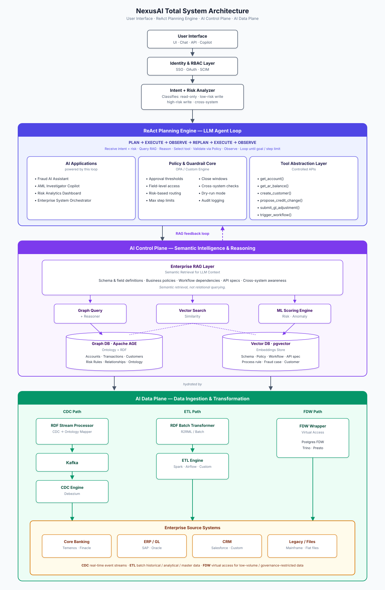
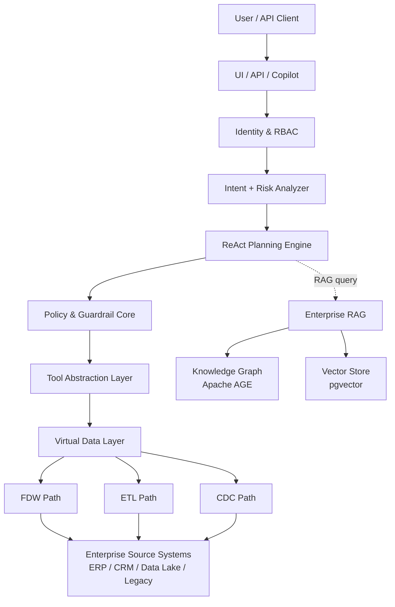

# Total System Architecture

End-to-end data flow through the platform: enterprise systems on the bottom, Data Plane hydration above them, Control Plane semantic enrichment in the middle, and the Reasoning Plane (ReAct loop + policy + tools) on top, with the Console and Solution Apps as the user-facing surfaces.

The high-level shape and screen-by-screen tour live in [Platform Architecture](../platform-architecture.md). This page is the protocol / data-flow reference.

## End-to-End Flow

## Plane Responsibilities

### Reasoning Plane

- **Intent + Risk classification** — every query tagged before planning starts.
- **ReAct loop** — PLAN → EXECUTE → OBSERVE → REPLAN, bounded by max-step budget.
- **Policy gate** — runs before every tool execution: approval thresholds, close windows, field-level access, cross-system checks, dry-run mode, max step limits, audit logging.
- **Tool registry** — typed inputs / outputs, read-only vs write-capable; the LLM never calls raw enterprise APIs.
- **AI Copilot** — conversational front-end that surfaces inspectable agent steps and policy violations.

### Control Plane

- **Enterprise RAG** — semantic retrieval that answers context questions ("Which object stores credit risk?", "What triggers the approval workflow?", "What fields are required for customer creation?", "What is the ERP sync dependency?").
- **Hybrid storage** — Knowledge Graph (Apache AGE) for structural truth + vector store (pgvector) for semantic similarity.
- **Knowledge Pipeline** — on-demand or scheduled extraction of unified schema, FDW mapping resolution, mapping rules, policies, workflows, integrations.
- **Authoring surfaces** — Policy / Workflow / Integration Rule editors.

### Data Plane

- **Virtual Data Layer (VDL)** — single query API across every connected entity, regardless of how it was hydrated.
- **Three hydration mechanisms** — FDW (live federated reads), ETL (batch ingest), CDC (streaming change capture).
- **Source systems** — ERP (SAP / Oracle), Core Banking (Temenos / Finacle), CRM (Salesforce / custom), data lakes, files, legacy.

## Hydration Choice Rules

- **Live latency-critical reads + source-of-truth must remain authoritative** → **FDW**. No replication; live reads through Postgres FDW.
- **Bulk historical / analytical data; cross-domain joins** → **ETL**. High query performance; full schema control.
- **Transaction-heavy operational systems; real-time AML / fraud** → **CDC**. Sub-second event capture with audit trail.

In practice, mature deployments use all three: CDC for live transactions, ETL for the analytical warehouse, FDW for low-volume governance-restricted sources.

## draw.io Source

For pixel-perfect editing (or to export PNG/SVG for slide decks), open
[`Total-system-architecture.drawio`](./Total-system-architecture.drawio) in
[diagrams.net](https://app.diagrams.net) (File → Open From → Device).

## Companion Docs

- [Architecture overview](architecture.md) — the layer stack and cross-plane principles.
- [Data Sources](data-sources.md) — decision framework for FDW / ETL / CDC.
- [Implementation Guide](implementation-guide.md) — production code mapping.
- [ReAct Layer](re-act-layer.md) — agent loop mechanics.
- [Semantic RAG](semantic-rag.md) — retrieval-bundle correctness and validation.
