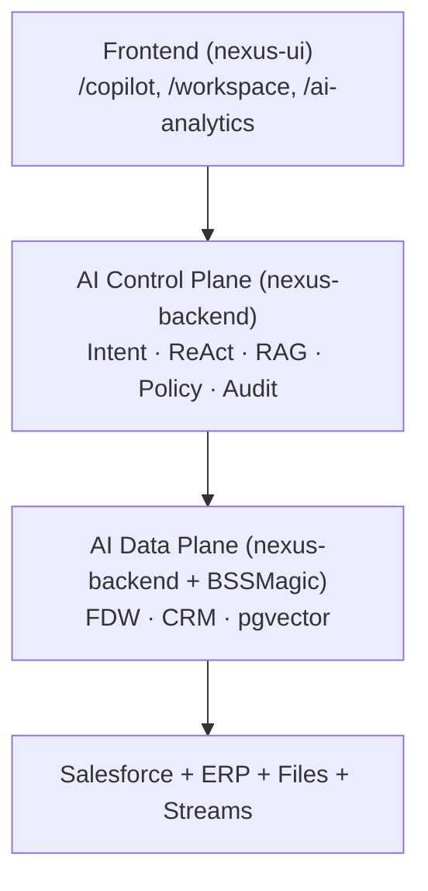

# Implementation Guide

How the architectural reference (see [architecture.md](architecture.md) and [Total-system-architecture.md](Total-system-architecture.md)) is realised in code, infrastructure, and APIs across the `nexus-backend`, `nexus-ui`, and BSSMagic components.

## System overview



## Data Plane

Provides virtualised read/write access to enterprise sources without bulk replication.

### Infrastructure

| Component | Technology | Location |
|---|---|---|
| Database | PostgreSQL 17 (Debian) | EKS pod `nexus-ai-prod-bssmagic-0` |
| FDW extension | Multicorn (Python FDW) | Pre-installed in BSSMagic image |
| Vector extension | pgvector 0.8.1 | Installed at runtime |
| Foreign server | `nexus_data` | Salesforce sandbox |
| Foreign tables | per source schema | Maps to Salesforce objects |
| CRM runtime | BSSMagic TMF API (port 8000) | Same pod as PostgreSQL |

### Source files (selection)

| File | Class / Module | Purpose |
|---|---|---|
| `src/config/fdw_config.py` | `FDWConfig` | Environment-based configuration |
| `src/services/fdw_connection_manager.py` | `PostgreSQLConnectionManager` | SQLAlchemy connection pool with async wrapper |
| `src/services/fdw_discovery_service.py` | `FDWDiscoveryService` | Introspects foreign servers, tables, columns |
| `src/services/fdw_query_service.py` | `FDWQueryService` | Parameterised query builder with whitelist validation |
| `src/services/bssmagic_crm_service.py` | `BSSMagicCRMService` | Salesforce CRM operations via TMF API |
| `src/services/data_plane_service.py` | `DataPlaneService` | CRUD for data plane configurations (DynamoDB) |
| `src/apis/fdw_api.py` | FastAPI router | REST endpoints for FDW operations |
| `src/fdw_lifecycle.py` | -- | Startup / shutdown lifecycle management |

### Environment variables

| Variable | Required | Default | Description |
|---|---|---|---|
| `FDW_PG_HOST` | yes | -- | PostgreSQL host. When set, FDW is enabled. |
| `FDW_PG_PORT` | no | `5432` | |
| `FDW_PG_DATABASE` | yes | -- | |
| `FDW_PG_USER` | yes | -- | |
| `FDW_PG_PASSWORD` | yes | -- | |
| `FDW_PG_SCHEMA` | no | `public` | |
| `FDW_PG_SSL_MODE` | no | `prefer` | |
| `FDW_PG_POOL_MIN` | no | `2` | |
| `FDW_PG_POOL_MAX` | no | `10` | |
| `FDW_PG_QUERY_TIMEOUT` | no | `30` | Seconds |

### REST endpoints

Base path: `/api/fdw`

| Method | Path | Description |
|---|---|---|
| GET | `/api/fdw/servers` | List foreign servers |
| GET | `/api/fdw/tables?server=name` | List foreign tables |
| GET | `/api/fdw/tables/{schema}/{table}/columns` | Column metadata |
| POST | `/api/fdw/query` | Execute parameterised query |
| GET | `/api/fdw/tmf/standards` | TMF spec standards |
| GET | `/api/fdw/tmf/types` | TMF type definitions |

Query example:

```json
{
  "table": "Lead",
  "schemaName": "nexus_data",
  "columns": ["Id", "Name", "Company", "Email"],
  "filters": [{"column": "Company", "operator": "like", "value": "%Networks%"}],
  "orderBy": [{"column": "Name", "direction": "asc"}],
  "limit": 10
}
```

Supported operators: `eq`, `neq`, `gt`, `gte`, `lt`, `lte`, `like`, `in`.

### BSSMagic CRM operations

| Operation | Endpoint | Risk |
|---|---|---|
| Create Lead | `POST /tmf-api/salesLead` | Write |
| Query Leads / Products / Pricing | `POST /query` (SOQL) | Read |
| Upload File | `POST /tmf-api/contentVersion` | Write |
| Link File | `POST /tmf-api/contentDocumentLink` | Write |
| RecordType lookup | `POST /query` (SOQL) | Read |

## Control Plane

Provides semantic intelligence, agent-based reasoning, and policy-enforced tool execution on top of the Data Plane.

### Source files (selection)

| File | Class / Module | Purpose |
|---|---|---|
| `src/services/control_plane/embedding_service.py` | `EmbeddingService` | OpenAI `text-embedding-3-small` (1,536 dims) |
| `src/services/control_plane/vector_store.py` | `VectorStore` | pgvector CRUD + cosine similarity search |
| `src/services/control_plane/schema_indexer.py` | `SchemaIndexer` | FDW Discovery -> embeddings -> pgvector |
| `src/services/control_plane/llm_client.py` | `LLMClient` | OpenAI `gpt-4o-mini` chat completions |
| `src/services/control_plane/rag_service.py` | `RAGService` | Vector retrieval + context builder + LLM |
| `src/services/control_plane/tool_registry.py` | `ToolRegistry` | Central registry with OpenAI function-calling format |
| `src/services/control_plane/agent_executor.py` | `AgentExecutor` | ReAct loop: PLAN -> EXECUTE -> OBSERVE |
| `src/services/control_plane/policy_engine.py` | `PolicyEngine` | Pre-execution validation + guardrails |
| `src/services/control_plane/audit_logger.py` | `AuditLogger` | DynamoDB audit trail |
| `src/services/control_plane/intent_analyzer.py` | `analyze_intent()` | LLM + heuristic intent classification |
| `src/apis/control_plane_api.py` | FastAPI router | REST endpoints |

### Intelligence store (pgvector)

Database: BSSMagic PostgreSQL (same instance as FDW). Extension: pgvector 0.8.1.

```sql
CREATE TABLE control_plane_embeddings (
    id SERIAL PRIMARY KEY,
    content_type VARCHAR(50) NOT NULL,       -- fdw_table | fdw_server | tmf_spec
    source_id VARCHAR(255) NOT NULL,         -- e.g. nexus_data.Lead
    content TEXT NOT NULL,                    -- enriched description
    metadata JSONB DEFAULT '{}',
    embedding vector(1536),
    created_at TIMESTAMPTZ DEFAULT NOW(),
    updated_at TIMESTAMPTZ DEFAULT NOW(),
    UNIQUE(content_type, source_id)
);
```

Indexes: B-tree on `content_type`; IVFFlat on `embedding` (cosine).

Contents grow with the connected source schema — every foreign server and every foreign table contributes one embedding.

### Registered tools

| Tool | Risk | Approval | Description |
|---|---|---|---|
| `search_schema_knowledge` | read_only | no | Semantic search over the schema embedding index |
| `discover_tables` | read_only | no | List / filter foreign tables by name pattern |
| `discover_columns` | read_only | no | Column metadata for a specific table |
| `query_table` | read_only | no | Parameterised SELECT via FDW (max 100 rows) |
| `soql_query` | read_only | no | Direct SOQL via BSSMagic `/query` |
| `create_salesforce_lead` | high_risk_write | **yes** | Create a Lead via the BSSMagic TMF API |

### Policy rules

| Rule | Enforcement | Configuration |
|---|---|---|
| Risk gating | Filter tools by intent risk | `read_only` -> read tools only; `high_risk_write` -> all tools |
| Step budget | Max steps per agent run | Default 10; configurable per request |
| Write limit | Max write actions per session | Default 3 |
| Approval gate | High-risk writes require approval | `create_salesforce_lead` |
| Field restriction | Block sensitive columns | `OwnerId`, `CreatedById`, `SystemModstamp`, `IsDeleted` |
| Loop detection | Block repeated identical calls | Threshold: 2 identical in last 5 |

### Intent classification

| Intent | Trigger | Tools available |
|---|---|---|
| `read_only` | Querying / searching / inspecting | All read tools |
| `low_risk_write` | Notes, descriptions | Read + low-risk write |
| `high_risk_write` | Record create / financial change | All tools |
| `cross_system` | Multi-system operations | All tools |

Method: LLM-based (gpt-4o-mini, temperature 0.0) with keyword heuristic fallback.

### REST endpoints

Base path: `/api/v1/control-plane`

| Method | Path | Description |
|---|---|---|
| POST | `/search` | Semantic vector search |
| POST | `/ask` | RAG Q&A (single LLM call with context) |
| POST | `/agent` | ReAct agent (multi-step tool use) |
| POST | `/index` | Trigger schema re-indexing |
| GET | `/stats` | Embedding counts and status |
| GET | `/tools` | List registered tools with risk levels |

Agent request:

```json
{ "question": "Show me the first 5 Leads with their name and company", "max_steps": 10 }
```

Agent response (selected fields):

```json
{
  "answer": "Here are the first 5 Leads...",
  "intent": "read_only",
  "session_id": "bf9872fb-...",
  "steps": [
    {"step": 1, "tool": "discover_tables", "duration_ms": 83.8},
    {"step": 2, "tool": "discover_columns", "duration_ms": 9.6},
    {"step": 3, "tool": "query_table", "duration_ms": 1447.1},
    {"step": 4, "action": "final_answer"}
  ],
  "total_steps": 4,
  "total_tokens": 9130,
  "policy_violations": []
}
```

## Frontend -- AI Copilot

| File | Description |
|---|---|
| `nexus-ui/src/pages/CopilotPage.tsx` | Full chat interface |
| `nexus-ui/src/App.tsx` | Route `/copilot` |
| `nexus-ui/src/components/Sidebar.tsx` | Sidebar nav item |

UI features: chat interface; example-question quick-starts; intent badge (colour-coded by risk); expandable step trace with tool names, durations, result previews; token counter; policy-violation badge; spinner with 120 s timeout. Auth via session cookie.

## Infrastructure

### EKS pods

| Pod | Replicas | Contains |
|---|---|---|
| `nexus-ai-prod-backend` | 3 | FastAPI gateway + Control Plane APIs |
| `nexus-ai-prod-frontend` | 3 | Nginx + React SPA |
| `nexus-ai-prod-bssmagic` | 1 (StatefulSet) | PostgreSQL 17 + pgvector + Multicorn FDW + BSSMagic runtime |

### External dependencies

| Service | Usage | Credentials |
|---|---|---|
| OpenAI API | Embeddings + Chat | AWS Secrets Manager: `nexus-ai/prod/openai` |
| AWS DynamoDB | Audit logs (`control-plane-audit`), data-plane configs | IAM role attached to EKS |
| Salesforce | Source system via FDW + BSSMagic | Configured in BSSMagic pod |

### Deployment

```bash
cd /opt/mycode/nexus/nexus-deployer/kube-operator
./deploy-app-changes.sh
```

The script builds backend + frontend Docker images, pushes to ECR, restarts the relevant pods, and waits for readiness.

### Re-indexing after schema changes

```bash
curl -X POST https://<host>/api/v1/control-plane/index
```

Re-reads all foreign tables from the FDW discovery cache, generates fresh embeddings, and upserts them into pgvector.

If the BSSMagic pod is restarted, pgvector must be reinstalled (it is installed at runtime in the current build):

```bash
kubectl exec nexus-ai-prod-bssmagic-0 -n nexus-ai-prod -c bssmagic-runtime -- \
  bash -c "apt-get update -qq && apt-get install -y -qq postgresql-17-pgvector"
kubectl exec nexus-ai-prod-bssmagic-0 -n nexus-ai-prod -c bssmagic-runtime -- \
  psql -U postgres -d bssmagic -c "CREATE EXTENSION IF NOT EXISTS vector;"
```

Then re-index via the API.

## Architecture mapping

| Architectural layer | Implementation | Status |
|---|---|---|
| User Interface (Chat / API / Copilot) | `CopilotPage.tsx` at `/copilot` | Deployed |
| Identity & RBAC | Cognito SSO + session cookies + role-based access | Deployed |
| Intent + Risk Analyzer | `intent_analyzer.py` | Deployed |
| Enterprise RAG | `rag_service.py` + `vector_store.py` (pgvector schema-embedding index) | Deployed |
| ReAct Planning Engine | `agent_executor.py` (PLAN -> EXECUTE -> OBSERVE, max 10 steps) | Deployed |
| Policy & Guardrail Core | `policy_engine.py` | Deployed |
| Tool Abstraction Layer | `tool_registry.py` + 6 tools (FDW + RAG + CRM) | Deployed |
| Audit Logging | `audit_logger.py` (DynamoDB `control-plane-audit`) | Deployed |
| Data Plane: FDW Path | `fdw_discovery_service.py` + `fdw_query_service.py` (Multicorn FDW -> Salesforce) | Deployed |
| Data Plane: CRM Path | `bssmagic_crm_service.py` (TMF API -> Salesforce writes) | Deployed |
| Intelligence Layer: Vector DB | pgvector 0.8.1 in BSSMagic PostgreSQL | Deployed |
| Intelligence Layer: Graph DB | Apache AGE | Planned (next iteration) |
| Data Plane: CDC Path | Debezium / Kafka | Planned |
| Data Plane: ETL Path | Spark / Airflow | Planned |
