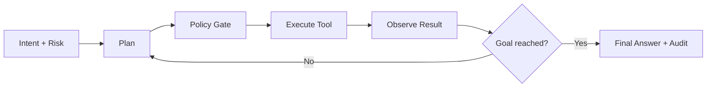

# ReAct Layer

The Reasoning Plane runs an agent loop in the **ReAct (Reason + Act)** pattern: the LLM plans the next action, the runtime executes a registered tool, the result becomes new context, and the loop continues until the goal is reached or the step budget is exhausted.

For the user-facing surface (AI Copilot, Planning Playground, Tools, Tool Builder) see [Platform Architecture > Reasoning Plane](../platform-architecture.md#reasoning-plane). This page explains the loop mechanics.

## The Loop

Per cycle:

- **Plan** — LLM emits the next intended tool call (or `final_answer`) given the question, retrieved context, and previous step results.
- **Policy gate** — runtime validates the action against approval thresholds, close windows, field-level access, cross-system checks, dry-run mode, max-step limits, and any custom OPA / rule-engine policy.
- **Execute** — tool runs against the Data Plane (FDW / ETL / CDC) or an enterprise system adapter. The LLM never invokes raw APIs.
- **Observe** — result is appended to context, including any errors, warnings, or partial results.
- **Loop** — repeat until `final_answer` or the step budget triggers.

## What Makes It Safe

- **Tool registry** — every tool has a typed signature, a risk classification (`read_only` / `low_risk_write` / `high_risk_write`), and explicit approval requirements where relevant.
- **Risk-aware tool subset** — the Intent + Risk Analyzer narrows the tool set the LLM is allowed to see for a given query. A read-only intent can never even propose a write.
- **Step budget** — bounded number of iterations prevents runaway loops.
- **Loop detection** — repeated identical tool calls are blocked.
- **Field restriction** — sensitive columns (audit fields, owner ids, system timestamps) are stripped from the tool's reachable surface.
- **Audit trail** — every step (intent, retrieved context, tool call, result, policy violation) is logged.

## Inputs the Loop Depends On

- **Intent classification** — read-only / low-risk-write / high-risk-write / cross-system. Determines available tools and approval requirements.
- **Retrieved context (Enterprise RAG)** — schema, policy, workflow, integration, and cross-system dependencies; pulled from the [Control Plane](../planes/control-plane.md) hybrid Graph + Vector store on each cycle as needed.
- **Tool catalogue** — the registered tool set the LLM can choose from, scoped to the user's role and the request's risk level.
- **Policy bundle** — evaluated by the policy engine before every execution.

## What "Tools" Looks Like in Practice

The platform ships with read tools (`discover_tables`, `discover_columns`, `query_table`, `search_schema_knowledge`, `search_enterprise_knowledge`, `soql_query`, `query_virtual_entity`, `list_virtual_entities`, `get_entity_schema`, `get_inventory_position`, `get_order_lifecycle`, `score_supplier_risk`, ...) and write-capable tools (`create_salesforce_lead`, per-Solution journey actions). Solution apps add app-curated tools (e.g. for Order-to-Cash: `Order Match Verifier`, `AR Cash Flow Projector`, `O2C Alert Generator`, `Dunning Notice Composer`).

## Why ReAct Fits Enterprise AI

- **Bounded autonomy** — the loop is iterative but capped; every iteration goes through policy.
- **Explainability** — the trace (every plan, every tool call, every observation) is captured and surfacable in the AI Copilot UI.
- **Iterative correction** — when a step fails or returns unexpected data, the LLM replans rather than crashing.
- **Composable** — new domains plug in as new registered tools; the loop is unchanged.

## Failure Modes the Runtime Guards Against

- **Hallucinated fields** — the tool layer rejects unknown fields and returns a structured error; the LLM replans.
- **Free-form SQL** — not allowed; only parameterised queries through the Data Plane Tool layer.
- **Cross-system inconsistency** — multi-system writes go through the orchestration layer (saga / compensating actions), never two raw API calls in sequence.
- **Step explosion** — max-step limits and loop detection terminate the agent with a useful error if it gets stuck.

## Related References

- [Platform Architecture > Reasoning Plane](../platform-architecture.md#reasoning-plane) — the user-facing console.
- [Reasoning Plane drill-down](../planes/reasoning-plane.md) — the dedicated page for the plane.
- [Semantic RAG](semantic-rag.md) — what the retrieval bundle must contain so the loop has the right context.
- [Implementation Guide](implementation-guide.md) — production code (`agent_executor.py`, `policy_engine.py`, `tool_registry.py`, `intent_analyzer.py`, ...).
