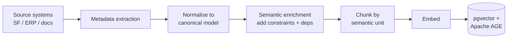
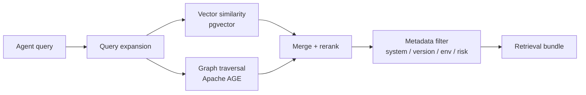

# Semantic RAG

The Reasoning Plane is only as safe as the retrieval bundle the Control Plane gives it. **Semantic RAG** in NexusAI is not "embed a PDF, return chunks" — it is the structured engineering of an enterprise knowledge model that exposes objects, fields, policies, workflows, and cross-system dependencies as retrievable units.

## What Good Retrieval Looks Like

For any agent question, the bundle returned to the LLM must surface six dimensions:

- **Object / Schema** — e.g. `Salesforce.Account.Credit_Limit__c`.
- **Field metadata** — type, max value, constraints.
- **Policy** — e.g. "Increases above 10% require Finance Manager approval".
- **Workflow dependency** — e.g. "Triggers Credit Approval Flow on update".
- **Integration dependency** — e.g. "Syncs to `AR_Customer.credit_limit`".
- **Version / environment** — e.g. `v3.2`, `prod`, `close_window=false`.

If any dimension is missing, the agent's plan is unsafe. The Control Plane's retrieval pipeline is designed so every query exercises all six.

## Canonical Knowledge Document

The Control Plane indexes a normalised model — never raw JSON dumps:

```json
{
  "id": "SF_ACCOUNT_CREDIT_LIMIT_V3",
  "system": "Salesforce",
  "entity_type": "Field",
  "object_name": "Account",
  "field_name": "Credit_Limit__c",
  "version": "3.2",
  "environment": "prod",
  "category": "Schema",
  "risk_level": "Medium",
  "content": "<enriched natural-language description with constraints + dependencies>",
  "structured_metadata": {
    "data_type": "Currency",
    "max_value": 1000000,
    "approval_threshold_percent": 10,
    "sync_target": "AR_Customer"
  }
}
```

`content` is what gets embedded; `structured_metadata` enables hybrid filtered retrieval.

## Indexing Pipeline



- **Extract** — Salesforce Metadata API + Tooling API; Oracle ERP table schema + AP/AR config; PDF / Confluence policy documents.
- **Normalise** — everything maps into the canonical model above.
- **Enrich** — raw `Field: Credit_Limit__c, Type: Currency(18,2)` becomes a paragraph naming the constraint, the threshold, the sync target, the close-window restriction, and the dependent workflows.
- **Chunk** — by semantic unit, never by token count: one object + its fields, one policy rule, one workflow, one integration mapping.
- **Embed** — OpenAI `text-embedding-3-small` (or compatible).
- **Store** — vector store (pgvector) for similarity + Apache AGE for graph traversal of dependencies.

## Hybrid Retrieval



- **Vector** finds semantically-similar chunks regardless of vocabulary.
- **Graph** expands dependencies (`triggers`, `syncs_to`, `constrained_by`, `owned_by`) so a query about `credit limit` returns not just the field but the policy, the workflow, and the ERP sync mapping.
- **Filter** scopes to the right system, version, and environment so the agent doesn't see sandbox or deprecated entries.

## Black-Box Validation

The Control Plane ships a **Planning Playground** with a built-in **Retrieval Quality Score** that scores each retrieval bundle on six dimensions: Object/Schema, Policy, Workflow Dependency, Cross-System Graph, Version Awareness, Integration. Bundles that fall below threshold fail the test, forcing engineers to improve the indexed knowledge before promoting the change.

Representative test scenarios used to validate the pipeline:

- **Source of truth for customer credit limit?** → bundle must surface `Account.Credit_Limit__c` field; ownership policy; sync mapping to `Oracle_AR`; "AR balance cannot override credit limit" rule.
- **Increase credit limit by more than 15%?** → bundle must surface the `>10% requires approval` rule; Credit Approval Flow; required approver role; SLA; ERP sync condition.
- **Deactivate a customer in Salesforce — Oracle ERP impact?** → bundle must surface `Account.Status` field; AR-customer sync; "deactivation requires AR balance check"; "cannot deactivate with open invoices".
- **Modify credit limits during financial close?** → bundle must surface close-window policy; ERP restriction; `close_period_active` env flag; SOX compliance rule.
- **What workflows fire on new enterprise customer creation?** → bundle must surface SF account creation workflow; risk assessment; ERP provisioning; credit review; data enrichment.

A complete suite ships with the platform; engineers add domain-specific tests as new ontologies onboard.

## Common Failure Modes

- **Embedding raw JSON** — captures shape but not meaning.
- **Chunking by token count** — breaks an object across two chunks; dependency information ends up in a different vector.
- **No metadata filters** — the bundle mixes prod and sandbox or stale and current versions.
- **No graph expansion** — you retrieve the field but miss the policy and the integration mapping.
- **Indexing transactional data** — the Control Plane indexes *meaning*, not transactional rows; the latter live in the Data Plane VDL.

## Versioning

When source metadata changes (a Salesforce custom field is added, a policy document is revised):

1. Detect the change (webhook / scheduled sync).
2. Rebuild the enriched chunk.
3. Increment `version`.
4. Soft-delete the old version (do not overwrite blindly).
5. Re-embed and reinsert.

The Knowledge Pipeline tab in the Control Plane runs this on demand or on a schedule; an engineer can always force a re-index from the console.

## Related References

- [Platform Architecture > Control Plane](../platform-architecture.md#control-plane) — console walkthrough.
- [Control Plane drill-down](../planes/control-plane.md) — the dedicated page for the plane.
- [Semantic RAG Pipeline](../semantic-layer/semantic-rag-pipeline.md) — the production pipeline implementation.
- [Implementation Guide](implementation-guide.md) — code locations.
