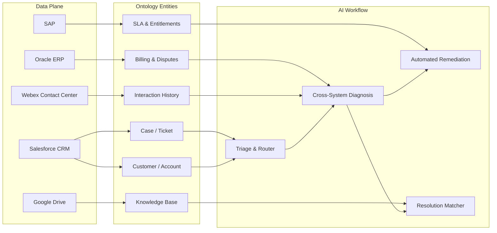

# Autonomous Issue Resolution Engine

AI-driven end-to-end issue diagnosis, routing, and remediation across CRM, billing, contact center, and service systems.

**Priority:** P0 — Immediate ROI  
**Time to Value:** 4-6 weeks  
**Category:** Service Automation

---

## Business Problem

Customer operations teams handle thousands of cases daily across disconnected systems — agents context-switch between Salesforce for case details, Oracle for billing inquiries, WXCC for call history, and SAP for service orders. Without unified AI orchestration:

- **Slow resolution** — agents spend 40-60% of handle time navigating systems to gather context before acting
- **Unnecessary escalations** — L1 agents escalate 35-50% of cases that could be resolved with cross-system data access
- **Inconsistent outcomes** — identical issues receive different resolutions depending on which agent handles them
- **Repeat contacts** — 20-30% of cases are repeat contacts for unresolved or partially resolved issues
- **Blind routing** — cases routed by keyword matching, not by issue complexity, customer value, or agent capability

---

## Capabilities

### Intelligent Case Triage & Routing
AI classifies incoming cases (voice, email, chat) by issue type, urgency, customer tier, and complexity — then routes to the optimal agent or automated resolution path.

### Cross-System Diagnosis
Automatically gathers context from all relevant systems: _"Customer called about billing overcharge — pulling Salesforce case history, Oracle invoice #INV-2026-4521, last 3 WXCC call recordings, and SAP service order status."_

### Automated Remediation
For known issue patterns (billing adjustments, service resets, plan changes), execute remediation directly: issue credit notes in Oracle, update case status in Salesforce, trigger service orders in SAP — with policy compliance checks at every step.

### Resolution Knowledge Matching
Match current case to historical resolution patterns: _"87% of similar cases (billing dispute + Platinum tier + >$500) were resolved with immediate credit + account review — median resolution: 12 minutes."_

### Repeat Contact Prevention
After resolution, proactively check for related latent issues: _"Customer's billing dispute resolved, but account also shows 2 pending service orders in SAP — preemptively updating customer and scheduling follow-up."_

---

## Data Sources & Ontology Mapping

| Ontology Entity | Source System | Key Fields |
|----------------|--------------|------------|
| Case | Salesforce Case | Case_ID, Account_ID, Subject, Description, Type, Priority, Status, Origin, Owner_ID, SLA_Deadline |
| Customer / Account | Salesforce Account + Oracle AR_Customer | Account_ID, Name, Tier, Segment, CLV, Churn_Risk, AR_Balance |
| Billing & Disputes | Oracle AR_Invoice + Billing_Dispute | Invoice_ID, Amount, Status, Dispute_Type, Dispute_Amount, Resolution |
| Interaction History | WXCC Call_Record + Salesforce Activity | Call_ID, Case_ID, Channel, Duration, Sentiment_Score, Agent_ID, Disposition |
| Knowledge Base | Google Drive SOP_Document + SF Knowledge_Article | Article_ID, Title, Category, Resolution_Steps, Confidence, Usage_Count |
| SLA & Entitlements | SAP SLA_Record + Salesforce Entitlement | SLA_ID, Account_ID, Response_Time, Resolution_Time, Breach_Status |

---

## AI Workflow

1. **Case Intake & Classification** — NLP classifies incoming case by issue taxonomy (billing, service, technical, account); assigns urgency and complexity score
2. **Customer Context Assembly** — Pull customer profile from Salesforce, billing status from Oracle, interaction history from WXCC, open service orders from SAP
3. **Issue Diagnosis** — Correlate case description with customer state: _"Billing complaint + Oracle shows recent plan change + 3 calls in 7 days = likely migration billing error"_
4. **Resolution Path Selection** — Match to knowledge base; rank resolution paths by success rate, policy compliance, and customer tier
5. **Automated Remediation** — For auto-resolvable patterns: execute actions (credit, adjustment, reset) with policy guardrails; for complex: prepare agent brief
6. **Post-Resolution Scan** — Check for related issues across systems; schedule follow-up if latent issues detected
7. **Output** — Update Salesforce case; push resolution notes; update knowledge base confidence scores; feed metrics to dashboard

---

## Dashboard & Alerts

### Key Metrics

| KPI | Description | Target |
|-----|-------------|--------|
| **Auto-Resolution Rate** | % of cases resolved without human agent | > 35% |
| **Mean Time to Resolution (MTTR)** | Average time from case open to close | < 4 hours |
| **First Contact Resolution (FCR)** | % resolved on first interaction | > 75% |
| **Escalation Rate** | % of cases escalated from L1 to L2/L3 | < 20% |
| **Repeat Contact Rate** | % of cases that are repeat contacts within 7 days | < 10% |
| **Resolution Accuracy** | % of automated resolutions confirmed correct by QA | > 95% |

### Alert Rules

| Alert | Trigger | Severity | Action |
|-------|---------|----------|--------|
| SLA breach imminent | Case approaching SLA deadline with no resolution path | Critical | Auto-escalate to senior agent; notify team lead |
| Auto-remediation failure | Automated action rejected by source system (Oracle/SAP) | High | Route to manual queue with pre-populated context |
| Repeat contact spike | Customer contacts >3 times in 7 days for same issue | High | Escalate to case manager; trigger root cause review |
| Resolution confidence low | Knowledge match confidence <0.6 for high-tier customer | Medium | Route to subject matter expert with full context brief |
| Pattern anomaly | New issue pattern detected (>10 similar cases in 24h) | Medium | Notify ops manager; flag for knowledge base update |

---

## ROI Model

| Metric | Before | After | Impact |
|--------|--------|-------|--------|
| Average handle time | 14 minutes | 8 minutes | **43% reduction** |
| Escalation rate | 42% | 22% | **48% reduction → $1.2M labor savings** |
| Repeat contact rate | 24% | 10% | **58% reduction → improved CSAT** |
| Auto-resolution rate | 5% (IVR only) | 38% | **$2.1M annual agent cost avoidance** |
| SLA breach rate | 18% | 6% | **67% reduction → penalty avoidance** |
| Agent onboarding time | 6 weeks | 3 weeks | **50% faster ramp → $400K training savings** |

!!! success "Estimated Annual ROI"
    **$3.0M - $5.5M** annually from reduced handle time, fewer escalations, auto-resolution, and SLA compliance — across a mid-size enterprise with 200 agents handling 500K cases/year.

---

## Implementation Notes

- Requires minimum 12 months of case history from Salesforce with resolution outcomes for pattern training
- Oracle billing integration must expose real-time invoice and dispute status via API
- WXCC call recordings require speech-to-text pipeline for sentiment analysis and intent extraction
- Knowledge base articles in Google Drive must follow structured template format for NLP extraction
- Auto-remediation actions (credits, adjustments) require policy-compliant approval workflow integration

---

[← Back to Catalogue](index.md) | [Next: Unified Operations Hub →](unified-operations-hub.md)
