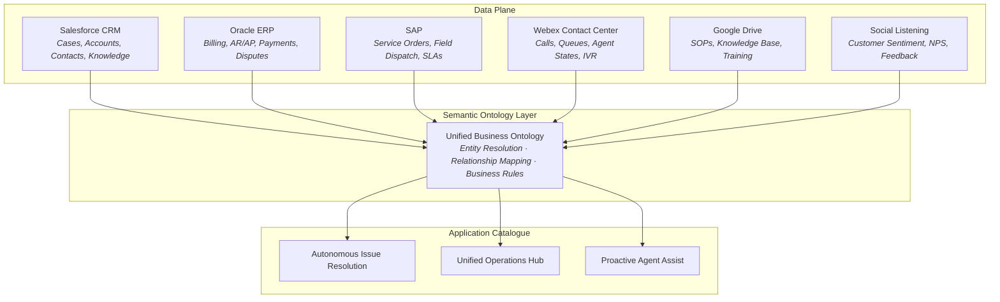
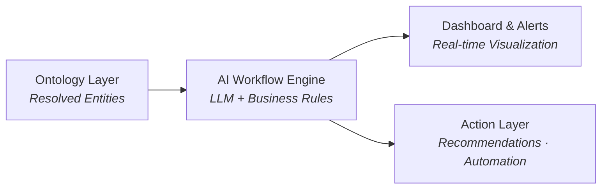

# Customer Operations Application Catalogue

Enterprise AI applications for customer operations, powered by the Semantic Ontology Layer.

---

## Data Plane Overview

The application catalogue draws from a unified data plane spanning structured enterprise systems, contact-center platforms, and unstructured data sources.

---

## Application Portfolio

### P0 — Immediate ROI

- **[Autonomous Issue Resolution Engine](autonomous-issue-resolution.md)** — sources: Salesforce, WXCC, Oracle ERP, SAP. Reduce avg resolution time 40–60%, cut escalations 30–45%. Time to value 4–6 weeks.

### P1 — High Value

- **[Unified Operations Hub](unified-operations-hub.md)** — sources: Salesforce, Oracle ERP, WXCC, SAP. Reduce cross-system handoff time 50–70%, cut billing errors 25–35%. Time to value 6–8 weeks.

### P2 — Strategic Value

- **[Proactive Agent Assist Copilot](proactive-agent-assist.md)** — sources: Salesforce, WXCC, Oracle ERP, Social Listening. Increase first-call resolution 15–25%, uplift CSAT 8–12 points. Time to value 8–10 weeks.

---

## Ontology Entity Map

Key business entities resolved across systems by the Semantic Ontology Layer:

| Business Entity | Salesforce CRM | Oracle ERP | SAP | Webex Contact Center |
|---|---|---|---|---|
| **Customer** | Account / Contact | AR_Customer | Business Partner | Caller Profile |
| **Case / Ticket** | Case / Case_Comment | — | Service_Order | Call_Record |
| **Billing** | — | AR_Invoice / AR_Payment | — | — |
| **Dispute** | Case (type=Billing) | Billing_Dispute / Credit_Note | — | — |
| **Interaction** | Activity / Email | — | — | Call_Record / Chat_Transcript |
| **Agent** | User (Service Agent) | — | — | Agent_State / Agent_Metrics |
| **Knowledge** | Knowledge_Article | — | — | — |
| **SLA** | Entitlement / Milestone | — | SLA_Record | Queue SLA |

---

## Architecture Pattern

Every application in this catalogue follows the same execution pattern:

- **Data Ingestion** — Ontology layer resolves entities across Salesforce, Oracle ERP, SAP, WXCC, and unstructured sources.
- **AI Workflow Execution** — LLM-powered pipelines apply business logic, anomaly detection, and predictive models.
- **Presentation** — Dashboards surface KPIs; alerts trigger on threshold breaches.
- **Action** — Recommendations feed back into source systems or trigger automated workflows.

---

[← Back to Home](../../index.md)
