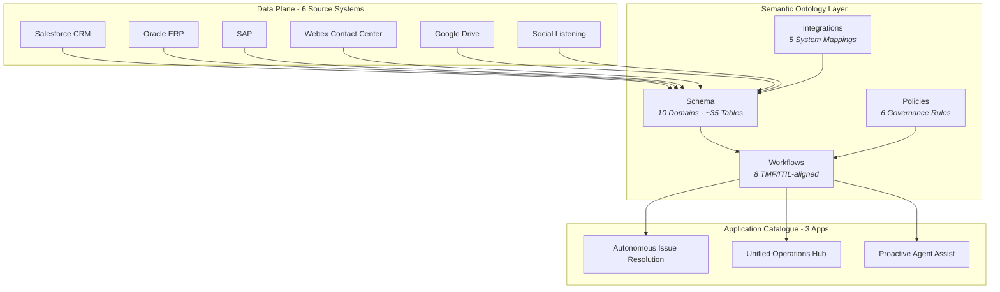

# Customer Operations Semantic Ontology Layer

The Semantic Ontology Layer sits between the Data Plane and the Application Catalogue, providing a unified, standards-aligned knowledge graph that resolves entities across Salesforce CRM, Oracle ERP (Billing & Finance), SAP (Service & Field), Webex Contact Center (WXCC), and unstructured data sources.

---

## Industry Standards Alignment

The customer operations ontology is aligned to two global standards — the equivalent of SCOR used in the Supply Chain vertical.

### TMF (TM Forum) Open APIs

The TM Forum Open API framework is the global standard for telco and digital service provider operations. Every domain, workflow, and policy in this ontology is tagged with its TMF process area:

| TMF Process Area | Scope | Ontology Coverage |
|-----------------|-------|-------------------|
| **Customer Management (TMF629)** | Customer profiles, segmentation, lifecycle | All 3 apps — Account, Contact, Customer_Profile |
| **Trouble Ticket (TMF621)** | Case creation, routing, resolution tracking | Autonomous Issue Resolution, Unified Operations Hub |
| **Service Order (TMF641)** | Service fulfillment, activation, modification | Unified Operations Hub — Service_Order, Field_Dispatch |
| **Billing (TMF678)** | Invoice, payment, dispute, credit management | Autonomous Issue Resolution, Unified Operations Hub |
| **Interaction (TMF683)** | Multi-channel interaction tracking | All 3 apps — Call_Record, Chat_Transcript, Email_Record |
| **SLA (TMF623)** | Service level agreements, breach management | Autonomous Issue Resolution, Unified Operations Hub |

### ITIL v4 Service Management

Service management entities carry ITIL-aligned process classifications:

| ITIL Practice | Purpose | Ontology Entity |
|--------------|---------|-----------------|
| **Incident Management** | Restore normal service ASAP | `Case` (type=Incident), Resolution workflows |
| **Problem Management** | Root cause of recurring incidents | `Problem_Record`, pattern detection workflows |
| **Service Request** | Pre-defined service delivery | `Case` (type=Service_Request), automated fulfillment |
| **Knowledge Management** | Capture and reuse resolution knowledge | `Knowledge_Article`, `SOP_Document`, `Resolution_Template` |
| **Service Level Management** | SLA monitoring and breach prevention | `SLA_Record`, `Entitlement`, SLA policies |

---

## Architecture

---

## Ontology Components

The ontology consists of four interconnected layers, all stored in `enterprise-knowledge/`:

| Layer | Files | Format | Purpose |
|-------|-------|--------|---------|
| [Schema](schema-reference.md) | `customer-ops-schema.yaml` | YAML | 10 domains, ~35 tables with fields, types, risk levels, constraints, and relationships |
| [Workflows](workflows.md) | `workflows/*.yaml` (8 files) | YAML | Triggered process flows with steps, rules, SLAs, and dependencies |
| [Policies](policies.md) | `policies/*.md` (6 files) | Markdown | Business rules, thresholds, approval chains, and compliance constraints |
| [Integrations](integrations.md) | `integrations/*.yaml` (5 files) | YAML | Field-level sync mappings between source systems with conflict resolution |

### Relationship Types

Entities in the schema are connected via typed relationships that form a knowledge graph:

| Relationship | Meaning | Example |
|-------------|---------|---------|
| `triggers` | Entity event initiates a workflow | `Case` triggers `Case Triage & Routing` workflow |
| `syncs_to` | Entity data flows to another system | `Account` syncs_to `Oracle_AR_Customer` via integration |
| `constrained_by` | Entity operations governed by a policy | `Billing_Dispute` constrained_by `billing-dispute-policy` |
| `depends_on` | Entity requires a parent/related entity | `Case_Comment` depends_on `Case` |
| `escalates_to` | Entity triggers escalation chain | `Case` escalates_to `Escalation_Rule` on SLA breach |

---

## Cross-Application Entity Heatmap

Shows how many of the 3 customer ops apps require each entity. Higher usage = more foundational.

| Entity | Count | Applications |
|--------|-------|-------------|
| `Account` | **3** | All apps |
| `Case` | **3** | All apps |
| `Call_Record` | **3** | All apps |
| `Oracle_AR_Customer` | **3** | All apps |
| `Knowledge_Article` | **3** | All apps |
| `Oracle_AR_Invoice` | **2** | Issue Resolution, Operations Hub |
| `Billing_Dispute` | **2** | Issue Resolution, Operations Hub |
| `Service_Order` | **2** | Issue Resolution, Operations Hub |
| `Chat_Transcript` | **2** | Issue Resolution, Proactive Assist |
| `CSAT_Survey` | **2** | Issue Resolution, Proactive Assist |
| `Agent_State` | **2** | Operations Hub, Proactive Assist |
| `NPS_Response` | **1** | Proactive Assist |
| `Field_Dispatch` | **1** | Operations Hub |
| `SOP_Document` | **1** | Issue Resolution |

`Account` and `Case` are the most connected entities in the customer ops ontology — equivalent to `Material_Master` in Supply Chain or `Subscriber` in Telco.

---

## Schema Statistics

| Metric | Count |
|--------|-------|
| **Domains** | 10 |
| **Tables** | ~35 |
| **Source Systems** | 6 (Salesforce, Oracle, SAP, WXCC, Google Drive, Social Listening) |
| **Workflows** | 8 |
| **Policies** | 6 |
| **Integrations** | 5 |
| **Relationship Types** | 5 (triggers, syncs_to, constrained_by, depends_on, escalates_to) |
| **TMF Processes Covered** | 6/6 (Customer Mgmt, Trouble Ticket, Service Order, Billing, Interaction, SLA) |

---

## Documentation

| Document | Description |
|----------|-------------|
| [Schema Reference](schema-reference.md) | Complete domain and table reference with fields, types, and relationships |
| [Workflows](workflows.md) | All 8 AI workflow definitions with triggers, steps, and dependencies |
| [Policies](policies.md) | All 6 governance policies with rules, thresholds, and approval chains |
| [Integrations](integrations.md) | All 5 system integration mappings with field-level detail |
| [App-Object Mapping](app-object-mapping.md) | Minimum required objects per application with relationship matrix |
| [Mapping Architecture](mapping-architecture.md) | Schema-first architecture, Semantic RAG pipeline, and ReAct tools |

---

[← Back to Customer Ops Catalogue](../index.md)
