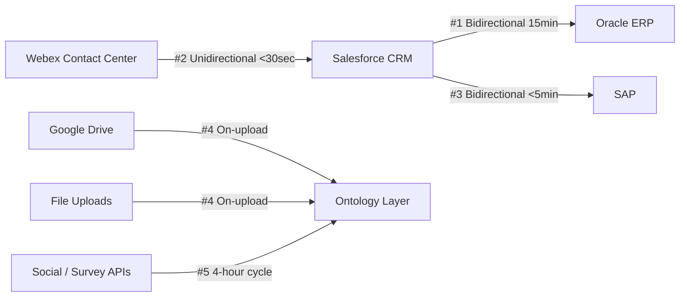
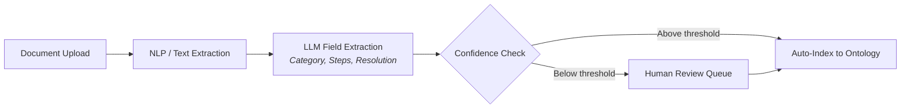
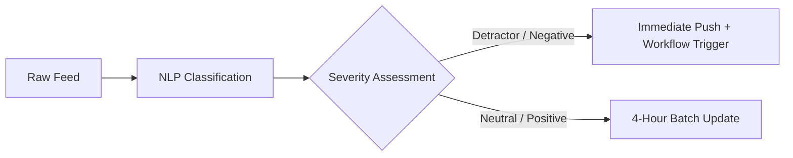

# Integrations

5 system integration mappings that connect the Data Plane source systems to the Semantic Ontology Layer. Each integration is defined in `enterprise-knowledge/integrations/` as a YAML file with field-level mappings, conflict resolution, and failure handling.

---

## Integration Summary

| # | Integration | Source | Target | Type | Frequency |
|---|------------|--------|--------|------|-----------|
| 1 | [SF-Oracle CustOps Sync](#1-salesforce-to-oracle-customer-ops-sync) | Salesforce | Oracle ERP | Bidirectional | 15-min interval |
| 2 | [SF-WXCC Interaction Sync](#2-salesforce-to-wxcc-interaction-sync) | WXCC | Salesforce | Unidirectional | Near real-time (<30 sec) |
| 3 | [SF-SAP Service Sync](#3-salesforce-to-sap-service-sync) | Salesforce | SAP | Bidirectional | Near real-time (<5 min) |
| 4 | [Unstructured Extraction](#4-unstructured-data-extraction) | Google Drive / File Uploads | Ontology Layer | Unidirectional | On-upload + daily scan |
| 5 | [Social Listening & Feedback Feed](#5-social-listening-feedback-feed) | Social Listening APIs / Surveys | Ontology Layer | Unidirectional | 4-hour cycle (critical immediate) |

---

## Integration Architecture

---

## 1. Salesforce to Oracle Customer Ops Sync

**ID:** `INTEGRATION_SF_ORACLE_CUSTOPS_V1_0` | **File:** `sf-oracle-custops-sync.yaml`

Salesforce is source of truth for customer and case data. Oracle is source of truth for billing and financial transactions.

### Customer Sync (Account -> Oracle_AR_Customer)

| Salesforce Field | Oracle Field | Direction | Transformation / Constraint |
|-----------------|-------------|-----------|---------------------------|
| Account.Name | AR_Customer.customer_name | SF -> Oracle | — |
| Account.Tier | AR_Customer.collection_priority | SF -> Oracle | Platinum->Priority, Gold->Standard, Silver->Monitored, Bronze->Basic |
| Account.Credit_Limit | AR_Customer.credit_limit | SF -> Oracle | Requires approval workflow |
| Account.Status | AR_Customer.customer_status | SF -> Oracle | Deactivation blocked if AR_Balance > 0 |
| AR_Customer.AR_Balance | Account.AR_Balance__c | Oracle -> SF | Read-only visibility in Salesforce |
| AR_Customer.Collection_Priority | Account.Collection_Priority__c | Oracle -> SF | Read-only |

### Case-Billing Sync (Case -> Billing_Dispute)

| Salesforce Field | Oracle Field | Direction | Notes |
|-----------------|-------------|-----------|-------|
| Case.Case_ID | Billing_Dispute.Case_ID | SF -> Oracle | Link case to dispute |
| Case.Account_ID | Billing_Dispute.Customer_ID | SF -> Oracle | Via account mapping |
| Case.Description | Billing_Dispute.Description | SF -> Oracle | NLP-extracted dispute details |
| Billing_Dispute.Status | Case.Billing_Dispute_Status__c | Oracle -> SF | Read-only |
| Oracle_AR_Credit_Note.Amount | Case.Credit_Amount__c | Oracle -> SF | Read-only; visible to agent |

**Conflict Resolution:** Salesforce wins for customer/case data; Oracle wins for billing/financial data

**Failure Handling:** 3 retries at 5-min intervals; dead letter queue; alert custops-integration-alerts@company.com

---

## 2. Salesforce to WXCC Interaction Sync

**ID:** `INTEGRATION_SF_WXCC_INTERACTION_V1_0` | **File:** `sf-wxcc-interaction-sync.yaml`

WXCC pushes interaction events to Salesforce in near real-time for unified customer timeline.

### Call Record Sync (WXCC -> Salesforce Activity)

| WXCC Field | Salesforce Field | Transformation |
|-----------|-----------------|----------------|
| Call_Record.Call_ID | Activity.External_ID__c | — |
| Call_Record.ANI | Activity.Account_ID | ANI lookup → Account matching |
| Call_Record.Agent_ID | Activity.Owner_ID | Agent ID mapping table |
| Call_Record.Duration_Seconds | Activity.Duration__c | Seconds → minutes conversion |
| Call_Record.Disposition | Activity.Disposition__c | — |
| Call_Record.Sentiment_Score | Activity.Sentiment_Score__c | — |
| Call_Record.Recording_URL | Activity.Recording_URL__c | Secure URL (time-limited token) |

### Chat Transcript Sync (WXCC -> Salesforce)

| WXCC Field | Salesforce Field |
|-----------|-----------------|
| Chat_Transcript.Chat_ID | Activity.External_ID__c |
| Chat_Transcript.Account_ID | Activity.Account_ID |
| Chat_Transcript.Transcript_Text | Activity.Description |
| Chat_Transcript.Sentiment_Score | Activity.Sentiment_Score__c |
| Chat_Transcript.Disposition | Activity.Disposition__c |

### Agent State Sync (WXCC -> Salesforce Presence)

| WXCC Field | Salesforce Field |
|-----------|-----------------|
| Agent_State.Agent_ID | User.Agent_ID__c |
| Agent_State.State | ServicePresenceStatus |
| Agent_State.Skills | SkillProfile mapping |

**Conflict Resolution:** WXCC wins (source of truth for interaction data)

**Frequency:** Near real-time (<30 seconds); Agent_State: real-time push on change

---

## 3. Salesforce to SAP Service Sync

**ID:** `INTEGRATION_SF_SAP_SERVICE_V1_0` | **File:** `sf-sap-service-sync.yaml`

Salesforce pushes case escalations to SAP for field service; SAP returns service completion data.

### Case to Service Order (Salesforce -> SAP)

| Salesforce Field | SAP Field | Transformation |
|-----------------|----------|----------------|
| Case.Case_ID | Service_Order.Case_ID | — |
| Case.Account_ID | Service_Order.Account_ID | Via customer mapping table |
| Case.Priority | Service_Order.Priority | Direct mapping |
| Case.Type | Service_Order.Type | Incident->Repair, Service_Request->Modification |
| Case.Description | Service_Order.Description | — |

### Service Order Completion (SAP -> Salesforce)

| SAP Field | Salesforce Field | Notes |
|----------|-----------------|-------|
| Service_Order.Status | Case.Service_Order_Status__c | Read-only in SF |
| Service_Order.Completion_Date | Case.Service_Completed__c | — |
| Field_Dispatch.Outcome | Case.Field_Visit_Outcome__c | — |
| Field_Dispatch.ETA | Case.Field_Visit_ETA__c | Real-time update |
| SLA_Record.Breach_Flag | Case.SLA_Breach__c | — |

**Conflict Resolution:** Salesforce wins for case data; SAP wins for service execution data

**Frequency:** SF→SAP: near real-time (<5 min); SAP→SF: on status change + 15-min sync

---

## 4. Unstructured Data Extraction

**ID:** `INTEGRATION_UNSTRUCTURED_EXTRACT_V1_0` | **File:** `unstructured-extraction-custops.yaml`

NLP pipeline for extracting structured data from knowledge base documents and SOPs.

| Pipeline | Source | Target Entity | Confidence Threshold |
|----------|--------|--------------|---------------------|
| SOP NLP | Google Drive PDFs/Docs | SOP_Document | >0.85: auto-index; <0.85: human review |
| Knowledge Article NLP | Google Drive / Confluence | Knowledge_Article | >0.85: auto-index; <0.85: human review |
| Training Material NLP | File Upload PDFs | Resolution_Template | >0.80: auto-index; <0.80: human review |

**Extraction Pipeline:**

---

## 5. Social Listening & Feedback Feed

**ID:** `INTEGRATION_SOCIAL_FEEDBACK_V1_0` | **File:** `social-feedback-feed.yaml`

4-hour refresh cycle for standard data; negative sentiment and detractor signals pushed immediately.

| Feed | Target Entity | Frequency | Special Rules |
|------|--------------|-----------|---------------|
| Social media monitoring | Brand_Sentiment | 4-hour cycle | Sentiment <-50: immediate push |
| NPS survey platform | NPS_Response | On-response | Detractor (0-6): immediate push + trigger Churn Intervention |
| CSAT survey platform | CSAT_Survey | On-response | Score <3: immediate push + alert |
| Customer feedback portal | Customer_Feedback | On-submission | Negative sentiment: immediate push |
| Review site monitoring | Customer_Feedback | 4-hour cycle | Aggregate by topic and platform |

**Signal Classification Pipeline:**

---

## Failure Handling (All Integrations)

All integrations share a common failure handling pattern:

| Setting | Value |
|---------|-------|
| Retry count | 3 |
| Retry interval | 5 minutes |
| Dead letter queue | Enabled |
| Alert on failure | Integration-specific alert email |
| Fallback | Source system value is authoritative; manual update required in target |

---

[← Back to Ontology Overview](index.md)
