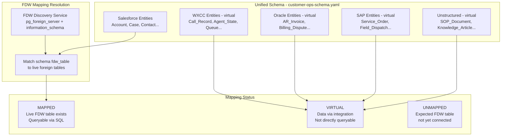
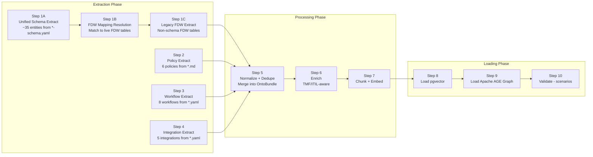
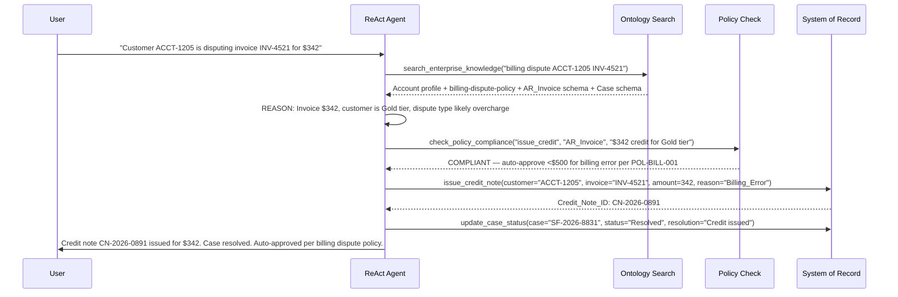

# Mapping Architecture & Semantic Indexing

How the unified customer operations schema maps to the existing systems of record, how the semantic indexing pipeline processes it, and how the ReAct agent uses the indexed ontology to serve queries and take actions.

---

## Schema-First Architecture

The customer operations ontology uses a **schema-first** approach — the unified schema is the primary knowledge source, not the FDW foreign tables. FDW becomes a mapping resolution layer that annotates which schema entities have live database connections.

### Entity Mapping Status

| Status | Meaning | Count | Example |
|--------|---------|-------|---------|
| **Mapped** | Live FDW foreign table exists; entity is queryable via `query_table` tool | ~8 | Account, Contact, Case, Case_Comment |
| **Virtual** | Entity data flows via integration sync; not directly queryable via FDW | ~25 | Call_Record, AR_Invoice, Service_Order, Agent_State |
| **Unmapped** | Schema defines the entity but no FDW table or integration connected yet | ~2 | Problem_Record, Trend_Alert (derived entities) |

---

## Semantic RAG Pipeline (12 Steps)

The pipeline follows the same 12-step process as the supply chain ontology, extended with Steps 1A (Unified Schema Extraction) and 1B (FDW Mapping Resolution):

### Step Details

| Step | File | What It Does |
|------|------|-------------|
| **1A** | `unified_schema_extractor.py` | Reads `customer-ops-schema.yaml`; creates OntoDocuments for every entity with TMF process, ITIL practice, and FDW mapping status annotations |
| **1B** | `fdw_mapping_resolver.py` | Queries `FDWDiscoveryService` to match schema entities to live FDW foreign tables; annotates as mapped/virtual/unmapped; enriches mapped entities with live column metadata |
| **1C** | `fdw_extractor.py` | Original FDW extractor for non-schema tables (backward compatibility for CRM-only FDW tables) |
| **2** | `policy_extractor.py` | Auto-discovers all `*.md` from `enterprise-knowledge/policies/` — includes 6 customer ops policies |
| **3** | `workflow_extractor.py` | Auto-discovers all `*.yaml` from `enterprise-knowledge/workflows/` — includes 8 customer ops workflows |
| **4** | `integration_extractor.py` | Auto-discovers all `*.yaml` from `enterprise-knowledge/integrations/` — includes 5 customer ops integrations |
| **5** | `normalizer.py` | Merges all extracted documents; deduplicates by ID; merges relationships and `structured_metadata` on collision |
| **6** | `enricher.py` | Schema entities: auto-enriched with TMF process, ITIL practice, and FDW status. Policies/workflows/integrations: LLM-enriched via gpt-4o-mini |
| **7** | `chunker.py` | 1 document = 1 chunk; batch embedded (20/batch) via OpenAI text-embedding-3-small |
| **8** | `vector_loader.py` | Upserted to pgvector `control_plane_embeddings` with content_type: `onto_schema`, `onto_policy`, `onto_workflow`, `onto_integration` |
| **9** | `graph_loader.py` | Nodes (Entity) and edges (triggers/syncs_to/constrained_by/depends_on/escalates_to) merged into Apache AGE `enterprise_onto` graph |
| **10** | `validator.py` | Black-box test scenarios validating retrieval quality across 6 dimensions |

### What Gets Indexed

| Source | Content Type | Approx Count |
|--------|-------------|-------------|
| Unified schema (Salesforce + WXCC + Oracle + SAP + unstructured) | `onto_schema` | ~35 |
| Policies (6 customer ops) | `onto_policy` | ~40+ (split by section) |
| Workflows (8 customer ops) | `onto_workflow` | ~8 |
| Integrations (5 customer ops) | `onto_integration` | ~5 |
| **Total** | — | **~88+** |

---

## ReAct Agent and Tools

The ReAct agent uses the indexed ontology to answer questions and take actions. The flow is: **Search ontology -> Reason with policies -> Execute actions -> Validate compliance.**

### Tool Inventory

#### Read Tools

| Tool | Domain | What It Does |
|------|--------|-------------|
| `search_enterprise_knowledge` | Core | Hybrid vector + graph search across all ontology types |
| `search_schema_knowledge` | Core | Vector search over FDW table definitions |
| `discover_tables` / `discover_columns` / `query_table` | Core | FDW table discovery and parameterized SQL queries |
| `check_policy_compliance` | Governance | Validates proposed actions against indexed policies |
| `get_customer_360` | Customer Ops | Assemble unified customer profile across all systems |
| `get_case_lifecycle` | Customer Ops | Trace case from creation through resolution across systems |
| `get_billing_status` | Customer Ops | Query billing status, disputes, and payment history |
| `get_interaction_history` | Customer Ops | Retrieve interaction timeline from WXCC + Salesforce |

#### Write Tools

| Tool | Risk Level | What It Does |
|------|-----------|-------------|
| `create_case` | LOW_RISK_WRITE | Create new case in Salesforce with full context |
| `update_case_status` | LOW_RISK_WRITE | Update case status, add comments, set resolution code |
| `issue_credit_note` | HIGH_RISK_WRITE | Issue credit note in Oracle (triggers approval per policy) |
| `create_service_order` | LOW_RISK_WRITE | Create service order in SAP for field dispatch |
| `escalate_case` | LOW_RISK_WRITE | Escalate case to next level with context brief |

### End-to-End ReAct Flow

---

## UI Integration

### Data Plane Page

- **Vertical selector** filters data sources by domain (All / Customer Ops / Supply Chain / CRM)
- Each source node shows **ontology entity count** and **TMF process coverage**
- Source cards display **FDW mapping status** (mapped / virtual) and **entity count badges**

### Control Plane Page

- **Semantic Layer tab** shows vertical-level stats (Customer Ops: 35 entities, 8 workflows, 6 policies, 5 integrations)
- **TMF process distribution** badges (Customer Mgmt, Trouble Ticket, Service Order, Billing, Interaction, SLA)
- **Knowledge Formation** and **Semantic Explorer** tabs support system and TMF filtering

### Reasoning Page

- **ReAct Tools tab** organizes tools into **Read Tools** and **Write Tools** with domain badges (Core / Customer Ops / CRM / Governance)
- **AI Copilot** system prompt includes customer operations context and tool selection strategy

---

## Configuration

The pipeline is configured via `SemanticRagConfig`:

| Parameter | Default | Purpose |
|-----------|---------|---------|
| `schema_dir` | `enterprise-knowledge/` | Directory containing `*-schema.yaml` files |
| `policy_path` | `enterprise-knowledge/policies/` | Directory with policy Markdown files |
| `workflow_path` | `enterprise-knowledge/workflows/` | Directory with workflow YAML files |
| `integration_path` | `enterprise-knowledge/integrations/` | Directory with integration YAML files |
| `skip_unified_schema` | `false` | Skip Step 1A (unified schema extraction) |
| `skip_fdw_mapping` | `false` | Skip Step 1B (FDW mapping resolution) |
| `enrich_with_llm` | `true` | Enable LLM enrichment for non-schema docs |
| `skip_graph` | `false` | Skip Apache AGE graph loading |

Trigger reindex via: `POST /api/v1/control-plane/reindex`

---

[← Back to Ontology Overview](index.md)
