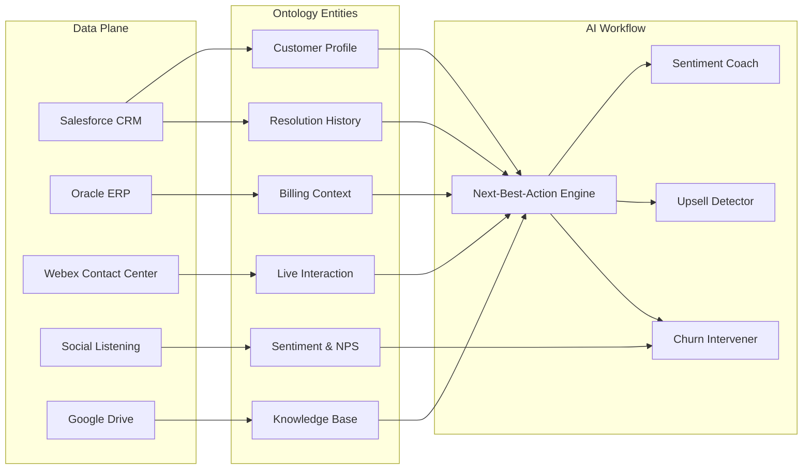

# Proactive Agent Assist Copilot

AI-powered real-time recommendations, next-best-actions, and contextual intelligence surfaced to agents during live customer interactions.

**Priority:** P2 — Strategic Value  
**Time to Value:** 8-10 weeks  
**Category:** Agent Augmentation

---

## Business Problem

Customer operations agents handle complex interactions where the right information at the right moment determines the outcome — yet agents operate with limited visibility into the customer's full picture. Without proactive AI assistance:

- **Missed upsell/cross-sell** — agents resolve issues without recognizing revenue opportunities; 70-80% of expansion moments go undetected
- **Reactive-only service** — agents wait for customers to report problems instead of preemptively addressing known issues
- **Knowledge overload** — 500+ knowledge articles, 50+ SOPs, and constantly changing policies mean agents often guess instead of searching
- **Inconsistent quality** — top-performing agents outperform average agents by 3-4x on CSAT and resolution speed, but their tribal knowledge is not captured
- **Churn blindness** — high-value customers showing churn signals are treated the same as routine callers until they leave

---

## Capabilities

### Real-Time Next-Best-Action
During a live interaction, surface the optimal action based on customer context, issue type, and business objectives: _"Recommend: Waive late fee ($45) — customer is Platinum tier with CLV $48K, 3 years tenure, first late payment. Retention ROI: 107x."_

### Churn Intervention Cards
For customers flagged with elevated churn risk, automatically surface retention context and pre-approved offers: _"CHURN ALERT: Account ACCT-2205 has 0.78 churn probability. Triggers: 2 unresolved cases in 30 days, NPS dropped from 72 to 31, usage down 40%. Pre-approved: 3-month 20% discount OR free premium feature trial."_

### Contextual Knowledge Delivery
Instead of agents searching through knowledge bases, AI pushes the relevant article or resolution template as the customer describes their issue — ranked by relevance, success rate, and recency.

### Sentiment-Aware Coaching
Real-time voice/text sentiment analysis with coaching prompts: _"Customer sentiment turning negative (0.3 → -0.4 in last 2 minutes). Suggested: acknowledge frustration, offer direct escalation path, reference previous positive interaction on Jan 15."_

### Upsell & Cross-Sell Intelligence
Detect expansion signals during service interactions: _"Customer asking about feature X — they're on Basic plan. Similar accounts who upgraded to Pro after this inquiry: 68% conversion rate. Suggest: offer 30-day Pro trial."_

---

## Data Sources & Ontology Mapping

| Ontology Entity | Source System | Key Fields |
|----------------|--------------|------------|
| Customer Profile | Salesforce Account + Oracle AR_Customer | Account_ID, Tier, CLV, Churn_Risk, Tenure, Product_Holdings, Preferences |
| Live Interaction | WXCC Call_Record + Chat_Transcript | Interaction_ID, Channel, Real_Time_Sentiment, Topic_Detected, Duration, Agent_ID |
| Billing Context | Oracle AR_Invoice + AR_Payment + Billing_Dispute | AR_Balance, Last_Payment, Open_Disputes, Payment_Behavior_Score |
| Knowledge Base | Google Drive SOP_Document + SF Knowledge_Article | Article_ID, Category, Resolution_Steps, Success_Rate, Recency_Score |
| Sentiment & NPS | Social Listening + CSAT_Survey + NPS_Response | NPS_Score, CSAT_Score, Sentiment_Trend, Last_Survey_Date, Detractor_Flag |
| Resolution History | Salesforce Case + Case_Comment | Past_Cases, Resolution_Patterns, Avg_Resolution_Time, Preferred_Channel |

---

## AI Workflow

1. **Interaction Detection** — WXCC webhook signals new customer interaction (call/chat/email); trigger context assembly
2. **Customer Profile Hydration** — Pull full profile: Salesforce account, Oracle billing, interaction history, NPS, churn risk, product holdings
3. **Real-Time Intent Detection** — NLP on live speech/text to classify intent (issue report, billing inquiry, upgrade interest, cancellation signal)
4. **Knowledge Matching** — Match detected intent to top-3 knowledge articles/resolution templates ranked by relevance and success rate
5. **Action Scoring** — Score candidate actions (resolve, escalate, offer, waive, upsell) against customer context, business rules, and policy constraints
6. **Recommendation Delivery** — Push ranked recommendations to agent desktop in real-time with confidence scores and one-click action buttons
7. **Outcome Capture** — Record which recommendations were accepted/rejected; feed back into model for continuous learning

---

## Dashboard & Alerts

### Key Metrics

| KPI | Description | Target |
|-----|-------------|--------|
| **Recommendation Acceptance Rate** | % of agent-facing recommendations acted upon | > 40% |
| **First Call Resolution (FCR)** | % of interactions resolved on first contact | > 80% |
| **CSAT Score** | Customer satisfaction score (1-5 scale) | > 4.2 |
| **Upsell Conversion Rate** | % of surfaced upsell recommendations converted | > 12% |
| **Churn Save Rate** | % of at-risk customers retained after intervention | > 55% |
| **Knowledge Article Relevance** | % of pushed articles rated helpful by agent | > 75% |
| **Agent Assist Latency** | Time from interaction start to first recommendation | < 8 seconds |

### Alert Rules

| Alert | Trigger | Severity | Action |
|-------|---------|----------|--------|
| High-value churn signal | Platinum/Gold customer with churn risk >0.7 calls in | Critical | Immediate routing to retention specialist with pre-built offer card |
| Sentiment collapse | Real-time sentiment drops below -0.6 during interaction | High | Push de-escalation guidance + supervisor notification |
| Revenue opportunity | Upsell signal detected for customer with >$50K CLV | Medium | Push offer card with pre-approved terms to agent |
| Knowledge gap | No relevant article found for detected intent (confidence <0.4) | Medium | Flag to knowledge management team; log for content creation |
| Model drift | Recommendation acceptance rate drops >15% over 7-day window | Medium | Alert ML ops; trigger model retraining pipeline |

---

## ROI Model

| Metric | Before | After | Impact |
|--------|--------|-------|--------|
| First call resolution | 65% | 82% | **26% improvement → $1.4M cost avoidance** |
| CSAT score | 3.6 | 4.3 | **19% improvement → reduced churn** |
| Upsell revenue per agent/month | $2,800 | $5,400 | **93% increase → $3.1M incremental annual revenue** |
| Churn save rate (at-risk accounts) | 28% | 56% | **100% improvement → $2.4M retained revenue** |
| Agent knowledge search time | 3.2 min/case | 0.4 min/case | **87% reduction → 15% handle time savings** |
| New agent time-to-competency | 8 weeks | 4 weeks | **50% faster ramp** |

!!! success "Estimated Annual ROI"
    **$4.0M - $7.0M** annually from upsell revenue, churn prevention, FCR improvement, and agent productivity — across a mid-size enterprise with 200 agents handling 500K interactions/year.

---

## Implementation Notes

- Real-time recommendation delivery requires <8 second latency from interaction start; WXCC webhook + pre-cached customer profiles critical
- Churn risk model requires minimum 18 months of labeled churn data (accounts that left + accounts retained after intervention)
- Upsell models should be trained on historical upgrade patterns with minimum 6 months of conversion data
- Sentiment analysis on voice requires real-time speech-to-text pipeline with WXCC call recording integration
- Recommendation acceptance/rejection feedback loop is essential for model improvement; agent desktop must capture this signal

---

[← Back to Catalogue](index.md) | [Previous: Unified Operations Hub](unified-operations-hub.md)
