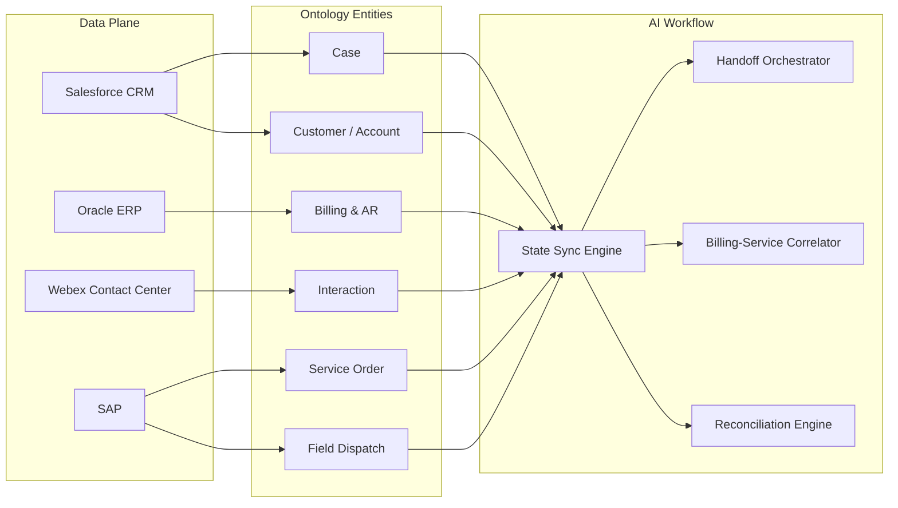

# Unified Operations Hub

Real-time orchestration across CRM, billing, contact center, and field service — eliminating cross-system handoffs and data silos in customer operations.

**Priority:** P1 — High Value  
**Time to Value:** 6-8 weeks  
**Category:** Operations Orchestration

---

## Business Problem

Customer operations span multiple systems that operate as independent silos — a billing dispute in Oracle has no link to the originating case in Salesforce, a field dispatch in SAP has no visibility into the customer's call history in WXCC. Without real-time coordination:

- **Data lag** — billing adjustments take 24-72 hours to reflect across systems; customers call back to check status, inflating contact volume
- **Broken handoffs** — agent transfers between teams lose context; customer repeats their story 2-3 times per interaction
- **Billing-service disconnect** — 15-25% of billing disputes originate from service delivery issues invisible to the billing team
- **Field dispatch blind spots** — field technicians arrive without customer context (case history, recent interactions, billing status)
- **Reconciliation overhead** — finance and operations teams spend 20+ hours/week manually reconciling cross-system discrepancies

---

## Capabilities

### Real-Time Cross-System State Sync
Maintain a unified operational state per customer across Salesforce (cases), Oracle (billing), WXCC (interactions), and SAP (service orders) — updated within seconds of any system change.

### Intelligent Handoff Orchestration
When a case transfers between teams or systems, the full context travels with it: _"Transferring to billing team — attaching case SF-2026-8831, Oracle invoice #INV-4521 (dispute: $342 overcharge), 2 prior WXCC calls (12min, 8min), and SAP service order SO-7722 (completed yesterday)."_

### Billing-Service Correlation Engine
Automatically correlate billing anomalies with upstream service events: _"Invoice spike for Account ACCT-1205 correlates with SAP service order SO-7701 (plan upgrade) executed 3 days ago — likely correct charge, not an error."_

### Field Service Context Cards
Push real-time customer context to field technicians before dispatch: case history, interaction sentiment, billing status, previous visit outcomes, and relevant knowledge articles.

### Cross-System Reconciliation
AI-powered reconciliation detects and flags discrepancies: _"Salesforce case SF-2026-9001 marked resolved but Oracle credit note CN-4410 still pending approval — flagging for finance review."_

---

## Data Sources & Ontology Mapping

| Ontology Entity | Source System | Key Fields |
|----------------|--------------|------------|
| Case | Salesforce Case | Case_ID, Account_ID, Type, Priority, Status, Origin, Owner_ID, Escalation_Level |
| Customer / Account | Salesforce Account + Oracle AR_Customer | Account_ID, Name, Tier, Segment, AR_Balance, Credit_Status, Payment_Terms |
| Billing & AR | Oracle AR_Invoice + AR_Payment + Billing_Dispute | Invoice_ID, Amount, Due_Date, Status, Dispute_Type, Credit_Note_ID |
| Interaction | WXCC Call_Record + Chat_Transcript | Interaction_ID, Channel, Agent_ID, Duration, Disposition, Sentiment_Score |
| Service Order | SAP Service_Order | Service_Order_ID, Account_ID, Type, Status, Scheduled_Date, Completion_Date |
| Field Dispatch | SAP Field_Dispatch | Dispatch_ID, Service_Order_ID, Technician_ID, Status, ETA, Outcome |

---

## AI Workflow

1. **Event Ingestion** — Subscribe to change events across all 4 systems (Salesforce CDC, Oracle alerts, WXCC webhooks, SAP IDocs)
2. **Entity Resolution** — Resolve customer identity across systems: Salesforce Account ↔ Oracle AR_Customer ↔ SAP Business Partner ↔ WXCC Caller Profile
3. **State Assembly** — Build real-time composite state per customer: open cases, pending invoices, active interactions, in-flight service orders
4. **Correlation Analysis** — Link billing events to service events; detect causal chains (_"service order → plan change → invoice adjustment → dispute"_)
5. **Handoff Context Packaging** — When case transfers between teams, assemble full cross-system context brief with relevant history and recommendations
6. **Discrepancy Detection** — Compare states across systems; flag where case status, billing status, and service status are inconsistent
7. **Output** — Push unified state to dashboards; trigger reconciliation alerts; deliver context cards to agents and field technicians

---

## Dashboard & Alerts

### Key Metrics

| KPI | Description | Target |
|-----|-------------|--------|
| **Cross-System Sync Latency** | Time for state change to propagate across all systems | < 30 seconds |
| **Handoff Context Completeness** | % of transfers with full cross-system context attached | > 95% |
| **Billing-Service Correlation Rate** | % of billing disputes auto-correlated with service events | > 70% |
| **Reconciliation Discrepancies** | Open cross-system discrepancies per day | < 15 |
| **Customer Repeat Rate** | % of customers who call back about same issue within 48h | < 12% |
| **Agent Context Switch Time** | Time spent by agent navigating between systems per case | < 1 minute |

### Alert Rules

| Alert | Trigger | Severity | Action |
|-------|---------|----------|--------|
| Sync failure | System state not updated for >5 minutes after source change | Critical | Alert integration ops; retry; mark stale data |
| Reconciliation mismatch | Case resolved in Salesforce but billing/service action still pending | High | Notify owning team; create follow-up task |
| Handoff context gap | Transfer initiated without billing or interaction context available | High | Hold transfer 60s for context assembly; escalate if unavailable |
| Billing-service anomaly | Invoice amount deviates >20% from service order estimate | Medium | Flag for billing review; attach service order context |
| Field dispatch blind | Technician dispatched without customer case history attached | Medium | Push context card to mobile; delay dispatch 15min if critical |

---

## ROI Model

| Metric | Before | After | Impact |
|--------|--------|-------|--------|
| Cross-system handoff time | 8 minutes avg | 2 minutes avg | **75% reduction → agent productivity gain** |
| Customer repeat calls (handoff-related) | 18% | 7% | **61% reduction → $1.8M cost avoidance** |
| Billing-service reconciliation (manual) | 25 hours/week | 5 hours/week | **80% reduction → $200K labor savings** |
| Billing dispute resolution time | 5 days avg | 2 days avg | **60% faster → improved cash flow** |
| Field technician first-visit resolution | 62% | 82% | **32% improvement → $600K truck roll savings** |
| Agent system navigation time | 35% of handle time | 12% of handle time | **66% reduction → capacity unlock** |

!!! success "Estimated Annual ROI"
    **$2.5M - $4.0M** annually from reduced handoff time, fewer repeat contacts, faster billing resolution, and field service efficiency — across a mid-size enterprise with 200 agents and 50 field technicians.

---

## Implementation Notes

- Real-time event streaming requires Salesforce Change Data Capture (CDC), Oracle Advanced Queuing, and WXCC webhook subscriptions
- Entity resolution across 4 systems is the foundational prerequisite; ontology layer must achieve >95% match confidence
- SAP service order integration requires IDocs or RFC-based event push for near real-time state updates
- Field context cards depend on mobile-compatible dashboard endpoint for technician devices
- Initial deployment should focus on the 3 highest-volume case categories before expanding to full taxonomy

---

[← Back to Catalogue](index.md) | [Previous: Autonomous Issue Resolution](autonomous-issue-resolution.md) | [Next: Proactive Agent Assist →](proactive-agent-assist.md)
