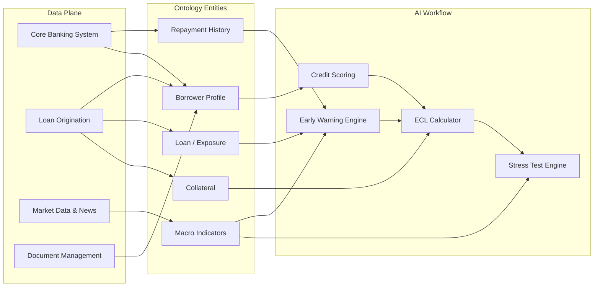

# Credit Risk & Early Warning System

AI-powered credit scoring, portfolio monitoring, and expected credit loss calculation for proactive risk management.

**Priority:** P0 — Immediate ROI  
**Time to Value:** 4-6 weeks  
**Category:** Risk Management

---

## Business Problem

Banks rely on credit bureau scores and static risk ratings that provide a point-in-time snapshot but fail to capture emerging risk. This leads to:

- **Late default detection** — deterioration signals (declining balances in other accounts, industry stress, behavioral changes) are invisible until missed payments occur
- **Blunt risk segmentation** — customers with identical bureau scores have vastly different actual risk profiles based on transaction behavior and relationship depth
- **Inaccurate provisioning** — IFRS 9 Expected Credit Loss (ECL) models rely on stale inputs, leading to over- or under-provisioning that impacts capital efficiency
- **Manual portfolio reviews** — credit teams spend weeks on quarterly reviews that could surface issues in real time
- **Concentration risk blind spots** — sector, geography, and single-name concentration builds undetected until stress events hit

---

## Capabilities

### AI-Enhanced Credit Scoring
Augment bureau scores with behavioral data: transaction patterns, balance trends, account utilization, and relationship depth from the Core Banking System — producing a more predictive composite risk score.

### Early Warning System (EWS)
Continuous monitoring of leading indicators across the loan portfolio: payment pattern deterioration, deposit balance erosion, sector stress signals from market data, and adverse news on borrowers.

### IFRS 9 ECL Engine
Automated Expected Credit Loss calculation with AI-driven PD (Probability of Default), LGD (Loss Given Default), and EAD (Exposure at Default) models. Stage classification (1/2/3) based on significant increase in credit risk (SICR) triggers.

### Portfolio Risk Analytics
Real-time portfolio-level dashboards showing concentration risk by sector, geography, product, rating grade, and vintage — with drill-down to individual exposures.

### Stress Testing & Scenario Analysis
Model portfolio performance under macroeconomic stress scenarios (rate hikes, GDP contraction, sector downturns) to assess capital adequacy and provisioning impact.

---

## Data Sources & Ontology Mapping

| Ontology Entity | Source System | Key Fields |
|----------------|--------------|------------|
| Borrower Profile | LOS + CBS + Documents | Borrower ID, Name, Segment, Bureau Score, Income, Employment, Financials |
| Loan / Exposure | Loan Origination System | Loan ID, Product, Sanctioned Amount, Outstanding, Rate, Tenor, Status |
| Repayment History | Core Banking System | Due Date, Paid Date, Amount Due, Amount Paid, DPD (Days Past Due) |
| Collateral | Loan Origination System | Collateral Type, Valuation, LTV Ratio, Last Valuation Date, Lien Status |
| Macro Indicators | Market Data (Bloomberg/Refinitiv) | GDP Growth, Unemployment Rate, Interest Rate, Sector Indices, CPI |

---

## AI Workflow

1. **Feature Engineering** — Combine bureau scores with CBS behavioral features (transaction velocity, balance trends, account utilization, relationship tenure) and LOS loan performance data
2. **Credit Score Enhancement** — Train gradient-boosted model on historical default events; produce a composite risk score that outperforms bureau-only scores by incorporating behavioral signals
3. **EWS Signal Detection** — Continuous scan of leading indicators: DPD trends, deposit balance decline in linked accounts, sector index deterioration, adverse news mentions, collateral value movement
4. **SICR Assessment** — Evaluate whether each exposure has experienced a Significant Increase in Credit Risk since origination; determine IFRS 9 stage migration (Stage 1 → 2 → 3)
5. **ECL Calculation** — Compute 12-month ECL (Stage 1) and lifetime ECL (Stage 2/3) using AI-driven PD term structures, LGD models incorporating collateral recovery, and EAD models with drawdown projections
6. **Portfolio Aggregation** — Roll up exposure-level risk metrics into portfolio views by segment, sector, geography, vintage, and rating grade
7. **Output** — Risk dashboards for credit committee; EWS alerts to relationship managers; ECL numbers to finance for provisioning; stress test results to ALCO

---

## Dashboard & Alerts

### Key Metrics

| KPI | Description | Target |
|-----|-------------|--------|
| **Gross NPA Ratio** | Non-performing assets / Gross advances | < 2.0% |
| **Provision Coverage Ratio** | Total provisions / Gross NPAs | > 70% |
| **ECL as % of Book** | Total ECL provision / Total loan book | Monitor; compare to peers |
| **EWS Hit Rate** | % of defaults that were flagged by EWS at least 90 days prior | > 75% |
| **Stage 2 Migration Rate** | % of Stage 1 exposures migrating to Stage 2 per quarter | < 5% |
| **Concentration — Top 10** | % of total exposure in top 10 borrowers | < 15% |

### Alert Rules

| Alert | Trigger | Severity | Action |
|-------|---------|----------|--------|
| EWS red flag | Borrower triggers 3+ early warning indicators simultaneously | Critical | Escalate to credit review committee; restrict further drawdowns |
| DPD threshold | Loan crosses 30 DPD for the first time | High | Notify collections; initiate soft recovery process |
| Stage migration | Exposure migrates from Stage 1 to Stage 2 | High | Recalculate ECL; update provision; notify credit risk team |
| Collateral erosion | Collateral market value drops >20% since last valuation | Medium | Trigger re-valuation; assess additional security requirement |
| Sector stress | Industry sector index declines >15% in 90 days | Medium | Review all exposures in affected sector; assess concentration |

---

## ROI Model

| Metric | Before | After | Impact |
|--------|--------|-------|--------|
| NPA ratio | 3.2% | 2.1% | **34% reduction → $22M fewer NPAs** (on $2B loan book) |
| EWS lead time | Detected at 60 DPD | Detected at 150+ days before default | **90+ day earlier intervention** |
| ECL forecast accuracy | ± 25% variance vs. actuals | ± 10% variance vs. actuals | **60% improvement → optimized capital** |
| Credit review cycle | 15 days per quarterly review | 3 days per quarterly review | **80% time savings** |
| Provision volatility | High quarter-to-quarter swings | Smooth, predictable provisioning | **Improved earnings stability** |

!!! success "Estimated Annual ROI"
    **$15M - $30M** annually from reduced NPAs, optimized provisioning, earlier intervention, and capital efficiency — across a mid-size bank with a $2B loan portfolio.

---

## Implementation Notes

- Requires minimum 3-5 years of loan performance history (origination to resolution) from the Loan Origination System for PD model training
- CBS transaction data is critical for behavioral scoring; daily account-level balances and transaction feeds must be available
- IFRS 9 ECL model outputs must be validated by the bank's model risk management team and approved by auditors before production use
- Stress testing scenarios should align with regulatory guidance (central bank prescribed scenarios + internal scenarios)
- Market data feeds for sector indices and macro indicators require Bloomberg/Refinitiv API integration

---

[← Back to Catalogue](index.md) | [Previous: Customer 360](customer-360.md) | [Next: Fraud Detection →](fraud-detection.md)
