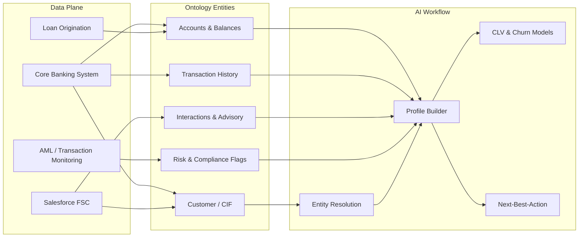

# Customer 360 & Relationship Intelligence

Unified customer profiles with household mapping, CLV prediction, churn detection, and next-best-action for banking.

**Priority:** P0 — Immediate ROI  
**Time to Value:** 4-6 weeks  
**Category:** Sales & Relationship Management

---

## Business Problem

Banks maintain customer data across multiple disconnected systems — Core Banking holds accounts and transactions, Salesforce FSC manages advisor interactions and pipeline, the Loan system tracks borrowing relationships, and AML flags risk events. This fragmentation creates:

- **No single view** — a relationship manager cannot see a customer's full portfolio (deposits + loans + cards + investments + advisory history) in one place
- **Household blindness** — linked family members, joint accounts, and corporate-individual relationships are not mapped, leading to fragmented servicing of high-value households
- **Silent attrition** — high-net-worth customers reduce balances and shift products to competitors over months without triggering any alert
- **Missed cross-sell** — a customer with a large savings balance but no investment relationship is never flagged despite high conversion propensity
- **Inconsistent servicing** — different channels (branch, digital, call center) operate on different data, creating contradictory customer experiences

---

## Capabilities

### Unified Customer Profile
Single golden record combining Core Banking (accounts, balances, transactions), Salesforce FSC (interactions, pipeline, advisor notes), Loan Origination (borrowing history, repayment behavior), and AML (risk flags, KYC status).

### Household & Relationship Mapping
Automatically discover and map household relationships (spouse, children, parents), corporate affiliations, and beneficial ownership structures. Calculate household-level AUM and total relationship value.

### Customer Lifetime Value (CLV) Prediction
ML model predicting 3-year forward revenue per customer based on product holding trajectory, balance trends, transaction patterns, and life-stage indicators.

### Churn Prediction & Early Warning
Detect early signals of customer attrition: declining balances, reduced transaction frequency, competitive product inquiries captured in Salesforce, and negative sentiment from service interactions.

### Next-Best-Action Engine
Context-aware recommendations for each customer interaction: product offers, service recovery actions, relationship deepening suggestions, and compliance requirements (KYC renewal, document collection).

---

## Data Sources & Ontology Mapping

| Ontology Entity | Source System | Key Fields |
|----------------|--------------|------------|
| Customer / CIF | CBS Customer Master + Salesforce Account | CIF Number, Name, DOB, Segment, KYC Status, Onboard Date |
| Accounts & Balances | CBS + Loan Origination | Account Type, Balance, Currency, Status, Interest Rate, Maturity |
| Transaction History | CBS Ledger | Date, Amount, Type (credit/debit), Channel, Counterparty, Category |
| Interactions & Advisory | Salesforce FSC Activities | Interaction Date, Channel, Type, Advisor, Notes, Outcome, Pipeline |
| Risk & Compliance Flags | AML System + CBS | KYC Status, Risk Rating, AML Alerts, PEP Flag, Sanction Match |

---

## AI Workflow

1. **Entity Resolution** — Match customer identity across CBS CIF, Salesforce Account, LOS Borrower, and AML subject into a single golden record using probabilistic matching (name, DOB, ID documents, phone, address)
2. **Household Discovery** — Graph-based analysis of joint accounts, shared addresses, common beneficiaries, and Salesforce relationship groups to build household structures
3. **Profile Assembly** — Aggregate all product holdings, balances, transaction patterns, interaction history, loan performance, and risk flags into a unified profile
4. **CLV Modeling** — Gradient-boosted model trained on historical customer revenue trajectories; features include product depth, balance trend, transaction intensity, tenure, and segment
5. **Churn Scoring** — Survival analysis model identifying customers with elevated exit probability in the next 90 days; key features are balance velocity, transaction frequency change, competitive signals, and complaint history
6. **Next-Best-Action** — Contextual recommendation engine combining CLV, product holding gaps, life-stage triggers, and compliance requirements to suggest the optimal action per customer per interaction
7. **Output** — Customer 360 dashboard for relationship managers; churn alerts pushed to Salesforce; NBA recommendations surfaced in branch/call center systems

---

## Dashboard & Alerts

### Key Metrics

| KPI | Description | Target |
|-----|-------------|--------|
| **Total Relationship Value (TRV)** | Sum of all product balances + off-balance-sheet AUM per customer | Monitor; grow top 20% |
| **Product Penetration** | Average number of active product categories per customer | > 3.5 products |
| **Churn Rate (HNW)** | Annual attrition rate for high-net-worth segment | < 5% |
| **CLV Accuracy** | Predicted vs. actual 12-month revenue correlation | R² > 0.75 |
| **NBA Conversion Rate** | % of next-best-action recommendations that result in product sale | > 18% |
| **Household Coverage** | % of customers linked to a household/relationship group | > 80% |

### Alert Rules

| Alert | Trigger | Severity | Action |
|-------|---------|----------|--------|
| HNW churn risk | Customer with TRV > $500K has churn probability > 0.65 | Critical | Assign senior RM; trigger retention campaign within 48 hours |
| Balance erosion | Customer balance declines >25% in 60-day window | High | Notify RM; schedule outreach call |
| KYC expiry | Customer KYC documents expire within 30 days | High | Push re-KYC task to Salesforce; block high-risk transactions |
| Cross-sell opportunity | High-CLV customer holding deposits but no investment products | Medium | Surface recommendation in next interaction; push to Salesforce |
| Household event | New account detected in existing household (child turning 18, new spouse) | Info | Trigger household review; suggest family banking package |

---

## ROI Model

| Metric | Before | After | Impact |
|--------|--------|-------|--------|
| HNW customer churn | 8% / year | 5% / year | **37% reduction → $12M AUM retained** (per $400M HNW book) |
| Product penetration | 2.8 products/customer | 3.6 products/customer | **29% increase → $3.2M additional fee income** |
| NBA conversion rate | 8% | 18% | **125% improvement in campaign effectiveness** |
| RM productivity | 45 min per customer prep | 10 min per customer prep | **78% time savings → more client-facing time** |
| Household identification | 35% mapped | 82% mapped | **Unlocked household-level pricing and servicing** |

!!! success "Estimated Annual ROI"
    **$8M - $18M** annually from retained AUM, increased product penetration, and RM productivity — across a mid-size bank with $5B in customer assets under management.

---

## Implementation Notes

- Customer entity resolution across CBS and Salesforce FSC is the critical foundation; expect 85-92% auto-match rates with manual review for remaining ambiguous records
- Household discovery requires joint account data and shared address/phone analysis; accuracy improves with Salesforce relationship group data
- CLV model needs minimum 24 months of product and balance history for training
- Next-best-action engine should integrate with the bank's existing campaign management platform to avoid duplicate outreach
- AML risk flags must be surfaced in the profile but access-controlled to authorized users only

---

[← Back to Catalogue](index.md) | [Next: Credit Risk →](credit-risk.md)
