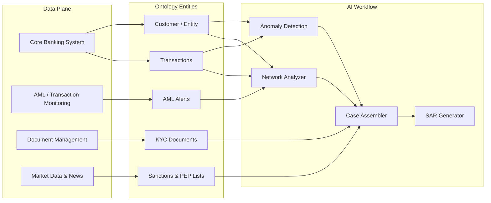

# Fraud Detection & AML Intelligence

Real-time transaction anomaly detection, network analysis, and automated suspicious activity reporting.

**Priority:** P1 — High Value  
**Time to Value:** 6-8 weeks  
**Category:** Financial Crime & Compliance

---

## Business Problem

Banks face an escalating volume and sophistication of financial crime — from card fraud and account takeover to complex money laundering networks. Existing rule-based AML systems generate massive alert volumes with low true-positive rates:

- **Alert fatigue** — AML teams process thousands of alerts monthly, 95%+ of which are false positives, draining investigator capacity
- **Rule rigidity** — static rules catch known patterns but miss novel fraud typologies and evolving laundering techniques
- **Siloed detection** — card fraud, digital fraud, and AML operate as separate systems with no correlation across crime types
- **Slow investigations** — investigators manually assemble evidence from multiple systems, taking 4-8 hours per case
- **SAR quality gaps** — Suspicious Activity Reports are manually drafted with inconsistent quality and narrative depth
- **Network blindness** — money laundering rings involve interconnected entities that rule-based systems evaluate in isolation

---

## Capabilities

### Real-Time Transaction Anomaly Detection
ML-based scoring of every transaction against the customer's behavioral baseline — flagging statistical outliers in amount, frequency, geography, counterparty, and channel combinations.

### Network Analysis
Graph-based detection of money laundering networks: identify clusters of related accounts, circular fund flows, rapid layering patterns, and hidden beneficial ownership structures.

### False Positive Reduction
AI model trained on historical alert dispositions to auto-suppress low-risk alerts and prioritize genuine suspicious activity, reducing investigator workload by 40-60%.

### Automated Case Assembly
When an alert fires, automatically compile a comprehensive case package: customer profile, transaction timeline, linked entities, KYC documents, prior alerts/SARs, and risk indicators — reducing investigation prep from hours to minutes.

### SAR Auto-Generation
LLM-powered drafting of Suspicious Activity Report narratives based on the assembled case evidence, with investigator review and approval workflow.

---

## Data Sources & Ontology Mapping

| Ontology Entity | Source System | Key Fields |
|----------------|--------------|------------|
| Customer / Entity | CBS + AML System | CIF, Name, Type (Individual/Corporate), Risk Rating, Country, PEP Status |
| Transactions | Core Banking System | Txn ID, Date, Amount, Currency, Type, Channel, Originator, Beneficiary |
| AML Alerts | Transaction Monitoring (NICE Actimize/SAS) | Alert ID, Rule, Score, Status, Assigned Analyst, Disposition, Date |
| KYC Documents | Document Management (SharePoint/Box) | Document Type, Customer, Verification Status, Expiry, Source |
| Sanctions & PEP Lists | Market Data + Regulatory Feeds | List Source, Entity Name, Match Score, List Date, Jurisdiction |

---

## AI Workflow

1. **Behavioral Baseline** — Build per-customer transaction profiles: typical amounts, frequency, counterparties, channels, and geographic patterns from CBS historical data
2. **Real-Time Scoring** — Score each incoming transaction against the behavioral baseline using an isolation forest + autoencoder ensemble; flag deviations beyond configured thresholds
3. **Network Construction** — Build a transaction graph connecting accounts via fund flows; apply community detection and cycle detection algorithms to identify suspicious clusters
4. **Alert Triage** — Apply a classification model trained on historical alert dispositions (true positive / false positive / escalated) to score and prioritize new alerts
5. **Case Assembly** — For prioritized alerts, automatically retrieve: customer 360 profile, 90-day transaction timeline, linked entities from network graph, KYC status, prior alerts/SARs, and sanctions matches
6. **SAR Drafting** — LLM generates a narrative SAR filing based on the case package, structured per regulatory requirements (FinCEN / local FIU format), with the investigator reviewing and approving
7. **Output** — Alert queue dashboard with AI-prioritized ranking; case packages for investigators; SAR drafts for review; network visualization for complex cases

---

## Dashboard & Alerts

### Key Metrics

| KPI | Description | Target |
|-----|-------------|--------|
| **True Positive Rate** | % of alerts that result in genuine suspicious activity finding | > 15% (up from 3-5%) |
| **False Positive Rate** | % of alerts dismissed as non-suspicious | < 85% (down from 95%+) |
| **Alert-to-SAR Ratio** | Number of SARs filed per 100 alerts | > 8 (up from 2-3) |
| **Average Investigation Time** | Hours from alert to disposition | < 2 hours (down from 6-8) |
| **SAR Filing Timeliness** | % of SARs filed within regulatory deadline | 100% |
| **Network Detection Rate** | % of laundering cases where network analysis identified additional linked entities | > 60% |

### Alert Rules

| Alert | Trigger | Severity | Action |
|-------|---------|----------|--------|
| High-risk anomaly | Transaction anomaly score > 95th percentile + high-risk customer | Critical | Immediate case assembly; assign senior investigator |
| Network cluster | New circular fund flow pattern detected across 3+ accounts | Critical | Freeze linked accounts pending review; escalate to AML head |
| Sanctions match | Customer or counterparty matches sanctions/PEP list with score > 85% | Critical | Block transaction; mandatory manual review within 4 hours |
| Unusual velocity | Customer transaction count exceeds 5x monthly average in 24 hours | High | Flag for review; temporary transaction limits |
| Dormant account activation | Account inactive >12 months suddenly receives large inbound transfer | Medium | Generate alert; include in next-day review queue |

---

## ROI Model

| Metric | Before | After | Impact |
|--------|--------|-------|--------|
| False positive alerts / month | 4,500 | 1,800 | **60% reduction → 2,700 fewer investigations** |
| Investigation time per case | 6 hours | 1.5 hours | **75% reduction → $2.4M labor savings** (at 15 investigators) |
| SAR preparation time | 4 hours per SAR | 45 minutes per SAR | **81% reduction** |
| Regulatory fines (AML deficiencies) | $5M exposure / year | $500K exposure / year | **90% risk reduction** |
| Undetected fraud losses | $8M / year | $4.5M / year | **$3.5M loss reduction** |

!!! success "Estimated Annual ROI"
    **$6M - $12M** annually from reduced investigation costs, lower fraud losses, avoided regulatory fines, and improved detection rates — across a mid-size bank processing 5M+ transactions monthly.

---

## Implementation Notes

- Real-time transaction scoring requires low-latency access to CBS transaction feeds (sub-second for card transactions, near-real-time for wire/ACH)
- Network analysis is computationally intensive; graph database (Neo4j or Amazon Neptune) recommended for relationship queries
- SAR auto-generation requires LLM fine-tuning on historical SAR narratives; the bank's compliance team must approve the template and review workflow
- Model training on historical alert dispositions requires clean labeled data — expect a 3-4 month disposition history cleanup effort
- Sanctions list integration requires daily updates from OFAC, EU, UN, and local regulatory lists

---

[← Back to Catalogue](index.md) | [Previous: Credit Risk](credit-risk.md) | [Next: Regulatory Compliance →](regulatory-compliance.md)
