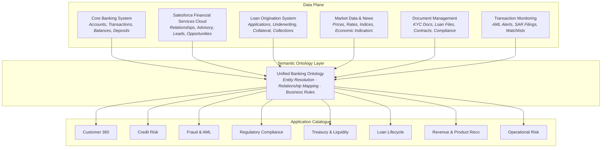
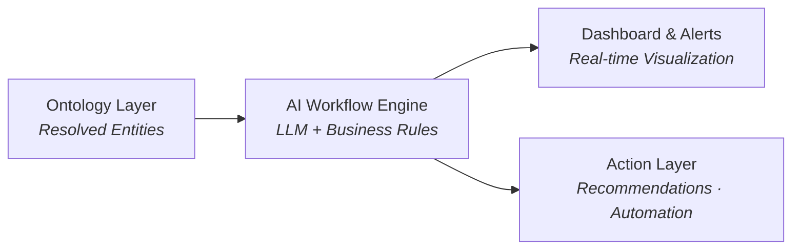

# Finance & Banking Application Catalogue

Enterprise AI applications for banking and financial services operations, powered by the Semantic Ontology Layer.

---

## Data Plane Overview

The application catalogue draws from a unified data plane spanning core banking systems, CRM, lending platforms, and semi-structured financial data sources.

---

## Application Portfolio

### P0 — Immediate ROI

- **[Customer 360 & Relationship Intelligence](customer-360.md)** — sources: CBS, Salesforce FSC, LOS, AML. Increase cross-sell 15–25%, reduce churn 20–30%. Time to value 4–6 weeks.
- **[Credit Risk & Early Warning System](credit-risk.md)** — sources: LOS, CBS, Market Data, Documents. Reduce NPAs 20–35%, improve ECL accuracy 40%. Time to value 4–6 weeks.

### P1 — High Value

- **[Fraud Detection & AML Intelligence](fraud-detection.md)** — sources: CBS, AML System, Documents, Market Data. Reduce false positives 40–60%, cut investigation time 50%. Time to value 6–8 weeks.
- **[Regulatory Compliance & Reporting Automation](regulatory-compliance.md)** — sources: CBS, LOS, Documents, Market Data. 70% reduction in reporting effort, zero regulatory penalties. Time to value 6–8 weeks.

### P2 — Strategic Value

- **[Treasury & Liquidity Optimization](treasury-liquidity.md)** — sources: CBS, Market Data, Salesforce FSC. Optimize liquidity buffer 10–15%, improve NIM 5–10 bps. Time to value 8–10 weeks.
- **[Loan Lifecycle Intelligence](loan-lifecycle.md)** — sources: LOS, CBS, Documents, Market Data. Reduce origination TAT 40%, improve recovery rate 15–20%. Time to value 8–10 weeks.

### P3 — Operational Excellence

- **[Revenue & Product Recommendation Engine](revenue-optimization.md)** — sources: CBS, Salesforce FSC, Market Data. Increase fee income 8–12%, improve product penetration 20%. Time to value 10–12 weeks.
- **[Operational Risk & Process Mining](operational-risk.md)** — sources: All Systems, Documents, AML. Reduce operational losses 25–30%, improve audit readiness 60%. Time to value 10–12 weeks.

---

## Ontology Entity Map

Key business entities resolved across systems by the Semantic Ontology Layer:

| Business Entity | Core Banking System | Salesforce FSC | Loan Origination System |
|---|---|---|---|
| **Customer** | CIF / Customer Master | Account / Contact / Household | Borrower / Co-Borrower |
| **Account** | Deposit / Current / FD / Savings | Financial Account | Loan Account |
| **Transaction** | Ledger Entry / Statement Line | — | Repayment / Disbursement |
| **Product** | Product Catalog / Scheme | Opportunity Product | Loan Product / Scheme |
| **Instrument** | Security / Investment Holding | — | Collateral / Guarantee |
| **Relationship** | Joint Holder / Nominee / PoA | Relationship Group | Guarantor / Co-Applicant |

---

## Architecture Pattern

Every application in this catalogue follows the same execution pattern:

- **Data Ingestion** — Ontology layer resolves entities across Core Banking, Salesforce FSC, Loan Origination, and semi-structured sources.
- **AI Workflow Execution** — LLM-powered pipelines apply business logic, anomaly detection, risk models, and predictive analytics.
- **Presentation** — Dashboards surface KPIs; alerts trigger on threshold breaches and regulatory limits.
- **Action** — Recommendations feed back into source systems or trigger automated workflows (credit decisions, compliance filings, customer outreach).

---

[← Back to Home](../../index.md)
