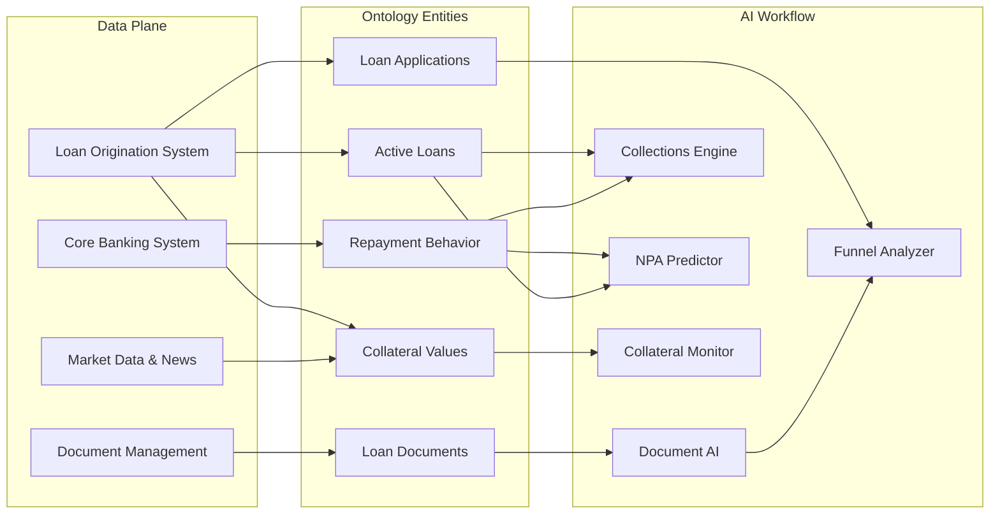

# Loan Lifecycle Intelligence

Origination funnel optimization, collections prioritization, NPA prediction, and collateral monitoring for the lending business.

**Priority:** P2 — Strategic Value  
**Time to Value:** 8-10 weeks  
**Category:** Lending & Collections

---

## Business Problem

The lending lifecycle — from application to disbursement to repayment to recovery — spans multiple systems and teams. Inefficiencies at each stage compound into significant revenue loss and risk exposure:

- **Slow origination** — loan applications take 7-15 days from submission to disbursement due to manual document verification, underwriting bottlenecks, and approval chains
- **Application leakage** — 30-40% of qualified applicants abandon the process due to long turnaround times, losing the deal to competitors
- **Reactive collections** — delinquent accounts are contacted using static aging buckets rather than risk-based prioritization, wasting effort on accounts that would self-cure
- **NPA surprise** — loans transition to non-performing status without sufficient advance warning for proactive restructuring
- **Collateral blind spots** — property and asset collateral values are updated annually or on-event, not monitored continuously against market movements
- **Manual document processing** — loan files contain dozens of unstructured documents (income proofs, title deeds, financial statements) that require manual verification

---

## Capabilities

### Origination Funnel Analytics
End-to-end visibility into the loan application pipeline: conversion rates at each stage (application → credit check → underwriting → approval → disbursement), bottleneck identification, and TAT analysis.

### Intelligent Document Processing
AI extraction and verification of data from loan documents: income proofs, bank statements, title deeds, financial statements, and identity documents — reducing manual processing time by 70%.

### Collections Prioritization
ML-based scoring of delinquent accounts by recovery probability, amount at risk, and optimal contact strategy — ensuring the collections team focuses effort where it yields the highest recovery.

### NPA Prediction & Proactive Restructuring
Early identification of accounts likely to transition to NPA status within the next 90 days, enabling proactive restructuring offers before the account deteriorates beyond recovery.

### Collateral Value Monitoring
Continuous monitoring of collateral values (real estate, vehicles, securities, gold) against market indices, triggering re-valuation and LTV recalculation when movements exceed thresholds.

---

## Data Sources & Ontology Mapping

| Ontology Entity | Source System | Key Fields |
|----------------|--------------|------------|
| Loan Applications | Loan Origination System | Application ID, Applicant, Product, Amount, Stage, Submit Date, Decision |
| Active Loans | LOS + CBS | Loan ID, Product, Outstanding, EMI, Rate, Tenor, DPD, Bucket, Status |
| Repayment Behavior | Core Banking System | Due Date, Paid Date, Amount Due, Amount Paid, Payment Mode, Bounce Count |
| Loan Documents | Document Management (SharePoint/Box) | Doc Type, Applicant, Verification Status, Extracted Data, Upload Date |
| Collateral Values | LOS + Market Data | Collateral Type, Original Value, Current Market Value, LTV, Last Valuation Date |

---

## AI Workflow

1. **Funnel Instrumentation** — Track every loan application through each origination stage with timestamps; calculate stage-wise conversion rates and identify bottlenecks
2. **Document Processing** — LLM + OCR pipeline to extract structured data from loan documents: income figures, employer details, property addresses, financial ratios; validate against application data
3. **Credit Decision Support** — Feed extracted document data into credit scoring models alongside bureau data and CBS behavioral features; generate underwriting recommendation
4. **Collections Scoring** — For delinquent accounts (1+ DPD), run a propensity model predicting: probability of self-cure, probability of recovery with contact, optimal contact channel (call, SMS, email, field visit), and best time to contact
5. **NPA Early Warning** — Flag accounts with 60%+ probability of reaching 90 DPD within the next 90 days based on repayment trajectory, balance trends, and borrower behavioral signals
6. **Collateral Revaluation** — Monitor property indices, gold prices, security market values against loan collateral; trigger automatic revaluation when market movement exceeds ±10% since last valuation
7. **Output** — Origination pipeline dashboard for business heads; collections work queue for recovery team; NPA watchlist for credit team; collateral alerts for risk team

---

## Dashboard & Alerts

### Key Metrics

| KPI | Description | Target |
|-----|-------------|--------|
| **Origination TAT** | Average days from application to disbursement | < 5 days |
| **Application Conversion Rate** | % of applications reaching disbursement | > 65% |
| **Document Processing Time** | Average hours per loan file (all documents) | < 2 hours |
| **Collections Effectiveness** | % of 30+ DPD accounts resolved within 60 days | > 70% |
| **NPA Prediction Accuracy** | % of new NPAs that were flagged 90 days prior | > 75% |
| **LTV Monitoring Coverage** | % of collateralized loans with current market valuations | > 95% |

### Alert Rules

| Alert | Trigger | Severity | Action |
|-------|---------|----------|--------|
| NPA transition imminent | Account predicted to reach 90 DPD with probability > 0.7 | Critical | Assign to senior recovery officer; initiate restructuring dialogue |
| Origination bottleneck | Stage-wise TAT exceeds 2x benchmark for 3 consecutive days | High | Notify operations head; investigate capacity or system issues |
| LTV breach | Collateral market value decline pushes LTV above 85% | High | Trigger formal revaluation; assess additional security requirement |
| Document fraud indicator | Document AI confidence score < 60% on income proof or ID | High | Route to fraud verification team; hold application |
| Collections SLA miss | Delinquent account not contacted within 5 days of entering 30+ DPD | Medium | Escalate to collections supervisor; reassign account |

---

## ROI Model

| Metric | Before | After | Impact |
|--------|--------|-------|--------|
| Origination TAT | 12 days average | 5 days average | **58% faster → reduced application leakage** |
| Application abandonment | 35% drop-off | 18% drop-off | **49% reduction → $24M additional disbursements** (on $500M annual origination) |
| Document processing cost | $45 per loan file | $12 per loan file | **73% reduction → $660K savings** on 20K loans/year |
| Collections recovery rate | 52% of delinquent value | 68% of delinquent value | **31% improvement → $4.8M additional recovery** |
| NPA surprise rate | 40% of NPAs undetected 90 days prior | 15% undetected | **62% improvement → proactive restructuring** |

!!! success "Estimated Annual ROI"
    **$8M - $15M** annually from faster origination, reduced abandonment, lower processing costs, improved recovery, and proactive NPA management — across a mid-size bank with $2B loan book and $500M annual origination.

---

## Implementation Notes

- Document AI pipeline requires training samples of each document type (income proofs, bank statements, title deeds) specific to the bank's market and language
- Collections scoring model needs minimum 12 months of delinquency resolution data with contact history and outcome labels
- NPA prediction shares behavioral features with the Credit Risk app; deploy together for consistency and avoid duplicate feature engineering
- Collateral market value monitoring requires integration with property index providers, gold price feeds, and security market data
- Origination funnel analytics require timestamp instrumentation at each stage in the LOS; may need LOS configuration changes

---

[← Back to Catalogue](index.md) | [Previous: Treasury & Liquidity](treasury-liquidity.md) | [Next: Revenue Optimization →](revenue-optimization.md)
