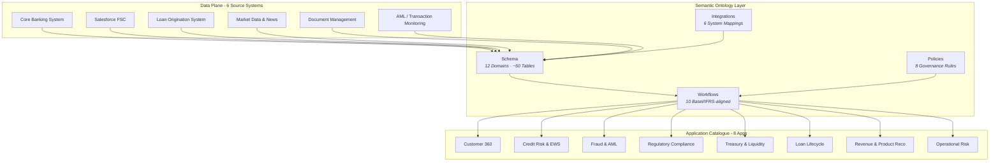

# Finance & Banking Semantic Ontology Layer

The Semantic Ontology Layer sits between the Data Plane and the Application Catalogue, providing a unified, standards-aligned knowledge graph that resolves entities across Core Banking System (CBS), Salesforce Financial Services Cloud (FSC), Loan Origination System (LOS), Market Data feeds, Document Management, and AML/Transaction Monitoring systems.

---

## Industry Standards Alignment

The finance & banking ontology is aligned to global regulatory and industry standards.

### Basel III/IV Framework

The Basel Committee on Banking Supervision framework governs capital adequacy, risk management, and liquidity. Every domain, workflow, and policy in this ontology is tagged with its Basel pillar:

| Basel Pillar | Scope | Ontology Coverage |
|-------------|-------|-------------------|
| **Pillar 1 — Minimum Capital** | Credit risk, market risk, operational risk RWA | Credit Risk app, Regulatory Compliance app, Operational Risk app |
| **Pillar 2 — Supervisory Review** | ICAAP, stress testing, concentration risk | Credit Risk app, Treasury app, Operational Risk app |
| **Pillar 3 — Market Discipline** | Public disclosure, risk reporting | Regulatory Compliance app |
| **Liquidity (LCR/NSFR)** | Short-term and structural liquidity | Treasury & Liquidity app |

### IFRS 9 Financial Instruments

Expected Credit Loss (ECL) provisioning entities carry IFRS 9-aligned classifications:

| IFRS 9 Concept | Purpose | Ontology Entity |
|---------------|---------|-----------------|
| **Stage Classification** | Impairment staging (1/2/3) | `ECL_Staging.Stage` |
| **PD (Probability of Default)** | Forward-looking default probability | `Credit_Score.PD_12M`, `Credit_Score.PD_Lifetime` |
| **LGD (Loss Given Default)** | Recovery rate estimation | `Collateral.Recovery_Rate`, `ECL_Staging.LGD` |
| **EAD (Exposure at Default)** | Exposure estimation | `Loan_Account.Outstanding`, `ECL_Staging.EAD` |
| **SICR (Significant Increase in Credit Risk)** | Stage migration trigger | `ECL_Staging.SICR_Flag` |

### FATF / AML Standards

Financial crime entities are aligned to FATF recommendations and FinCEN requirements:

| FATF Standard | Purpose | Ontology Entity |
|--------------|---------|-----------------|
| **Customer Due Diligence (CDD)** | KYC verification and risk rating | `KYC_Document`, `Customer_Master.Risk_Rating` |
| **Suspicious Activity Reporting** | SAR/STR filing | `SAR_Filing` |
| **Transaction Monitoring** | Anomaly detection | `AML_Alert`, `Transaction_Pattern` |
| **Sanctions Screening** | Watchlist matching | `Watchlist_Match` |

---

## Architecture

---

## Ontology Components

The ontology consists of four interconnected layers, all stored in `enterprise-knowledge/`:

| Layer | Files | Format | Purpose |
|-------|-------|--------|---------|
| [Schema](schema-reference.md) | `finance-banking-schema.yaml` | YAML | 12 domains, ~50 tables with fields, types, risk levels, constraints, and relationships |
| [Workflows](workflows.md) | `workflows/*.yaml` (10 files) | YAML | Triggered process flows with steps, rules, SLAs, and dependencies |
| [Policies](policies.md) | `policies/*.md` (8 files) | Markdown | Business rules, thresholds, approval chains, and compliance constraints |
| [Integrations](integrations.md) | `integrations/*.yaml` (6 files) | YAML | Field-level sync mappings between source systems with conflict resolution |

### Relationship Types

Entities in the schema are connected via typed relationships that form a knowledge graph:

| Relationship | Meaning | Example |
|-------------|---------|---------|
| `triggers` | Entity event initiates a workflow | `Loan_Account` DPD change triggers `ECL Calculation` workflow |
| `syncs_to` | Entity data flows to another system | `Customer_Master` syncs_to `SF_Financial_Account` via integration |
| `constrained_by` | Entity operations governed by a policy | `Loan_Application` constrained_by `lending-policy` |
| `depends_on` | Entity requires a parent/related entity | `Repayment_Schedule` depends_on `Loan_Account` |
| `validates` | Entity validates another in a business process | `KYC_Document` validates `Customer_Master` for onboarding |

---

## Cross-Application Entity Heatmap

Shows how many of the 8 finance apps require each entity. Higher usage = more foundational.

| Entity | Count | Applications |
|--------|-------|-------------|
| `Customer_Master` | **8** | All apps |
| `Deposit_Account` | **5** | Customer 360, Credit Risk, Treasury, Revenue, Operational Risk |
| `Loan_Account` | **5** | Credit Risk, Loan Lifecycle, Regulatory Compliance, Customer 360, Revenue |
| `Transaction_Ledger` | **5** | Customer 360, Fraud/AML, Treasury, Revenue, Operational Risk |
| `Credit_Score` | **4** | Credit Risk, Loan Lifecycle, Customer 360, Revenue |
| `SF_Financial_Account` | **4** | Customer 360, Revenue, Loan Lifecycle, Treasury |
| `Collateral` | **3** | Credit Risk, Loan Lifecycle, Regulatory Compliance |
| `AML_Alert` | **3** | Fraud/AML, Customer 360, Regulatory Compliance |
| `Capital_Component` | **2** | Regulatory Compliance, Treasury |
| `Loss_Event` | **2** | Operational Risk, Regulatory Compliance |
| `Yield_Curve` | **2** | Treasury, Revenue |

`Customer_Master` is the most connected entity in the finance ontology — equivalent to `Account` in CRM or `Material_Master` in Supply Chain.

---

## Schema Statistics

| Metric | Count |
|--------|-------|
| **Domains** | 12 |
| **Tables** | ~50 |
| **Source Systems** | 6 (CBS, Salesforce FSC, LOS, Market Data, DMS, AML) |
| **Workflows** | 10 |
| **Policies** | 8 |
| **Integrations** | 6 |
| **Relationship Types** | 5 (triggers, syncs_to, constrained_by, depends_on, validates) |
| **Basel Pillars Covered** | 3/3 + Liquidity |

---

## Documentation

| Document | Description |
|----------|-------------|
| [Schema Reference](schema-reference.md) | Complete domain and table reference with fields, types, and relationships |
| [Workflows](workflows.md) | All 10 AI workflow definitions with triggers, steps, and dependencies |
| [Policies](policies.md) | All 8 governance policies with rules, thresholds, and approval chains |
| [Integrations](integrations.md) | All 6 system integration mappings with field-level detail |
| [App-Object Mapping](app-object-mapping.md) | Minimum required objects per application with relationship matrix |
| [Mapping Architecture](mapping-architecture.md) | Schema-first architecture, Semantic RAG pipeline, and ReAct tools |

---

[← Back to Finance & Banking Catalogue](../index.md)
