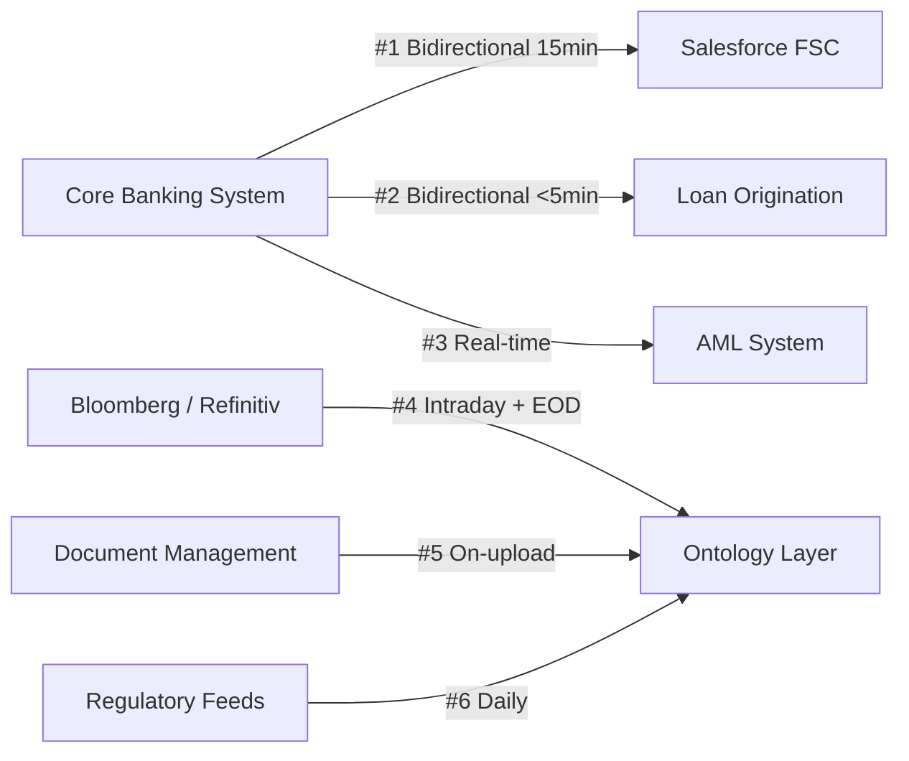
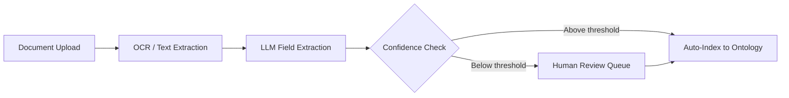
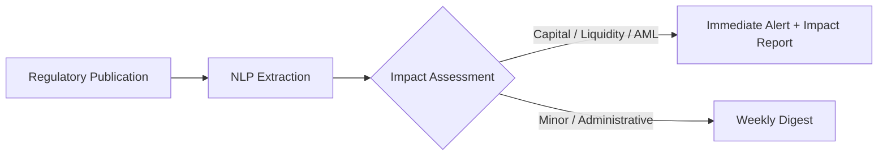

# Integrations

6 system integration mappings that connect the Data Plane source systems to the Semantic Ontology Layer. Each integration is defined in `enterprise-knowledge/integrations/` as a YAML file with field-level mappings, conflict resolution, and failure handling.

---

## Integration Summary

| # | Integration | Source | Target | Type | Frequency |
|---|------------|--------|--------|------|-----------|
| 1 | [CBS-Salesforce FSC Sync](#1-cbs-to-salesforce-fsc-sync) | CBS | Salesforce FSC | Bidirectional | 15-min interval |
| 2 | [CBS-LOS Sync](#2-cbs-to-los-sync) | CBS | Loan Origination System | Bidirectional | Near real-time (<5 min) |
| 3 | [CBS-AML System Sync](#3-cbs-to-aml-system-sync) | CBS | AML / Transaction Monitoring | Unidirectional | Real-time (transactions) |
| 4 | [Market Data Feed](#4-market-data-feed) | Bloomberg / Refinitiv | Ontology Layer | Unidirectional | Intraday + EOD |
| 5 | [Unstructured Document Extraction](#5-unstructured-document-extraction) | Document Management / File Uploads | Ontology Layer | Unidirectional | On-upload + daily scan |
| 6 | [Regulatory Feed](#6-regulatory-feed) | Regulatory Bodies / News | Ontology Layer | Unidirectional | Daily scan (critical immediate) |

---

## Integration Architecture

---

## 1. CBS to Salesforce FSC Sync

**ID:** `INTEGRATION_CBS_SFSC_V1_0` | **File:** `cbs-sfsc-sync.yaml`

CBS is source of truth for accounts, balances, and transactions. Salesforce FSC is source of truth for advisory interactions and pipeline.

### Customer Sync (Customer_Master -> SF_Account)

| CBS Field | Salesforce Field | Direction | Transformation / Constraint |
|----------|-----------------|-----------|---------------------------|
| Customer_Master.CIF_Number | SF_Account.CIF__c | CBS -> SF | — |
| Customer_Master.Name | SF_Account.Name | CBS -> SF | — |
| Customer_Master.Segment | SF_Account.Segment__c | CBS -> SF | — |
| Customer_Master.KYC_Status | SF_Account.KYC_Status__c | CBS -> SF | — |
| Customer_Master.Risk_Rating | SF_Account.Risk_Rating__c | CBS -> SF | Visible to authorized users only |
| SF_Account.Relationship_Manager | Customer_Master.RM_ID | SF -> CBS | — |

### Account Sync (Deposit_Account / Loan_Account -> SF_Financial_Account)

| CBS Field | Salesforce Field | Direction | Notes |
|----------|-----------------|-----------|-------|
| Account.Account_ID | SF_Financial_Account.External_ID__c | CBS -> SF | — |
| Account.Type | SF_Financial_Account.Product_Type__c | CBS -> SF | — |
| Account.Balance | SF_Financial_Account.Balance__c | CBS -> SF | Read-only in Salesforce |
| Account.Status | SF_Financial_Account.Status__c | CBS -> SF | — |
| Loan_Account.DPD | SF_Financial_Account.DPD__c | CBS -> SF | Visible to RM for retention context |

**Conflict Resolution:** CBS wins for account/balance/transaction data; Salesforce wins for advisory/interaction data

**Failure Handling:** 3 retries at 5-min intervals; dead letter queue; alert banking-integration-alerts@company.com

---

## 2. CBS to LOS Sync

**ID:** `INTEGRATION_CBS_LOS_V1_0` | **File:** `cbs-los-sync.yaml`

CBS provides customer profile and existing product data to LOS for underwriting. LOS pushes loan account creation back to CBS on disbursement.

### Customer Sync (CBS -> LOS)

| CBS Field | LOS Field | Direction | Notes |
|----------|----------|-----------|-------|
| Customer_Master.CIF_Number | Borrower.CIF_Number | CBS -> LOS | For pre-fill in application |
| Deposit_Account.Balance | Borrower.Deposit_Balance | CBS -> LOS | For debt-to-income and behavioral scoring |
| Transaction_Ledger (aggregated) | Borrower.Salary_Credit_Avg | CBS -> LOS | Average monthly salary credit |
| Credit_Score.Composite_Score | Borrower.Internal_Score | CBS -> LOS | For credit decision |

### Loan Account Sync (LOS -> CBS)

| LOS Field | CBS Field | Direction | Notes |
|----------|----------|-----------|-------|
| Loan_Application.Decision = Approved | Loan_Account (new) | LOS -> CBS | Create Loan_Account on disbursement |
| Loan_Account.Repayment_Schedule | Repayment_Schedule (new) | LOS -> CBS | Installment plan |
| Collateral (all fields) | Collateral (new) | LOS -> CBS | Collateral records linked to Loan_Account |

**Conflict Resolution:** CBS wins for existing customer data; LOS wins for loan origination decisions

**Frequency:** CBS→LOS: near real-time (<5 min); LOS→CBS: on event (approval, disbursement, status change)

---

## 3. CBS to AML System Sync

**ID:** `INTEGRATION_CBS_AML_V1_0` | **File:** `cbs-aml-sync.yaml`

CBS pushes real-time transaction feeds and customer data to the AML/Transaction Monitoring system.

### Transaction Feed (CBS -> AML)

| CBS Field | AML Field | Notes |
|----------|----------|-------|
| Transaction_Ledger.* | AML_Transaction_Feed.* | Full transaction record for real-time scoring |
| Card_Transaction.* | AML_Card_Feed.* | Card transactions for fraud detection |
| Customer_Master.Risk_Rating | AML_Customer.Risk_Rating | For risk-based monitoring thresholds |
| Customer_Master.PEP_Flag | AML_Customer.PEP_Flag | Enhanced monitoring trigger |

### Alert Feedback (AML -> CBS)

| AML Field | CBS Field | Notes |
|----------|----------|-------|
| AML_Alert.Status | Customer_Master.AML_Flag__c | Flagged if active True Positive alert |
| Watchlist_Match.Status | Customer_Master.Sanctions_Flag__c | Flagged if confirmed match |

**Conflict Resolution:** CBS wins for customer/transaction data; AML system wins for alert/investigation data

**Frequency:** CBS→AML: real-time (every transaction); AML→CBS: on alert disposition change

---

## 4. Market Data Feed

**ID:** `INTEGRATION_MARKET_DATA_V1_0` | **File:** `market-data-feed.yaml`

Intraday and end-of-day market data from Bloomberg/Refinitiv for treasury, credit risk, and regulatory applications.

| Feed | Target Entity | Frequency | Special Rules |
|------|--------------|-----------|---------------|
| Yield curves (Govt, Swap, Corporate, OIS) | Yield_Curve | Intraday (every 30 min) + EOD snapshot | — |
| Macro indicators (GDP, CPI, Unemployment) | Macro_Indicator | Monthly/quarterly per indicator release | Immediate push on central bank rate decisions |
| Sector indices | Sector_Index | Daily close | Alert if Change_Pct_90D exceeds ±15% |
| Commodity prices (Gold, Oil) | Commodity_Price | Daily close | Used for collateral mark-to-market |
| Security prices and ratings | Investment_Holding (market value update) | Intraday for listed; daily for OTC | Rating downgrade: immediate push |

---

## 5. Unstructured Document Extraction

**ID:** `INTEGRATION_UNSTRUCTURED_EXTRACT_V1_0` | **File:** `unstructured-extraction-banking.yaml`

NLP and OCR+LLM pipeline for extracting structured data from banking documents.

| Pipeline | Source | Target Entity | Confidence Threshold |
|----------|--------|--------------|---------------------|
| KYC Document NLP | DMS (SharePoint/Box) | KYC_Document | >0.85: auto-verify; <0.85: manual review |
| Loan Document OCR + LLM | File Upload PDFs/scans | Loan_Document | >0.85: auto-populate; 0.7-0.85: flag; <0.7: manual |
| Contract NLP | DMS PDFs | Contract_Document | >0.85: auto-index; <0.85: human review |
| Audit/Compliance Report NLP | DMS PDFs | Compliance_Report | >0.85: auto-index; <0.85: human review |

**Extraction Pipeline:**

---

## 6. Regulatory Feed

**ID:** `INTEGRATION_REGULATORY_FEED_V1_0` | **File:** `regulatory-feed.yaml`

Daily scan of regulatory publications with LLM-based change intelligence.

| Feed | Target Entity | Frequency | Special Rules |
|------|--------------|-----------|---------------|
| Basel Committee publications | Regulatory_Circular | Daily scan | Capital/liquidity impact: immediate alert |
| Central bank circulars | Regulatory_Circular | Daily scan | New requirements: immediate alert |
| IASB amendments (IFRS) | Regulatory_Circular | Daily scan | Provisioning impact: immediate alert |
| FATF updates | Regulatory_Circular | Weekly scan | AML requirement changes: immediate alert |
| Sanctions list updates (OFAC, EU, UN) | Watchlist_Match (re-screening) | Daily | New additions trigger immediate full re-screening |

**Regulatory Change Pipeline:**

---

## Failure Handling (All Integrations)

All integrations share a common failure handling pattern:

| Setting | Value |
|---------|-------|
| Retry count | 3 |
| Retry interval | 5 minutes |
| Dead letter queue | Enabled |
| Alert on failure | Integration-specific alert email |
| Fallback | Source system value is authoritative; manual update required in target |

---

[← Back to Ontology Overview](index.md)
