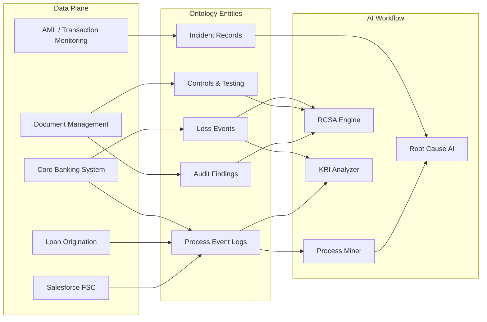

# Operational Risk & Process Mining

Loss event tracking, RCSA automation, key risk indicator monitoring, and process bottleneck identification.

**Priority:** P3 — Operational Excellence  
**Time to Value:** 10-12 weeks  
**Category:** Risk & Operations

---

## Business Problem

Operational risk in banking encompasses losses from failed processes, people errors, system failures, and external events. Basel III requires banks to measure and hold capital against operational risk, yet most banks manage it reactively:

- **Incomplete loss data** — operational loss events are underreported or inconsistently categorized, weakening risk models and capital calculations
- **Static RCSA** — Risk and Control Self-Assessments are conducted annually via spreadsheets, producing stale snapshots that don't reflect current risk exposures
- **Process inefficiency** — manual processes in operations (account opening, loan processing, trade settlement) contain hidden bottlenecks and rework loops that nobody can quantify
- **Disconnected KRIs** — Key Risk Indicators are tracked in isolation without correlation to actual loss events, making them unreliable predictors
- **Audit burden** — internal audit teams spend weeks collecting evidence for assessments that could be continuously monitored
- **Incident response gaps** — operational incidents (system outages, processing errors, cyber events) lack consistent tracking and root cause analysis

---

## Capabilities

### Loss Event Management
Structured capture, categorization, and analysis of operational loss events per Basel event types (internal fraud, external fraud, employment practices, clients/products, damage to physical assets, business disruption, execution/delivery/process management).

### RCSA Automation
AI-assisted Risk and Control Self-Assessment: automatically pre-populate risk registers from loss event data, control testing results, and audit findings. Continuous rather than annual assessment cycle.

### Process Mining
Automated discovery and analysis of actual process flows from system event logs (CBS, LOS, Salesforce). Identify bottlenecks, rework loops, compliance deviations, and process variants that differ from the designed process.

### Key Risk Indicator (KRI) Intelligence
AI-driven KRI framework that automatically correlates leading indicators with historical loss events to identify which KRIs are genuinely predictive and set dynamic thresholds.

### Incident Tracking & Root Cause Analysis
Centralized incident management with AI-assisted root cause categorization, impact assessment, and remediation tracking. Correlate incidents across systems to identify systemic issues.

---

## Data Sources & Ontology Mapping

| Ontology Entity | Source System | Key Fields |
|----------------|--------------|------------|
| Process Event Logs | CBS + LOS + Salesforce | Case ID, Activity, Timestamp, User, System, Status, Duration |
| Loss Events | Core Banking + Manual Entry | Event ID, Basel Category, Amount, Date, Business Unit, Root Cause |
| Controls & Testing | Document Management | Control ID, Risk, Test Result, Frequency, Owner, Last Test Date |
| Incident Records | AML System + IT Systems | Incident ID, Category, Impact, Duration, Affected Systems, Resolution |
| Audit Findings | Document Management | Finding ID, Severity, Area, Recommendation, Status, Due Date |

---

## AI Workflow

1. **Event Log Collection** — Extract process event logs from CBS (account operations, payments, trade settlement), LOS (loan processing stages), and Salesforce (service request lifecycle)
2. **Process Discovery** — Apply process mining algorithms (Alpha Miner, Heuristic Miner) to reconstruct actual process flows from event logs; compare against designed process models
3. **Bottleneck Detection** — Identify stages with excessive wait times, high rework rates, or frequent manual interventions; quantify throughput impact and cost
4. **Loss Event Enrichment** — Categorize loss events per Basel taxonomy using NLP on event descriptions; link to affected processes, controls, and business units
5. **RCSA Pre-Population** — Automatically generate risk register entries from loss events, control test failures, and audit findings; assess residual risk scores
6. **KRI Correlation** — Statistical analysis to identify which operational metrics (error rates, processing volumes, staff turnover, system availability) correlate with actual loss events; set dynamic alert thresholds
7. **Incident RCA** — AI-assisted root cause categorization of operational incidents; pattern detection across incidents to identify systemic issues
8. **Output** — Process mining dashboards for COO; RCSA registers for risk management; KRI dashboards for risk committee; incident tracking for operations

---

## Dashboard & Alerts

### Key Metrics

| KPI | Description | Target |
|-----|-------------|--------|
| **Operational Loss Ratio** | Total operational losses / Gross revenue | < 0.5% |
| **Control Effectiveness** | % of controls rated "effective" in latest testing | > 90% |
| **Process Conformance** | % of process instances following the designed happy path | > 85% |
| **Mean Time to Resolve (MTTR)** | Average hours from incident detection to resolution | < 4 hours |
| **KRI Breach Rate** | % of KRIs exceeding threshold in any given month | < 10% |
| **Open Audit Findings** | Number of audit findings past remediation due date | 0 critical, < 5 high |

### Alert Rules

| Alert | Trigger | Severity | Action |
|-------|---------|----------|--------|
| Material loss event | Single operational loss > $500K | Critical | Notify CRO and board risk committee; initiate formal RCA |
| Control failure | Key control fails testing or is overridden 3+ times in 30 days | High | Escalate to control owner and risk management; suspend process if critical |
| Process deviation spike | Process conformance drops below 75% for any critical process | High | Investigate root cause; assess if regulatory or policy breach |
| KRI threshold breach | Key Risk Indicator exceeds dynamic threshold for 2+ consecutive periods | Medium | Notify risk owner; assess if RCSA update needed |
| Audit finding overdue | High-severity audit finding past due date by >30 days | Medium | Escalate to business unit head and internal audit |

---

## ROI Model

| Metric | Before | After | Impact |
|--------|--------|-------|--------|
| Operational losses | $12M / year | $8.5M / year | **29% reduction → $3.5M savings** |
| Process rework rate | 15% of transactions require rework | 6% rework rate | **60% reduction → $1.8M efficiency gain** |
| RCSA assessment cycle | Annual (12-month lag) | Continuous (real-time updates) | **Risk visibility from annual to real-time** |
| Audit preparation effort | 3 weeks per audit cycle | 3 days per cycle | **85% time reduction** |
| Incident MTTR | 8 hours average | 3 hours average | **62% faster resolution** |
| OpRisk capital charge | $180M (Basic Indicator Approach) | $155M (with better loss data) | **$25M capital reduction** |

!!! success "Estimated Annual ROI"
    **$4M - $8M** annually from reduced operational losses, process efficiency gains, lower capital charges, and audit productivity — across a mid-size bank with $1B+ in annual revenue.

---

## Implementation Notes

- Process mining requires structured event logs with Case ID, Activity, and Timestamp at minimum; CBS and LOS may need log enrichment to meet this requirement
- Loss event data quality is typically poor at inception; expect a 6-month data quality improvement initiative before models reach full accuracy
- RCSA automation is most effective when the bank already has a defined risk taxonomy and control framework (COSO, Basel event types)
- KRI correlation analysis needs 2-3 years of historical KRI readings and loss events for meaningful statistical relationships
- Process mining may surface compliance deviations (segregation of duties breaches, unauthorized overrides) that require immediate escalation — define escalation protocols before going live

---

[← Back to Catalogue](index.md) | [Previous: Revenue Optimization](revenue-optimization.md)
