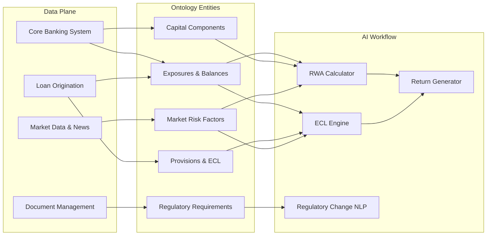

# Regulatory Compliance & Reporting Automation

Automated regulatory reporting, capital adequacy calculation, and compliance change management for banking.

**Priority:** P1 — High Value  
**Time to Value:** 6-8 weeks  
**Category:** Regulatory & Compliance

---

## Business Problem

Banks operate under dense regulatory frameworks — Basel III/IV capital requirements, IFRS 9 provisioning standards, local central bank reporting mandates, and evolving conduct regulations. Compliance is expensive and error-prone:

- **Manual report assembly** — regulatory returns require data aggregation from CBS, Loan systems, and treasury platforms, taking weeks per submission
- **Data reconciliation burden** — numbers across source systems rarely match on first pass; finance teams spend days reconciling before every filing
- **Regulatory change lag** — new circulars and amendments are published frequently; impact assessment is manual, slow, and inconsistent
- **Capital inefficiency** — conservative assumptions in risk-weighted asset (RWA) calculations tie up more capital than necessary
- **Audit trail gaps** — regulators increasingly demand end-to-end data lineage from source to reported number; manual processes cannot provide this
- **Penalty exposure** — late or inaccurate filings result in regulatory fines and reputational damage

---

## Capabilities

### Basel III/IV Capital Adequacy Automation
Automated calculation of Common Equity Tier 1 (CET1), Tier 1, and Total Capital ratios. Risk-weighted asset (RWA) computation across credit risk (Standardized/IRB), market risk (FRTB), and operational risk.

### IFRS 9 Provisioning Automation
End-to-end ECL provisioning pipeline: stage classification, PD/LGD/EAD model execution, forward-looking macro overlay, and provision number generation — integrated with the Credit Risk app's ECL engine.

### Regulatory Return Generation
Automated population of regulatory return templates (CCAR, DFAST, local central bank returns) with data sourced from the ontology layer, including validation rules and submission-ready output.

### Regulatory Change Intelligence
AI-powered monitoring of regulatory publications (central bank circulars, Basel Committee updates, IASB amendments). Automated impact assessment against the bank's current portfolio and systems.

### Data Lineage & Audit Trail
Complete traceability from reported numbers back to source system records, transformation logic, and model parameters — enabling regulator and auditor self-service.

---

## Data Sources & Ontology Mapping

| Ontology Entity | Source System | Key Fields |
|----------------|--------------|------------|
| Exposures & Balances | CBS + LOS | Account ID, Product, Outstanding, Limit, Risk Weight, Asset Class, Rating |
| Capital Components | Core Banking / GL | CET1, AT1, Tier 2, Deductions, Retained Earnings, Reserves |
| Provisions & ECL | Loan Origination + Credit Risk App | Stage, PD, LGD, EAD, ECL Amount, Macro Scenario, Model Version |
| Regulatory Requirements | Document Management (Circulars/Guidelines) | Regulation ID, Effective Date, Impacted Areas, Compliance Status |
| Market Risk Factors | Market Data (Bloomberg/Refinitiv) | Interest Rates, FX Rates, Equity Indices, Credit Spreads, Volatility |

---

## AI Workflow

1. **Data Aggregation** — Pull exposure data from CBS and LOS, capital positions from GL, market risk factors from Bloomberg/Refinitiv, and provision numbers from the Credit Risk app
2. **Reconciliation Engine** — Automated three-way reconciliation between CBS balances, LOS loan book, and GL positions; flag and route breaks for resolution
3. **RWA Computation** — Calculate risk-weighted assets per Basel III/IV rules: Standardized Approach for credit risk, FRTB for market risk, Basic Indicator/Standardized for operational risk
4. **Capital Ratio Calculation** — Compute CET1 ratio, Tier 1 ratio, and Total Capital ratio; compare against regulatory minimums and internal buffers
5. **IFRS 9 Integration** — Pull ECL numbers from the Credit Risk app; validate stage migration logic; generate provisioning impact on P&L and balance sheet
6. **Return Population** — Map calculated numbers to regulatory return templates; apply validation rules; generate submission-ready files
7. **Regulatory Change Scan** — LLM-based monitoring of regulatory publication feeds; extract key changes, affected regulations, and compliance deadlines; assess impact against current bank positions
8. **Output** — Regulatory dashboards for CFO/CRO; submission-ready returns for compliance; change impact reports for legal; full data lineage for auditors

---

## Dashboard & Alerts

### Key Metrics

| KPI | Description | Target |
|-----|-------------|--------|
| **CET1 Ratio** | Common Equity Tier 1 / RWA | > 11% (regulatory min + buffer) |
| **Total Capital Ratio** | Total Capital / RWA | > 14% |
| **Reporting Accuracy** | % of regulatory returns submitted without restatement | 100% |
| **Filing Timeliness** | % of returns filed before regulatory deadline | 100% |
| **Reconciliation Breaks** | Number of unresolved data breaks at filing time | 0 critical breaks |
| **Regulatory Change Response** | Days from circular publication to impact assessment completion | < 10 days |

### Alert Rules

| Alert | Trigger | Severity | Action |
|-------|---------|----------|--------|
| Capital breach risk | CET1 ratio projected to fall within 50 bps of regulatory minimum | Critical | Escalate to ALCO; initiate capital conservation actions |
| Filing deadline approaching | Regulatory return due in 5 business days with unresolved reconciliation breaks | Critical | Escalate to CFO; mobilize reconciliation task force |
| Reconciliation break | Material difference (>$1M) between CBS and GL for any asset class | High | Route to finance operations for same-day resolution |
| Regulatory change detected | New circular published affecting capital/provisioning requirements | High | Notify compliance and risk teams; initiate impact assessment |
| RWA spike | RWA increases >5% month-over-month without corresponding asset growth | Medium | Investigate driver; assess if rating migrations or model changes |

---

## ROI Model

| Metric | Before | After | Impact |
|--------|--------|-------|--------|
| Regulatory reporting effort | 12 FTEs, 3 weeks per quarterly filing | 4 FTEs, 4 days per quarterly filing | **67% headcount savings, 81% time savings** |
| Reconciliation effort | 5 days per filing cycle | 1 day (automated with exception routing) | **80% time reduction** |
| Regulatory fines (last 3 years) | $2.5M in penalties for late/inaccurate filings | $0 (target) | **$2.5M risk elimination** |
| Capital optimization | 50 bps excess capital held due to conservative RWA estimates | 20 bps excess | **$15M capital freed** (on $5B RWA) |
| Regulatory change response | 45 days average impact assessment | 8 days average | **82% faster compliance** |

!!! success "Estimated Annual ROI"
    **$5M - $12M** annually from labor savings, avoided penalties, capital optimization, and faster regulatory response — across a mid-size bank with $5B in risk-weighted assets.

---

## Implementation Notes

- Basel III/IV RWA calculation rules must be configured per the bank's regulatory jurisdiction; Standardized vs. IRB approach selection impacts data requirements
- IFRS 9 ECL pipeline shares models with the Credit Risk & Early Warning app; deploy together for consistency
- Regulatory return templates vary by jurisdiction; initial setup requires mapping to local central bank formats
- Data lineage implementation requires tagging every transformation step with metadata; this is a foundational capability that benefits all downstream reporting
- Regulatory change NLP monitoring requires feeds from relevant regulatory bodies (Basel Committee, local central bank, IASB, national legislation portals)

---

[← Back to Catalogue](index.md) | [Previous: Fraud Detection](fraud-detection.md) | [Next: Treasury & Liquidity →](treasury-liquidity.md)
