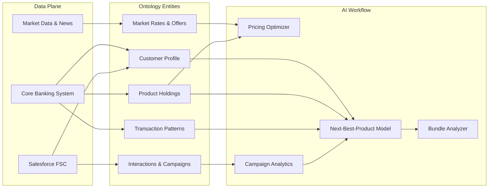

# Revenue & Product Recommendation Engine

Next-best-product recommendations, fee optimization, and product bundling analytics for retail and commercial banking.

**Priority:** P3 — Operational Excellence  
**Time to Value:** 10-12 weeks  
**Category:** Revenue & Product Strategy

---

## Business Problem

Banks have extensive product portfolios — deposits, loans, cards, insurance, investments, trade finance — but most customers hold only 1-2 products. Revenue growth through existing customers is significantly cheaper than new acquisition, yet banks struggle to cross-sell effectively:

- **Low product penetration** — average customer holds 1.8 products despite eligibility for 4-5, leaving substantial fee and interest income unrealized
- **Generic campaigns** — mass marketing campaigns with 2-3% conversion rates because offers are not personalized to individual customer context and needs
- **Fee income leakage** — pricing structures not optimized by segment; high-value customers receive unnecessary waivers while price-sensitive segments are overcharged
- **No competitive intelligence** — pricing decisions made without visibility into competitor rate offerings and market positioning
- **Bundle blindness** — products are sold individually rather than as value bundles (e.g., salary account + credit card + personal loan + insurance) that increase stickiness and lifetime value

---

## Capabilities

### Next-Best-Product Recommendation
AI model predicting the highest-propensity product for each customer based on their current holdings, transaction behavior, life-stage signals, peer cohort patterns, and channel preferences.

### Dynamic Pricing & Fee Optimization
Segment-level pricing optimization for interest rates, processing fees, annual charges, and service fees — balancing revenue maximization against customer retention and competitive positioning.

### Product Bundle Design
Data-driven identification of product combinations that maximize customer lifetime value and reduce churn. Design and test bundles for specific segments (salaried professionals, SME owners, retirees).

### Campaign Effectiveness Analytics
Measure and optimize marketing campaigns: A/B test different offers, channels, and messaging; attribute revenue to campaigns; and continuously improve targeting models based on outcomes.

### Competitive Rate Intelligence
Monitor competitor product rates and offers from market data and public sources. Alert product teams when competitive gaps emerge and recommend pricing adjustments.

---

## Data Sources & Ontology Mapping

| Ontology Entity | Source System | Key Fields |
|----------------|--------------|------------|
| Customer Profile | CBS + Salesforce FSC | CIF, Segment, Age, Income Band, Occupation, Tenure, KYC Status |
| Product Holdings | Core Banking System | Account Type, Product Name, Balance, Rate, Open Date, Status |
| Transaction Patterns | Core Banking System | Category (salary, rent, shopping, travel), Frequency, Average Amount, Channel |
| Interactions & Campaigns | Salesforce FSC | Campaign ID, Channel, Offer, Response, Conversion, Date, Advisor |
| Market Rates & Offers | Market Data + Competitive Intel | Competitor, Product, Rate, Fee, Promotion, Effective Date |

---

## AI Workflow

1. **Customer Feature Assembly** — Build a comprehensive feature set per customer: demographics, product holding vector, transaction category distribution, channel preference, tenure, and relationship depth
2. **Propensity Modeling** — Train multi-label classification models predicting purchase probability for each unowned product category; rank by expected revenue contribution
3. **Life-Stage Detection** — Identify life-stage triggers from transaction patterns: salary increase (income jump), marriage (joint account activity), home purchase (large debit + property search), retirement (pension credits)
4. **Pricing Simulation** — Model price-response curves per segment: how does conversion change at different fee/rate levels? Identify revenue-optimal pricing for each segment × product combination
5. **Bundle Optimization** — Association rule mining + CLV modeling to identify product combinations that maximize 3-year customer value; design bundles with pricing incentives for adoption
6. **Campaign Orchestration** — Feed recommendations into Salesforce FSC for advisor-led sales and digital campaign platforms for self-service channels; track conversion and attribution
7. **Output** — Product recommendation dashboard for branch and digital channels; pricing recommendations for product teams; bundle proposals for marketing; campaign performance for CMO

---

## Dashboard & Alerts

### Key Metrics

| KPI | Description | Target |
|-----|-------------|--------|
| **Product Penetration** | Average active product categories per customer | > 3.5 (up from 1.8) |
| **NBP Conversion Rate** | % of next-best-product offers that convert to sale | > 15% |
| **Fee Income per Customer** | Annual fee income per active customer | 12% year-over-year growth |
| **Campaign ROI** | Revenue attributed / Campaign cost | > 8x |
| **Bundle Adoption Rate** | % of new customers taking bundled vs. single product | > 40% |
| **Price Competitiveness Index** | Bank's rate positioning vs. top 5 competitors per product | Within 25 bps of market median |

### Alert Rules

| Alert | Trigger | Severity | Action |
|-------|---------|----------|--------|
| Competitive rate gap | Competitor launches deposit rate >50 bps above bank's rate for same tenor | High | Notify product team; model attrition risk and pricing response options |
| Campaign underperformance | Campaign conversion rate <50% of predicted target after 2 weeks | Medium | Pause campaign; analyze targeting model; adjust offer or audience |
| High-value opportunity | Customer with CLV >$50K identified with 3+ unowned high-propensity products | Medium | Push priority recommendation to assigned advisor in Salesforce |
| Fee waiver anomaly | Branch-level fee waivers exceed 2x average for segment | Medium | Flag for audit; review waiver authority and justification |
| Product attrition signal | Product category closure rate exceeds 5% monthly for any segment | Info | Investigate root cause; assess competitive positioning |

---

## ROI Model

| Metric | Before | After | Impact |
|--------|--------|-------|--------|
| Product penetration | 1.8 products/customer | 2.8 products/customer | **56% increase in product depth** |
| Cross-sell conversion | 3% campaign conversion | 15% AI-targeted conversion | **5x improvement** |
| Annual fee income | $42M | $47M | **$5M incremental fee revenue** |
| Customer attrition (multi-product) | 12% for single-product holders | 4% for 3+ product holders | **Stickiness multiplier from bundling** |
| Campaign waste | 40% of budget on low-propensity targets | 12% waste rate | **70% reduction in ineffective spend** |

!!! success "Estimated Annual ROI"
    **$5M - $10M** annually from incremental fee income, improved cross-sell conversion, reduced attrition, and campaign efficiency — across a mid-size retail bank with 500K+ customers.

---

## Implementation Notes

- Product propensity models require minimum 18 months of product acquisition and closure history with customer features at time of event
- Pricing optimization should be rolled out incrementally (one product at a time) to avoid unintended competitive responses
- Competitive rate monitoring requires either automated web scraping of public rate pages or subscription to a competitive intelligence provider
- Campaign attribution requires Salesforce FSC integration with proper UTM tracking for digital channels and advisor activity logging for branch channels
- Bundle design should involve product managers from each product line to validate commercial viability and risk appetite

---

[← Back to Catalogue](index.md) | [Previous: Loan Lifecycle](loan-lifecycle.md) | [Next: Operational Risk →](operational-risk.md)
