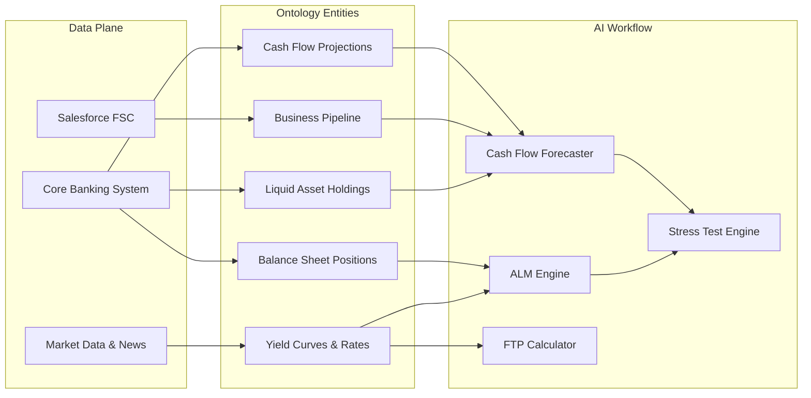

# Treasury & Liquidity Optimization

Cash flow forecasting, asset-liability management, and fund transfer pricing optimization for bank treasury.

**Priority:** P2 — Strategic Value  
**Time to Value:** 8-10 weeks  
**Category:** Treasury & Finance

---

## Business Problem

Bank treasury operations manage the balance sheet's interest rate risk, liquidity position, and internal pricing of funds across business units. The complexity of these interconnected functions creates:

- **Liquidity buffer inefficiency** — excess reserves held to meet regulatory ratios (LCR, NSFR) because forecast accuracy is poor, tying up funds that could earn higher returns
- **ALM duration gap risk** — asset and liability duration mismatches accumulate without real-time visibility, exposing the bank to interest rate movements
- **Opaque fund transfer pricing** — FTP rates are set periodically and don't reflect real-time market conditions, distorting business unit profitability measurement
- **Cash flow forecast errors** — large unexpected inflows/outflows (loan disbursements, deposit withdrawals, interbank settlements) cause reactive treasury actions at unfavorable rates
- **Manual stress scenarios** — ALCO relies on spreadsheet-based stress tests that take days to produce and cannot model complex multi-factor scenarios

---

## Capabilities

### Cash Flow Forecasting
AI-driven prediction of daily and weekly cash inflows and outflows across all product categories (deposits, lending, cards, trade finance, interbank) using historical patterns, seasonal factors, and pipeline data from Salesforce.

### Liquidity Coverage Ratio (LCR) Optimization
Real-time monitoring and optimization of the LCR position. Recommend the optimal composition of High-Quality Liquid Assets (HQLA) to meet regulatory minimums while maximizing yield.

### Asset-Liability Management (ALM)
Duration gap and repricing gap analysis across the full balance sheet. Model the impact of parallel and non-parallel yield curve shifts on Net Interest Income (NII) and Economic Value of Equity (EVE).

### Fund Transfer Pricing (FTP)
Dynamic FTP rate engine that prices internal funds based on real-time market yield curves, liquidity premiums, and tenor-matched rates — ensuring accurate business unit profitability measurement.

### Scenario Analysis & Stress Testing
Multi-factor scenario engine modeling the impact of rate movements, deposit run-off scenarios, credit line drawdowns, and market stress events on the bank's liquidity and profitability.

---

## Data Sources & Ontology Mapping

| Ontology Entity | Source System | Key Fields |
|----------------|--------------|------------|
| Balance Sheet Positions | Core Banking System | Account Type, Balance, Currency, Rate, Maturity, Repricing Date |
| Cash Flow Projections | CBS + Loan Origination | Contractual Flows, Behavioral Flows, Prepayment Assumptions |
| Yield Curves & Rates | Market Data (Bloomberg/Refinitiv) | Tenor, Rate, Currency, Curve Type (Govt, Swap, Corporate), Date |
| Business Pipeline | Salesforce FSC | Loan Pipeline, Deposit Maturities, Expected Inflows/Outflows |
| Liquid Asset Holdings | Core Banking / Treasury | Security Type, Face Value, Market Value, HQLA Level (1/2A/2B), Maturity |

---

## AI Workflow

1. **Position Snapshot** — Extract end-of-day balance sheet positions from CBS: all deposit, lending, investment, and interbank balances with maturity and repricing schedules
2. **Cash Flow Projection** — Combine contractual cash flows (fixed maturities) with behavioral models (deposit stickiness, prepayment rates, drawdown patterns) and Salesforce pipeline data
3. **Yield Curve Ingestion** — Pull real-time and end-of-day yield curves from Bloomberg/Refinitiv across relevant tenors and currencies
4. **LCR Calculation** — Compute LCR ratio: HQLA stock / Net cash outflows over 30-day stress scenario; recommend optimal HQLA composition
5. **ALM Analysis** — Calculate duration gap, repricing gap, NII sensitivity to rate shocks (±100/200/300 bps), and EVE impact under multiple yield curve scenarios
6. **FTP Rate Engine** — Compute tenor-matched FTP rates using the swap curve + liquidity premium + credit spread adjustment; publish rates for business unit P&L allocation
7. **Stress Scenarios** — Run multi-factor scenarios combining rate movements, deposit run-off, credit line drawdowns, and market stress; quantify liquidity and profitability impact
8. **Output** — Treasury dashboard for CFO/Treasurer; LCR/NSFR monitoring for compliance; FTP rates for business unit controllers; stress test results for ALCO

---

## Dashboard & Alerts

### Key Metrics

| KPI | Description | Target |
|-----|-------------|--------|
| **LCR (Liquidity Coverage Ratio)** | HQLA / 30-day net outflows | > 110% (regulatory min 100%) |
| **NSFR (Net Stable Funding Ratio)** | Available stable funding / Required stable funding | > 105% |
| **NII Sensitivity (±100 bps)** | Change in net interest income for 100 bps parallel rate shift | Within board-approved limits |
| **Duration Gap** | Asset duration — Liability duration | < 2.0 years |
| **Cash Forecast Accuracy** | Predicted vs. actual daily net cash position | ± 5% |
| **HQLA Yield** | Weighted average yield on HQLA portfolio | Maximize within LCR constraint |

### Alert Rules

| Alert | Trigger | Severity | Action |
|-------|---------|----------|--------|
| LCR breach risk | LCR projected to fall below 105% in next 5 business days | Critical | Notify treasurer; initiate HQLA acquisition or liability restructuring |
| Duration gap breach | Duration gap exceeds board limit | High | Escalate to ALCO; execute hedging transactions |
| Large unexpected outflow | Single-day net outflow exceeds 2σ above forecast | High | Investigate driver; assess LCR impact; notify treasury desk |
| Rate sensitivity warning | NII impact of ±200 bps exceeds 10% of trailing 12-month NII | Medium | Review hedging positions; present options to ALCO |
| FTP rate stale | FTP rates not updated for >2 business days | Medium | Investigate data feed; apply interim rates from last valid curve |

---

## ROI Model

| Metric | Before | After | Impact |
|--------|--------|-------|--------|
| Excess liquidity buffer | $180M above regulatory minimum | $120M above minimum | **$60M redeployed to higher-yield assets** |
| HQLA yield | 2.8% weighted average | 3.3% weighted average | **50 bps improvement → $900K on $180M HQLA** |
| NIM (Net Interest Margin) | 2.45% | 2.52% | **7 bps improvement → $3.5M on $5B balance sheet** |
| Cash forecast accuracy | ± 15% daily variance | ± 5% daily variance | **67% improvement → fewer emergency transactions** |
| Treasury team effort | 8 FTEs, 60% on manual analysis | 5 FTEs, 30% on manual analysis | **$1.2M labor savings** |

!!! success "Estimated Annual ROI"
    **$4M - $8M** annually from optimized liquidity deployment, improved NIM, HQLA yield enhancement, and treasury productivity — across a mid-size bank with a $5B balance sheet.

---

## Implementation Notes

- Requires end-of-day position and maturity data from CBS at the account level; aggregate positions are insufficient for accurate ALM
- Bloomberg/Refinitiv yield curve feed integration is essential; FTP accuracy depends entirely on timely and accurate rate inputs
- Behavioral models for deposit stickiness and loan prepayments need 3-5 years of historical flow data for calibration
- LCR/NSFR calculation logic must align with the bank's regulatory jurisdiction (Basel III definitions vary by country)
- FTP methodology (matched-maturity, pooled, or hybrid) should be agreed with finance and business unit heads before implementation

---

[← Back to Catalogue](index.md) | [Previous: Regulatory Compliance](regulatory-compliance.md) | [Next: Loan Lifecycle →](loan-lifecycle.md)
