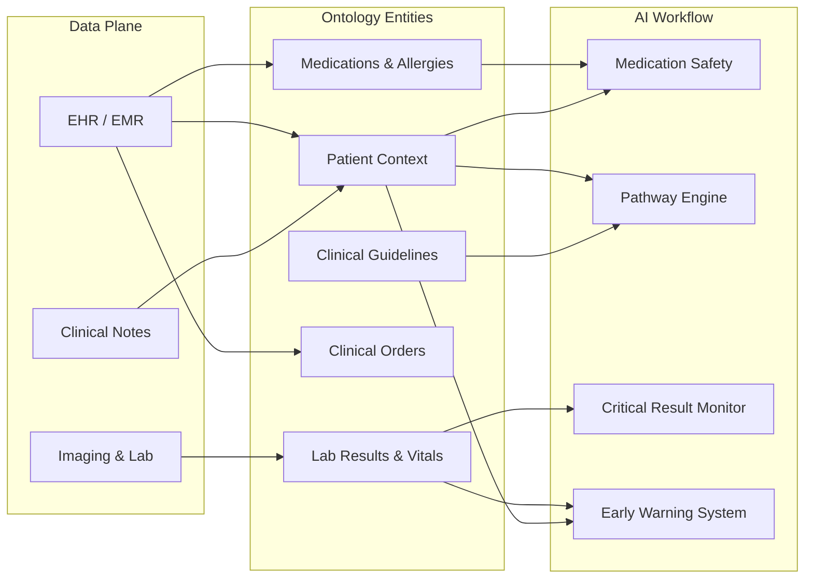

# Clinical Decision Support

Evidence-based treatment recommendations, drug interaction alerts, and clinical pathway adherence optimization.

**Priority:** P0 — Immediate ROI  
**Time to Value:** 4-6 weeks  
**Category:** Clinical Intelligence

---

## Business Problem

Clinicians face an explosion of medical knowledge — with 3,000+ clinical guidelines and 20,000+ drug interactions to navigate — while managing increasing patient volumes under time pressure:

- **Information overload** — physicians cannot keep up with the latest evidence-based guidelines across every condition they treat
- **Adverse drug events (ADEs)** — drug-drug interactions, dosing errors, and allergy contraindications cause 1.3M injuries annually in the US, many preventable with better decision support
- **Protocol variation** — clinicians treating the same condition follow different protocols, leading to inconsistent outcomes and increased cost
- **Alert fatigue** — existing EHR alerts fire too frequently (>90% overridden), burying critical alerts in noise
- **Diagnostic delay** — abnormal lab results and imaging findings sometimes go unacknowledged for days, delaying treatment for time-sensitive conditions
- **Unnecessary testing** — duplicate orders and low-value diagnostics add cost without clinical benefit

---

## Capabilities

### Intelligent Drug Interaction & Allergy Checking
Context-aware medication safety checks that go beyond basic drug-drug interaction lists — considering patient-specific factors (renal function, age, weight, comorbidities) to reduce alert fatigue while catching genuinely dangerous interactions.

### Evidence-Based Treatment Recommendations
AI-powered clinical pathway suggestions based on patient diagnosis, comorbidities, prior treatments, and current guidelines — surfaced within clinician workflow at the point of care.

### Critical Result Management
Automated detection and escalation of critical lab results, imaging findings, and clinical deterioration patterns (early warning scores) to ensure no abnormal result goes unacknowledged.

### Diagnostic Order Optimization
Identify duplicate orders, recommend bundled test panels, and flag low-value diagnostics based on clinical context — reducing unnecessary testing while ensuring diagnostic completeness.

### Sepsis & Deterioration Early Warning
Real-time monitoring of vital signs, lab trends, and nursing assessments to predict sepsis, respiratory failure, and other clinical deterioration events 4-12 hours before clinical manifestation.

---

## Data Sources & Ontology Mapping

| Ontology Entity | Source System | Key Fields |
|----------------|--------------|------------|
| Patient Context | EHR + Clinical Notes | Age, Weight, Diagnoses, Comorbidities, Renal Function (eGFR), Liver Function, Pregnancy Status |
| Medications & Allergies | EHR MAR / Pharmacy | Drug Name, Dose, Route, Frequency, Start Date, Allergies, Prior ADEs |
| Lab Results & Vitals | EHR + LIS | Test Name, Result Value, Reference Range, Critical Flag, Timestamp, Trend |
| Clinical Orders | EHR CPOE | Order Type, Test/Procedure, Priority, Ordering Provider, Indication, Status |
| Clinical Guidelines | Knowledge Base (UpToDate, NCCN, ADA) | Condition, Guideline Source, Recommendation, Evidence Level, Last Updated |

---

## AI Workflow

1. **Patient Context Assembly** — Build real-time patient context: active diagnoses, current medications, allergies, renal/hepatic function, vitals, and relevant NLP-extracted findings from clinical notes
2. **Medication Safety Scoring** — For each new medication order, evaluate against: drug-drug interactions weighted by patient context (renal dose adjustment needed?), allergy cross-reactivity, duplicate therapy, and age/weight-based dosing
3. **Alert Prioritization** — Score each alert by clinical severity × patient-specific risk to reduce alert fatigue; suppress low-risk alerts (override rate >95% historically) and prominently display high-risk alerts
4. **Pathway Matching** — Map patient's condition + comorbidity profile to the most relevant clinical pathway; highlight deviations from evidence-based recommendations in current treatment plan
5. **Critical Result Detection** — Monitor incoming lab results and imaging reports; flag results exceeding critical thresholds or showing significant acute changes; escalate to ordering provider with auto-paging if unacknowledged within configured timeframe
6. **Deterioration Prediction** — Continuous scoring using modified early warning score (MEWS) + ML model incorporating vital sign trends, lab changes, and nursing assessment patterns to predict clinical deterioration 4-12 hours ahead
7. **Output** — Medication safety alerts in EHR order entry; pathway recommendations in clinical workflow; critical result notifications to providers; deterioration alerts to rapid response team

---

## Dashboard & Alerts

### Key Metrics

| KPI | Description | Target |
|-----|-------------|--------|
| **Adverse Drug Event Rate** | ADEs per 1,000 patient-days | < 2.0 (down from 5-8) |
| **Alert Override Rate** | % of CDS alerts overridden by clinicians | < 70% (down from 92%) |
| **Clinical Pathway Adherence** | % of patients managed per evidence-based pathway | > 80% |
| **Critical Result Acknowledgment Time** | Minutes from result to provider acknowledgment | < 30 min (100% within 60 min) |
| **Sepsis Bundle Compliance** | % of sepsis cases with 3-hour bundle completed on time | > 85% |
| **Unnecessary Test Rate** | % of orders flagged as duplicate or low-value | < 8% (down from 15%) |

### Alert Rules

| Alert | Trigger | Severity | Action |
|-------|---------|----------|--------|
| Critical drug interaction | High-severity interaction with patient-specific risk factors | Critical | Interruptive alert in CPOE; require clinical justification to proceed |
| Sepsis prediction | ML sepsis risk score exceeds threshold with supporting clinical indicators | Critical | Page rapid response team; auto-order sepsis bundle labs if protocol allows |
| Critical lab result | Result exceeds critical threshold (e.g., K+ > 6.5, Troponin > 5x ULN) | Critical | Auto-page ordering provider; escalate to covering physician if unacknowledged in 15 min |
| Pathway deviation | Treatment plan deviates from recommended pathway for >48 hours | Medium | Non-interruptive recommendation to attending physician |
| Duplicate order | Same diagnostic test ordered within clinically inappropriate window | Medium | Soft-stop alert suggesting prior result availability |

---

## ROI Model

| Metric | Before | After | Impact |
|--------|--------|-------|--------|
| Adverse drug events | 6.2 per 1,000 patient-days | 3.1 per 1,000 patient-days | **50% reduction → $4.8M avoided costs** (ADE costs $3-5K each) |
| Alert fatigue (override rate) | 92% of alerts overridden | 68% | **26% improvement → safer care** |
| Unnecessary testing | 15% of orders low-value | 7% of orders | **53% reduction → $2.1M savings** |
| Sepsis mortality improvement | 22% mortality | 16% mortality | **27% reduction → lives saved** |
| Critical result TAT | 55 min average | 18 min average | **67% faster → better outcomes** |

!!! success "Estimated Annual ROI"
    **$6M - $12M** annually from ADE reduction, unnecessary test elimination, sepsis improvement, and faster critical result management — across a mid-size health system with 300+ beds.

---

## Implementation Notes

- Drug interaction knowledge base must be clinically curated and regularly updated; commercial databases (First Databank, Medi-Span) provide the foundation
- Alert fatigue reduction requires analysis of historical alert override patterns to identify which alerts are consistently overridden and can be safely suppressed
- Clinical pathway content must be developed with physician leadership and approved by the medical staff; AI surfaces deviations, but clinical judgment drives decisions
- Sepsis prediction models require real-time vital sign feeds from bedside monitors and nurse charting; EHR integration via HL7/FHIR is standard
- All CDS interventions must be approved by the pharmacy and therapeutics (P&T) committee and medical informatics leadership

---

[← Back to Catalogue](index.md) | [Previous: Patient 360](patient-360.md) | [Next: Revenue Cycle →](revenue-cycle.md)
