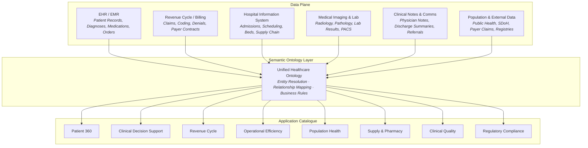
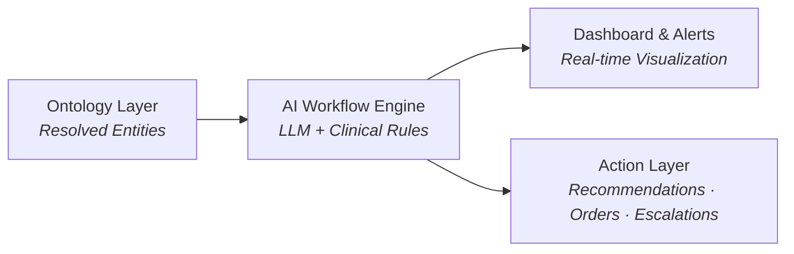

# Healthcare Application Catalogue

Enterprise AI applications for hospital and health system operations, powered by the Semantic Ontology Layer.

---

## Data Plane Overview

The application catalogue draws from a unified data plane spanning clinical systems, revenue cycle platforms, and unstructured medical data sources.

---

## Data Plane Components

### Structured Enterprise Systems

- **EHR / EMR** — Epic (EpicCare Inpatient/Ambulatory), Oracle Health (Cerner) Millennium, MEDITECH Expanse, Allscripts/Veradigm, athenahealth, NextGen Healthcare, eClinicalWorks. Patient demographics, clinical data, diagnoses (ICD-10), medications, lab orders, vitals, clinical workflows, CPOE.
- **Revenue Cycle / Billing** — Epic Resolute, Waystar, R1 RCM, Change Healthcare (Optum), Experian Health, Availity, nThrive/Finvi, athenahealth RCM. Claims submission, medical coding (CPT/HCPCS/DRG), denial management, prior authorization, payer contracts, patient billing, collections.
- **Hospital Information System** — SAP S/4HANA for Healthcare, Oracle Health, Infor CloudSuite Healthcare, Workday, GHX, Vizient. ADT (admissions/discharge/transfer), bed management, OR scheduling, materials management, supply chain, HR, financials.

### Semi-Structured & Unstructured Sources

- **Medical Imaging & Lab** — GE Healthcare PACS, Philips IntelliSpace PACS, Sectra PACS, Agfa HealthCare, Hologic; LIS: Epic Beaker, Cerner PathNet, Sunquest, Orchard Harvest. Radiology images (DICOM), pathology reports, lab results (HL7/FHIR), diagnostic findings, imaging AI pre-reads.
- **Clinical Notes & Communications** — Nuance DAX Copilot, 3M M*Modal, Abridge, Suki AI, Microsoft DAX Copilot, DeepScribe; secure messaging: TigerConnect, Vocera (Stryker). Physician dictation, ambient documentation, progress notes, discharge summaries, referral letters, care-team messaging.
- **Population & External Data** — Arcadia.io, Innovaccer, Azara DRVS, Milliman MedInsight, CMS public-use files, CDC WONDER, LexisNexis SDOH, Area Deprivation Index (ADI), AHRQ SDoH databases. Population demographics, social determinants of health, payer-claims databases, epidemiological data, risk adjustment, benchmarking.

---

## Application Portfolio

### P0 — Immediate ROI

- **[Patient 360 & Care Coordination](patient-360.md)** — sources: EHR, RCM, Imaging, Notes. Reduce readmissions 15–25%, improve care-gap closure 30%. Time to value 4–6 weeks.
- **[Clinical Decision Support](clinical-decision-support.md)** — sources: EHR, Imaging, Notes. Reduce adverse drug events 20–30%, improve protocol adherence 25%. Time to value 4–6 weeks.

### P1 — High Value

- **[Revenue Cycle Optimization](revenue-cycle.md)** — sources: RCM, EHR, Notes. Reduce denial rate 25–40%, accelerate collections 15–20 days. Time to value 6–8 weeks.
- **[Operational Efficiency & Capacity](operational-efficiency.md)** — sources: HIS, EHR, RCM. Improve bed utilisation 10–15%, reduce OR idle time 20%. Time to value 6–8 weeks.

### P2 — Strategic Value

- **[Population Health Management](population-health.md)** — sources: EHR, Population Data, RCM. Reduce high-risk ER visits 20–30%, improve preventive care 25%. Time to value 8–10 weeks.
- **[Supply Chain & Pharmacy Intelligence](supply-chain-pharmacy.md)** — sources: HIS, EHR, Imaging. Reduce supply waste 15–25%, optimise formulary spend 8–12%. Time to value 8–10 weeks.

### P3 — Operational Excellence

- **[Clinical Quality & Safety](clinical-quality.md)** — sources: EHR, Notes, HIS. Reduce HAIs 20–30%, improve quality-measure scores 15%. Time to value 10–12 weeks.
- **[Regulatory & Compliance Automation](regulatory-compliance.md)** — sources: All Systems, Notes. 70% reporting effort reduction, maintain accreditation readiness. Time to value 10–12 weeks.

---

## Ontology Entity Map

Key business entities resolved across systems by the Semantic Ontology Layer:

| Business Entity | EHR / EMR | Revenue Cycle | Hospital Information System |
|---|---|---|---|
| **Patient** | MRN / Patient Record | Guarantor / Account | ADT Record |
| **Encounter** | Visit / Episode | Claim / Charge | Admission / Discharge |
| **Provider** | Ordering / Attending Physician | Billing Provider / NPI | Staff / Schedule |
| **Diagnosis** | Problem List (ICD-10) | Claim Diagnosis | — |
| **Procedure** | Order / Result | CPT / HCPCS Code | OR Schedule / Case |
| **Medication** | MAR / Prescription | NDC / Drug Charge | Pharmacy Inventory |

---

## Architecture Pattern

Every application in this catalogue follows the same execution pattern:

- **Data Ingestion** — Ontology layer resolves entities across EHR, Revenue Cycle, HIS, and unstructured clinical data (patient matching, encounter linking, terminology normalisation).
- **AI Workflow Execution** — LLM-powered pipelines apply clinical logic, predictive models, coding intelligence, and operational optimisation.
- **Presentation** — Dashboards surface clinical KPIs, financial metrics, and operational status; alerts trigger on clinical deterioration, denial patterns, and capacity constraints.
- **Action** — Recommendations surface in clinician workflows (EHR alerts), revenue-cycle queues (denial follow-up), and operational dashboards (bed management, OR scheduling).

---

[← Back to Home](../../index.md)
