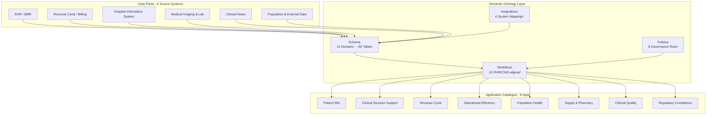

# Healthcare Semantic Ontology Layer

The Semantic Ontology Layer sits between the Data Plane and the Application Catalogue, providing a unified, standards-aligned knowledge graph that resolves entities across EHR/EMR, Revenue Cycle/Billing, Hospital Information System (HIS), Medical Imaging & Lab, Clinical Notes, and Population & External Data sources.

---

## Industry Standards Alignment

The healthcare ontology is aligned to global healthcare interoperability and coding standards.

### HL7 FHIR (Fast Healthcare Interoperability Resources)

The HL7 FHIR standard provides the interoperability framework for clinical data exchange. Every domain in this ontology maps to FHIR resource types:

| FHIR Resource | Scope | Ontology Coverage |
|--------------|-------|-------------------|
| **Patient** | Demographics, identifiers, contacts | All 8 apps — Patient_Master |
| **Encounter** | Visit/admission/episode tracking | Patient 360, Operational Efficiency, Revenue Cycle |
| **Condition** | Diagnoses, problem list | Patient 360, Clinical Decision Support, Population Health |
| **MedicationRequest / MedicationAdministration** | Prescriptions, MAR | Clinical Decision Support, Supply Chain & Pharmacy |
| **Observation** | Lab results, vitals, assessments | Clinical Decision Support, Clinical Quality |
| **Claim / ExplanationOfBenefit** | Billing, reimbursement | Revenue Cycle, Population Health |
| **Procedure** | Surgical and clinical procedures | Revenue Cycle, Operational Efficiency |

### Clinical Coding Standards

| Standard | Purpose | Ontology Entity |
|---------|---------|-----------------|
| **ICD-10-CM/PCS** | Diagnosis and procedure coding | `Diagnosis.ICD10_Code`, `Procedure_Record.ICD10_PCS` |
| **CPT / HCPCS** | Procedure and service billing codes | `Claim.CPT_Code`, `Charge.HCPCS_Code` |
| **SNOMED CT** | Clinical terminology standardization | `Diagnosis.SNOMED_Code`, `Allergy.SNOMED_Code` |
| **LOINC** | Lab test identification | `Lab_Result.LOINC_Code` |
| **NDC** | Drug identification | `Medication_Order.NDC`, `Pharmacy_Inventory.NDC` |
| **RxNorm** | Normalized drug naming | `Medication_Order.RxNorm_CUI` |

### Regulatory & Quality Frameworks

| Framework | Purpose | Ontology Entity |
|----------|---------|-----------------|
| **HIPAA** | Privacy and security of PHI | `PHI_Access_Log`, `Patient_Consent`, privacy policies |
| **CMS Quality Programs** | MIPS, IQR, VBP, Promoting Interoperability | `Quality_Measure`, `Regulatory_Return` |
| **HEDIS** | Health plan quality measures | `Care_Gap`, `Quality_Measure` |
| **TJC / DNV** | Hospital accreditation standards | `Accreditation_Standard` |

---

## Architecture

---

## Ontology Components

The ontology consists of four interconnected layers, all stored in `enterprise-knowledge/`:

| Layer | Files | Format | Purpose |
|-------|-------|--------|---------|
| [Schema](schema-reference.md) | `healthcare-schema.yaml` | YAML | 12 domains, ~50 tables with fields, types, risk levels, constraints, and relationships |
| [Workflows](workflows.md) | `workflows/*.yaml` (10 files) | YAML | Triggered process flows with steps, rules, SLAs, and dependencies |
| [Policies](policies.md) | `policies/*.md` (8 files) | Markdown | Business rules, thresholds, approval chains, and compliance constraints |
| [Integrations](integrations.md) | `integrations/*.yaml` (6 files) | YAML | Field-level sync mappings between source systems with conflict resolution |

### Relationship Types

Entities in the schema are connected via typed relationships that form a knowledge graph:

| Relationship | Meaning | Example |
|-------------|---------|---------|
| `triggers` | Entity event initiates a workflow | `Lab_Result` critical flag triggers `Critical Result Management` workflow |
| `syncs_to` | Entity data flows to another system | `Encounter` syncs_to `Claim` via EHR-RCM integration |
| `constrained_by` | Entity operations governed by a policy | `Medication_Order` constrained_by `clinical-safety-policy` |
| `depends_on` | Entity requires a parent/related entity | `Lab_Result` depends_on `Lab_Order` |
| `validates` | Entity validates another in a clinical process | `Lab_Result` validates `Diagnosis` for clinical confirmation |

---

## Cross-Application Entity Heatmap

Shows how many of the 8 healthcare apps require each entity. Higher usage = more foundational.

| Entity | Count | Applications |
|--------|-------|-------------|
| `Patient_Master` | **8** | All apps |
| `Encounter` | **7** | All except Supply Chain |
| `Diagnosis` | **6** | Patient 360, CDS, Revenue Cycle, Population Health, Quality, Regulatory |
| `Medication_Order` | **4** | CDS, Supply/Pharmacy, Quality, Patient 360 |
| `Lab_Result` | **4** | CDS, Quality, Patient 360, Population Health |
| `Claim` | **3** | Revenue Cycle, Population Health, Regulatory |
| `Vital_Sign` | **3** | CDS, Quality, Operational Efficiency |
| `Bed_Census` | **2** | Operational Efficiency, Patient 360 |
| `Quality_Measure` | **2** | Quality, Regulatory |
| `Supply_Inventory` | **1** | Supply Chain & Pharmacy |

`Patient_Master` is the most connected entity in the healthcare ontology — equivalent to `Customer_Master` in Banking or `Material_Master` in Supply Chain.

---

## Schema Statistics

| Metric | Count |
|--------|-------|
| **Domains** | 12 |
| **Tables** | ~50 |
| **Source Systems** | 6 (EHR, RCM, HIS, Imaging/Lab, Notes, Population/External) |
| **Workflows** | 10 |
| **Policies** | 8 |
| **Integrations** | 6 |
| **Relationship Types** | 5 (triggers, syncs_to, constrained_by, depends_on, validates) |
| **FHIR Resources Covered** | 12+ (Patient, Encounter, Condition, Medication*, Observation, Claim, Procedure, etc.) |

---

## Documentation

| Document | Description |
|----------|-------------|
| [Schema Reference](schema-reference.md) | Complete domain and table reference with fields, types, and relationships |
| [Workflows](workflows.md) | All 10 AI workflow definitions with triggers, steps, and dependencies |
| [Policies](policies.md) | All 8 governance policies with rules, thresholds, and approval chains |
| [Integrations](integrations.md) | All 6 system integration mappings with field-level detail |
| [App-Object Mapping](app-object-mapping.md) | Minimum required objects per application with relationship matrix |
| [Mapping Architecture](mapping-architecture.md) | Schema-first architecture, Semantic RAG pipeline, and ReAct tools |

---

[← Back to Healthcare Catalogue](../index.md)
