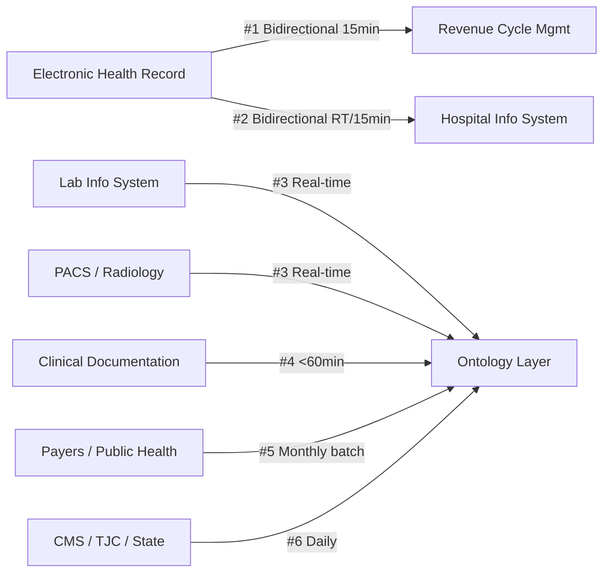
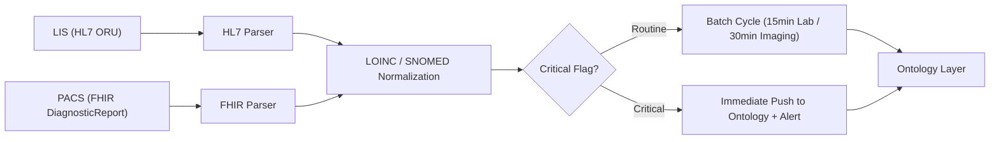
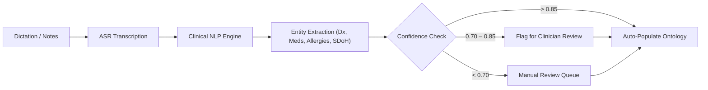
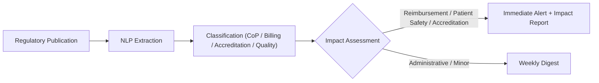

# Integrations

6 system integration mappings that connect the Data Plane source systems to the Semantic Ontology Layer. Each integration is defined in `enterprise-knowledge/integrations/` as a YAML file with field-level mappings, conflict resolution, and failure handling.

---

## Integration Summary

| # | Integration | Source | Target | Type | Frequency |
|---|------------|--------|--------|------|-----------|
| 1 | [EHR to Revenue Cycle Sync](#1-ehr-to-revenue-cycle-sync) | EHR | Revenue Cycle Management | Bidirectional | 15-min interval |
| 2 | [EHR to HIS Sync](#2-ehr-to-his-sync) | EHR | Hospital Information System | Bidirectional | Real-time ADT, 15-min other |
| 3 | [Lab & Imaging Feed](#3-lab--imaging-feed) | LIS / PACS | Ontology Layer | Unidirectional | Real-time results |
| 4 | [Clinical Notes NLP Pipeline](#4-clinical-notes-nlp-pipeline) | Clinical Documentation | Ontology Layer | Unidirectional | <60 min from dictation |
| 5 | [Population & External Data Feed](#5-population--external-data-feed) | Payers / Public Health | Ontology Layer | Unidirectional | Monthly batch + event-driven |
| 6 | [Regulatory & Quality Feed](#6-regulatory--quality-feed) | CMS / TJC / State | Ontology Layer | Unidirectional | Daily scan |

---

## Integration Architecture

---

## 1. EHR to Revenue Cycle Sync

**ID:** `INTEGRATION_EHR_RCM_V1_0` | **File:** `ehr-rcm-sync.yaml`

EHR is source of truth for clinical data (demographics, encounters, diagnoses). RCM is source of truth for financial and billing data.

### Clinical Data Sync (EHR -> RCM)

| EHR Field | RCM Field | Direction | Transformation / Constraint |
|----------|----------|-----------|---------------------------|
| Patient.MRN | RCM_Patient.MRN | EHR -> RCM | — |
| Patient.Demographics | RCM_Patient.Demographics | EHR -> RCM | Name, DOB, Address, Insurance_ID |
| Encounter.Encounter_ID | RCM_Encounter.Encounter_ID | EHR -> RCM | — |
| Encounter.Admit_Date | RCM_Encounter.Service_Date | EHR -> RCM | — |
| Encounter.Diagnoses[] | RCM_Claim.Diagnosis_Codes[] | EHR -> RCM | ICD-10-CM; primary + secondary ordering preserved |
| Encounter.Procedures[] | RCM_Claim.Procedure_Codes[] | EHR -> RCM | CPT/HCPCS with modifiers |
| Encounter.Attending_Provider | RCM_Claim.Rendering_Provider | EHR -> RCM | NPI lookup required |

### Financial Data Sync (RCM -> EHR)

| RCM Field | EHR Field | Direction | Notes |
|----------|----------|-----------|-------|
| RCM_Claim.Claim_Status | Encounter.Claim_Status__c | RCM -> EHR | Submitted / Accepted / Denied / Paid |
| RCM_Auth.Authorization_Status | Encounter.Auth_Status__c | RCM -> EHR | Approved / Pending / Denied |
| RCM_Eligibility.Coverage_Status | Patient.Coverage_Status__c | RCM -> EHR | Active / Inactive / Pending verification |
| RCM_Eligibility.Benefits_Summary | Patient.Benefits_Summary__c | RCM -> EHR | Copay, deductible, coinsurance |
| RCM_Clearance.Financial_Clearance | Encounter.Financial_Clearance__c | RCM -> EHR | Cleared / Pending / Hold |

**Conflict Resolution:** EHR wins for clinical data (demographics, diagnoses, procedures); RCM wins for financial/billing data (claim status, authorization, coverage)

**Failure Handling:** 3 retries at 5-min intervals; dead letter queue; alert healthcare-integration-alerts@company.com

---

## 2. EHR to HIS Sync

**ID:** `INTEGRATION_EHR_HIS_V1_0` | **File:** `ehr-his-sync.yaml`

EHR is source of truth for clinical orders and patient status. HIS is source of truth for operational data (bed management, OR scheduling, staffing). ADT events are real-time; all other data syncs on 15-min interval.

### Clinical Orders Sync (EHR -> HIS)

| EHR Field | HIS Field | Direction | Transformation / Constraint |
|----------|----------|-----------|---------------------------|
| ADT_Event.Event_Type | HIS_ADT.Event_Type | EHR -> HIS | Admit / Discharge / Transfer — **real-time** |
| ADT_Event.Patient_MRN | HIS_ADT.Patient_MRN | EHR -> HIS | **Real-time** |
| ADT_Event.Location | HIS_ADT.Unit_Ward | EHR -> HIS | **Real-time** |
| ADT_Event.Attending_Provider | HIS_ADT.Attending_Provider | EHR -> HIS | **Real-time** |
| Order.Bed_Request | HIS_Bed.Bed_Request | EHR -> HIS | Isolation / Telemetry / Standard |
| Order.Diet_Order | HIS_Dietary.Diet_Order | EHR -> HIS | Diet type, allergies, restrictions |
| Order.Activity_Level | HIS_Nursing.Activity_Level | EHR -> HIS | Bedrest / Ambulatory / Fall precautions |

### Operational Data Sync (HIS -> EHR)

| HIS Field | EHR Field | Direction | Notes |
|----------|----------|-----------|-------|
| HIS_Bed.Bed_Assignment | Encounter.Bed_Assignment__c | HIS -> EHR | Room / Bed / Unit |
| HIS_Bed.Bed_Status | Encounter.Bed_Status__c | HIS -> EHR | Occupied / Available / Cleaning |
| HIS_OR.Schedule | Encounter.OR_Schedule__c | HIS -> EHR | OR room, time, duration, team |
| HIS_Staffing.Staffing_Level | Unit.Staffing_Level__c | HIS -> EHR | Nurse-to-patient ratio by unit |
| HIS_Supply.Consumption | Encounter.Supply_Consumption__c | HIS -> EHR | Implants, supplies linked to case |

**Conflict Resolution:** EHR wins for clinical orders (ADT, diet, activity); HIS wins for operational/bed management data

**Frequency:** ADT events: real-time (<30 sec); all other data: 15-min interval

---

## 3. Lab & Imaging Feed

**ID:** `INTEGRATION_LAB_IMAGING_V1_0` | **File:** `lab-imaging-feed.yaml`

Unidirectional feed from Laboratory Information System (LIS) and PACS/Radiology into the Ontology Layer. Critical results are pushed immediately; routine results follow standard SLA.

### Lab Results (LIS -> Ontology via HL7 ORU)

| LIS Field | Ontology Field | Notes |
|----------|---------------|-------|
| OBX.LOINC_Code | Lab_Result.LOINC_Code | Standardized test identifier |
| OBX.Value | Lab_Result.Value | Numeric or coded result |
| OBX.Units | Lab_Result.Unit | UCUM standard |
| OBX.Reference_Range | Lab_Result.Reference_Range | Low-High for patient context |
| OBX.Abnormal_Flag | Lab_Result.Critical_Flag | Critical / High / Low / Normal |
| OBX.Observation_DateTime | Lab_Result.Result_Timestamp | — |
| OBR.Ordering_Provider | Lab_Result.Ordering_Provider | NPI |
| OBR.Specimen_Type | Lab_Result.Specimen_Type | Blood / Urine / CSF / Tissue |

### Imaging Results (PACS -> Ontology via HL7/FHIR DiagnosticReport)

| PACS Field | Ontology Field | Notes |
|-----------|---------------|-------|
| DiagnosticReport.Modality | Imaging_Result.Modality | XR / CT / MRI / US / NM / PET |
| DiagnosticReport.Findings | Imaging_Result.Findings | Structured findings text |
| DiagnosticReport.Impression | Imaging_Result.Impression | Radiologist summary impression |
| DiagnosticReport.Critical_Flag | Imaging_Result.Critical_Flag | Critical / Routine |
| DiagnosticReport.Radiologist | Imaging_Result.Interpreting_Provider | NPI |
| DiagnosticReport.Study_DateTime | Imaging_Result.Study_Timestamp | — |
| DiagnosticReport.Accession_Number | Imaging_Result.Accession_Number | Unique study identifier |

### Delivery SLA

| Result Type | SLA | Trigger |
|------------|-----|---------|
| Critical lab result | Immediate push (<1 min) | Critical_Flag = Critical |
| Routine lab result | <15 min | Standard batch cycle |
| Critical imaging finding | Immediate push (<1 min) | Critical_Flag = Critical |
| Routine imaging report | <30 min | Standard batch cycle |

**Extraction Pipeline:**

---

## 4. Clinical Notes NLP Pipeline

**ID:** `INTEGRATION_NOTES_NLP_V1_0` | **File:** `clinical-notes-nlp.yaml`

Unidirectional NLP pipeline extracting structured clinical data from physician dictation and clinical documentation. Target SLA: <60 min from dictation to ontology population.

### Source Documents

| Source | System | Format |
|--------|--------|--------|
| Physician notes | Nuance DAX / 3M M*Modal | Dictated → transcribed text |
| Discharge summaries | EHR Documentation Module | Structured + free-text |
| Procedure notes | EHR Documentation Module | Free-text with templates |
| History & Physical (H&P) | EHR Documentation Module | Structured + free-text |
| Consult notes | EHR Documentation Module | Free-text |

### Extracted Entities

| Extracted Entity | Target Ontology Field | Confidence Handling |
|-----------------|----------------------|-------------------|
| Diagnoses | Encounter.NLP_Diagnoses[] | ICD-10-CM code suggestions |
| Medications | Patient.NLP_Medications[] | RxNorm coded; dose, route, frequency |
| Allergies | Patient.NLP_Allergies[] | Substance + reaction type |
| Procedures | Encounter.NLP_Procedures[] | CPT/SNOMED coded |
| SDoH Indicators | Patient.NLP_SDoH[] | Housing, food security, transportation, social isolation |
| Adverse Event Signals | Encounter.NLP_Adverse_Events[] | Falls, pressure injuries, medication errors |

### Confidence Thresholds

| Confidence Score | Action |
|-----------------|--------|
| > 0.85 | Auto-populate ontology fields |
| 0.70 – 0.85 | Flag for clinician review; pre-populate as suggestion |
| < 0.70 | Route to manual review queue; do not auto-populate |

**NLP Extraction Pipeline:**

---

## 5. Population & External Data Feed

**ID:** `INTEGRATION_POPULATION_V1_0` | **File:** `population-external-feed.yaml`

Batch and event-driven feeds from payers, public health agencies, and quality organizations for population health management and value-based care analytics.

| Feed | Target Entity | Frequency | Special Rules |
|------|--------------|-----------|---------------|
| Payer attribution lists | Population_Panel | Monthly | Reconcile against active patient roster; flag new/removed attributions |
| Claims data from payer | Claims_External | Monthly (90-day lag) | Identify out-of-network utilization and care gaps |
| SDoH databases (ADI, SVI) | SDoH_Index | Quarterly refresh | Geocoded to patient address; Area Deprivation Index + Social Vulnerability Index |
| Public health data (CDC, CMS) | Public_Health_Indicator | Quarterly | Disease prevalence, immunization rates, health disparities by region |
| Quality measure benchmarks (HEDIS) | Quality_Benchmark | Annual | HEDIS percentile thresholds for star ratings and VBC contracts |

**Frequency:** Monthly batch for payer data; quarterly for public health/SDoH; annual for HEDIS benchmarks; event-driven for critical public health alerts (e.g., outbreak notifications)

---

## 6. Regulatory & Quality Feed

**ID:** `INTEGRATION_REGULATORY_V1_0` | **File:** `regulatory-quality-feed.yaml`

Daily scan of regulatory and quality publications with LLM-based change detection and impact assessment.

| Feed | Target Entity | Frequency | Special Rules |
|------|--------------|-----------|---------------|
| CMS Federal Register publications | Regulatory_Update | Daily scan | CoP/billing/reimbursement changes: immediate alert |
| TJC/DNV standard updates | Accreditation_Standard | On publication | New/revised standards: immediate alert + gap analysis trigger |
| State health department regulations | State_Regulation | Daily scan | Licensure/reporting changes: immediate alert |
| Quality measure specification updates | Quality_Measure_Spec | On publication | Measure retirement/revision: immediate alert to quality team |
| CMS quality program updates (MIPS, VBP) | Quality_Program | On publication | Scoring methodology changes: immediate alert |

**Regulatory Change Detection Pipeline:**

---

## Failure Handling (All Integrations)

All integrations share a common failure handling pattern:

| Setting | Value |
|---------|-------|
| Retry count | 3 |
| Retry interval | 5 minutes |
| Dead letter queue | Enabled |
| Alert on failure | Integration-specific alert email |
| Fallback | Source system value is authoritative; manual update required in target |

---

[← Back to Ontology Overview](index.md)
