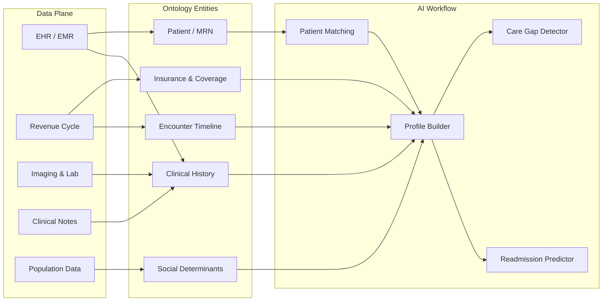

# Patient 360 & Care Coordination

Unified patient profiles with care gap identification, readmission risk prediction, and care team coordination.

**Priority:** P0 — Immediate ROI  
**Time to Value:** 4-6 weeks  
**Category:** Clinical & Care Management

---

## Business Problem

Patient data is fragmented across EHR (clinical), revenue cycle (financial), imaging systems (diagnostics), and clinical notes (unstructured). Clinicians and care coordinators lack a complete picture:

- **Fragmented records** — a patient's history spans multiple EHR instances (primary care, specialists, hospitals), each with partial information
- **Care gaps invisible** — overdue screenings, immunizations, and chronic disease management milestones are buried in individual records, not surfaced proactively
- **Readmission surprises** — patients discharged without adequate follow-up return to the ED within 30 days; readmission penalties cost hospitals millions annually
- **Care coordination breakdown** — transitions between primary care, specialists, and post-acute settings lose information, leading to duplicated tests and contradictory treatments
- **Social determinant blindness** — food insecurity, transportation barriers, and housing instability significantly impact health outcomes but are rarely captured or acted upon

---

## Capabilities

### Unified Patient Profile
Single longitudinal view combining EHR clinical data (diagnoses, medications, labs, vitals), revenue cycle (coverage, claims, financial clearance), imaging (results, pending studies), and NLP-extracted data from clinical notes.

### Care Gap Identification
Automated detection of overdue preventive care (mammograms, colonoscopies, HbA1c tests, immunizations) and chronic disease management gaps based on evidence-based clinical guidelines.

### Readmission Risk Prediction
ML model predicting 30-day readmission probability at discharge based on clinical acuity, comorbidities, prior utilization, medication complexity, social determinants, and post-discharge care plan adequacy.

### Care Team Coordination Hub
Unified view of all providers involved in a patient's care (PCP, specialists, care coordinators, social workers) with shared task lists, transition alerts, and care plan tracking.

### Social Determinants of Health (SDoH) Integration
Incorporate SDoH screening data (Z-codes), community resource availability, and area-level deprivation indices into the patient profile to identify non-clinical barriers to health.

---

## Data Sources & Ontology Mapping

| Ontology Entity | Source System | Key Fields |
|----------------|--------------|------------|
| Patient / MRN | EHR + RCM | MRN, Name, DOB, Gender, Address, Insurance, PCP, Consent Status |
| Clinical History | EHR + Imaging + Notes | Diagnoses (ICD-10), Medications, Allergies, Lab Results, Vitals, Procedures, Imaging Results |
| Encounter Timeline | EHR + RCM | Encounter Date, Type (inpatient/outpatient/ED), Facility, Provider, Disposition, LOS |
| Insurance & Coverage | Revenue Cycle | Payer, Plan, Coverage Dates, Copay, Deductible, Prior Auth Requirements |
| Social Determinants | EHR (Z-codes) + Population Data | Housing Status, Food Security, Transportation, Employment, Area Deprivation Index |

---

## AI Workflow

1. **Patient Matching** — Probabilistic matching across EHR instances and external data sources using MRN, name, DOB, SSN (last 4), address, and phone to build a Master Patient Index
2. **Profile Assembly** — Aggregate clinical history (problems, medications, allergies, labs), encounter timeline, coverage details, SDoH factors, and NLP-extracted findings from clinical notes
3. **Care Gap Detection** — Apply evidence-based guidelines (HEDIS, USPSTF, ADA, AHA) against patient's clinical record to identify overdue screenings, labs, immunizations, and chronic disease milestones
4. **Readmission Risk Scoring** — Gradient-boosted model trained on historical readmissions; features include LACE+ score components, medication count, SDoH flags, discharge disposition, and follow-up appointment status
5. **Transition of Care Alerts** — For patients transitioning between care settings (hospital → SNF → home), generate alerts for the receiving provider with critical information: medication reconciliation, pending results, follow-up needs
6. **SDoH Action Matching** — For patients with identified social barriers, match to available community resources (food banks, transportation services, housing programs) based on location and eligibility
7. **Output** — Patient 360 dashboard in EHR for clinicians; care gap worklists for care coordinators; readmission risk alerts at discharge; transition-of-care notifications for receiving providers

---

## Dashboard & Alerts

### Key Metrics

| KPI | Description | Target |
|-----|-------------|--------|
| **30-Day Readmission Rate** | % of discharged patients readmitted within 30 days | < 10% (CMS target) |
| **Care Gap Closure Rate** | % of identified care gaps addressed within 90 days | > 75% |
| **Patient Matching Accuracy** | % of patient records correctly linked across systems | > 98% |
| **Transition of Care Completion** | % of transitions with medication reconciliation + follow-up scheduled | > 90% |
| **SDoH Screening Rate** | % of patients with completed SDoH assessment | > 60% |
| **Care Coordinator Caseload Efficiency** | Patients managed per coordinator with care gap closure rate maintained | 20% improvement |

### Alert Rules

| Alert | Trigger | Severity | Action |
|-------|---------|----------|--------|
| High readmission risk | Patient at discharge with readmission probability > 0.35 | Critical | Trigger enhanced discharge planning; schedule 48-hour follow-up call; assign care coordinator |
| Critical care gap | High-risk patient overdue for HbA1c >6 months (diabetic) or mammogram >18 months | High | Push to care gap worklist; generate patient outreach (portal message, phone call) |
| Transition of care | Patient transferred to SNF/home health without medication reconciliation completed | High | Alert receiving provider; flag incomplete transition |
| SDoH barrier identified | Patient screens positive for food insecurity or transportation barrier | Medium | Route to social worker; match to community resources |
| Duplicate patient detected | Two records with >90% match probability found across systems | Medium | Queue for manual review; prevent duplicate orders/billing |

---

## ROI Model

| Metric | Before | After | Impact |
|--------|--------|-------|--------|
| 30-day readmission rate | 14.5% | 10.2% | **30% reduction → $4.2M avoided CMS penalties + costs** |
| Care gap closure | 48% of gaps addressed | 72% of gaps addressed | **50% improvement → better outcomes + quality bonuses** |
| Duplicate patient rate | 8% of records | 2% of records | **75% reduction → fewer medical errors** |
| Care coordinator productivity | 85 patients per coordinator | 110 patients per coordinator | **29% improvement → $1.2M labor savings** |
| Preventable ED visits | 3,200 / year | 2,100 / year | **34% reduction → $3.3M cost avoidance** |

!!! success "Estimated Annual ROI"
    **$8M - $15M** annually from readmission reduction, care gap closure, ED avoidance, and coordinator productivity — across a mid-size health system with 25,000+ annual discharges.

---

## Implementation Notes

- Patient matching across EHR instances requires a robust EMPI (Enterprise Master Patient Index); expect 90-95% auto-match rates with manual review for ambiguous cases
- Care gap detection requires mapping clinical guidelines to computable rules against EHR-structured data (diagnoses, procedures, labs)
- Readmission model needs minimum 24 months of discharge-to-readmission data with clinical features at time of discharge
- SDoH integration depends on screening tool adoption (PRAPARE, AHC-HRSN); area-level data (ADI, SVI) can supplement individual screening
- HIPAA compliance must be maintained throughout; all data access must follow minimum necessary standard and role-based access controls

---

[← Back to Catalogue](index.md) | [Next: Clinical Decision Support →](clinical-decision-support.md)
