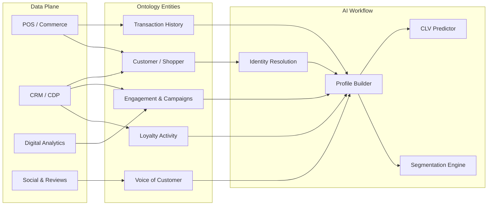

# Customer 360 & Loyalty Intelligence

Unified shopper profiles with loyalty program optimization, CLV prediction, and segment-driven engagement.

**Priority:** P0 — Immediate ROI  
**Time to Value:** 4-6 weeks  
**Category:** Customer Management & Loyalty

---

## Business Problem

Retailers interact with customers across physical stores, e-commerce, mobile apps, social media, and email — each generating data in separate systems. This fragmentation undermines customer understanding:

- **Anonymous shoppers** — 60-70% of in-store transactions are unidentified, leaving the majority of purchase behavior unlinked to a customer profile
- **Identity fragmentation** — the same customer exists as separate records in POS (loyalty card), CRM (email), e-commerce (account), and social (handle) with no unified view
- **Loyalty program waste** — blanket loyalty rewards given to all members regardless of value segment; high-value customers get the same treatment as one-time buyers
- **CLV blindness** — no data-driven understanding of which customers will be high-value long-term vs. discount-driven one-time buyers
- **Segment of one missed** — retailers operate on broad demographic segments rather than behavioral micro-segments that predict actual purchasing intent

---

## Capabilities

### Unified Shopper Profile
Single golden record per customer combining POS transaction history (in-store), e-commerce behavior (online), CRM interactions (email/SMS engagement), loyalty program activity, and social sentiment — across all channels.

### Customer Lifetime Value (CLV) Prediction
ML model predicting 12/24/36-month revenue per customer based on purchase frequency trajectory, basket composition, channel preferences, and engagement patterns.

### Loyalty Program Optimization
AI-driven tier management and reward design: identify which rewards drive incremental behavior vs. rewarding actions customers would take anyway. Optimize earn/burn ratios by segment.

### Behavioral Micro-Segmentation
Cluster customers into actionable behavioral segments beyond demographics: deal-seekers, brand-loyalists, trend-followers, seasonal shoppers, lapsed-at-risk — with tailored engagement strategies per segment.

### Customer Identity Resolution
Probabilistic matching across channels to stitch anonymous in-store transactions to known online/loyalty profiles using payment fingerprints, loyalty lookups, and behavioral patterns.

---

## Data Sources & Ontology Mapping

| Ontology Entity | Source System | Key Fields |
|----------------|--------------|------------|
| Customer / Shopper | POS + CRM/CDP + E-commerce | Customer ID, Loyalty ID, Email, Phone, Name, First Purchase Date |
| Transaction History | POS + E-commerce | Transaction ID, Date, Store/Channel, Items, Basket Value, Payment Method |
| Engagement & Campaigns | CRM/CDP + Digital Analytics | Email Opens, Click-throughs, App Sessions, Page Views, Campaign Response |
| Loyalty Activity | CRM/CDP Loyalty Module | Points Earned, Points Redeemed, Tier, Tier Qualification Date, Rewards Used |
| Voice of Customer | Social Media + Reviews | Review Score, Review Text, Sentiment, Topics, Platform, Date |

---

## AI Workflow

1. **Identity Resolution** — Probabilistic matching across POS (loyalty card, payment token), CRM (email, phone), e-commerce (account), and social (handle) to build a unified customer graph
2. **Profile Assembly** — Aggregate purchase history (frequency, recency, monetary), channel preferences, category affinities, engagement metrics, loyalty tier, and sentiment scores
3. **CLV Modeling** — BG/NBD + Gamma-Gamma model (or gradient-boosted regression) trained on historical customer revenue trajectories; predict forward-looking revenue at 12/24/36 months
4. **Behavioral Segmentation** — K-means + behavioral feature engineering to create actionable segments: frequency × recency × monetary × channel × category patterns
5. **Loyalty Optimization** — Uplift modeling to identify which loyalty rewards drive incremental spend (treatment effect) vs. rewarding organic behavior (deadweight); optimize reward allocation by segment
6. **Lapsed Customer Detection** — Survival analysis to identify customers whose purchase gap exceeds their predicted inter-purchase interval; flag for win-back campaigns
7. **Output** — Customer 360 dashboard for marketing; CLV-ranked customer lists for CRM; loyalty optimization recommendations for loyalty team; lapsed alerts pushed to campaign manager

---

## Dashboard & Alerts

### Key Metrics

| KPI | Description | Target |
|-----|-------------|--------|
| **Identified Transaction Rate** | % of transactions linked to a known customer profile | > 55% (up from 30-35%) |
| **Customer Retention Rate** | % of active customers (purchased in last 12 months) retained | > 65% |
| **CLV Accuracy** | Predicted vs. actual 12-month revenue correlation | R² > 0.70 |
| **Loyalty Program ROI** | Incremental revenue from loyalty / Total loyalty program cost | > 4x |
| **Repeat Purchase Rate** | % of customers making 2+ purchases in 12 months | > 40% |
| **Average Customer Lifespan** | Months from first to last purchase for typical customer | > 28 months |

### Alert Rules

| Alert | Trigger | Severity | Action |
|-------|---------|----------|--------|
| High-CLV churn risk | Top-decile CLV customer with purchase gap >2x their average interval | Critical | Trigger personalized win-back offer; assign to clienteling team |
| Loyalty tier erosion | >5% of Gold/Platinum members projected to drop tier next quarter | High | Launch tier-protection campaign; surface engagement recommendations |
| Segment shift | Customer moves from "brand-loyalist" to "deal-seeker" segment | Medium | Adjust engagement strategy; investigate cause (competitive, price, assortment) |
| Identity match opportunity | Large cluster of anonymous transactions matching a known customer's payment pattern | Medium | Trigger identity confirmation (receipt email opt-in, loyalty card prompt) |
| Review sentiment drop | Product or store rating drops >0.5 stars in 30-day window | Info | Notify merchandising or store ops; investigate root cause |

---

## ROI Model

| Metric | Before | After | Impact |
|--------|--------|-------|--------|
| Identified customer rate | 32% of transactions | 58% of transactions | **81% improvement in attribution** |
| Repeat purchase rate | 28% | 38% | **36% increase → $8.4M incremental revenue** (on $250M annual sales) |
| Loyalty program cost | $4.2M / year | $3.5M / year (optimized rewards) | **$700K savings with better ROI** |
| Lapsed customer win-back | 5% reactivation rate | 15% reactivation rate | **3x improvement → $2.1M recovered revenue** |
| Marketing campaign efficiency | 2.2% conversion (batch) | 6.8% conversion (segmented) | **3x improvement** |

!!! success "Estimated Annual ROI"
    **$8M - $15M** annually from improved retention, loyalty optimization, lapsed customer recovery, and campaign efficiency — across a mid-size retailer with $250M annual revenue and 2M+ customers.

---

## Implementation Notes

- Identity resolution requires POS transaction-level data with payment token or loyalty card ID; retailers without a loyalty program will have lower identified rates initially
- CLV model needs minimum 24 months of transaction history with customer linkage for reliable training
- Loyalty optimization via uplift modeling requires A/B test infrastructure (control group that doesn't receive the reward)
- Customer Data Platform (CDP) is the ideal integration point for stitched profiles; if not present, the ontology layer serves this role
- GDPR/CCPA consent must be managed for cross-channel profile stitching and marketing automation

---

[← Back to Catalogue](index.md) | [Next: Demand Forecasting →](demand-forecasting.md)
