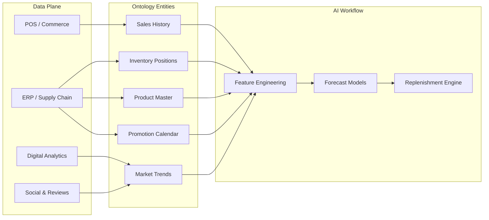

# Demand Forecasting & Replenishment

SKU-store level demand prediction, automated replenishment, and seasonal planning for retail operations.

**Priority:** P0 — Immediate ROI  
**Time to Value:** 4-6 weeks  
**Category:** Planning & Supply Chain

---

## Business Problem

Retail demand is driven by a complex mix of seasonality, promotions, trends, weather, local events, and competitive actions. Inaccurate forecasting at the SKU-store level results in:

- **Stockouts** — empty shelves that drive customers to competitors; estimated 4-8% of revenue lost to out-of-stocks
- **Overstock** — excess inventory leading to markdowns, spoilage (grocery/fresh), and tied-up working capital
- **Bullwhip amplification** — small demand signals at the store level get amplified through the supply chain, causing wild swings in warehouse and supplier orders
- **Promotion chaos** — promotional demand lifts are guessed rather than modeled, leading to either product shortages or excess post-promotion inventory
- **Long-tail blindness** — high-SKU-count retailers (10K-100K SKUs) cannot manually forecast slow-moving or new items

---

## Capabilities

### SKU-Store-Day Demand Forecasting
Granular demand prediction at the SKU × Store × Day level for the next 4-12 weeks, accounting for base demand, trend, seasonality, promotions, price changes, and external factors.

### Promotion Demand Modeling
Predict the volume lift from planned promotions by type (BOGO, % off, bundle) based on historical promotional response curves per category and store cluster.

### Automated Replenishment
Convert demand forecasts into store-level replenishment orders considering lead times, minimum order quantities, shelf capacity, and delivery schedules — pushed to ERP for execution.

### New Product Forecasting
Predict demand for new SKUs with no sales history by leveraging similar-item analogues, category trends, pre-launch digital signals (search interest, social buzz), and test-store performance.

### Weather & Event Overlay
Automatically adjust forecasts for weather-sensitive categories (beverages, ice cream, outdoor gear) and local event impacts (concerts, sports, festivals, school holidays).

---

## Data Sources & Ontology Mapping

| Ontology Entity | Source System | Key Fields |
|----------------|--------------|------------|
| Sales History | POS / E-commerce | SKU, Store, Date, Units Sold, Revenue, Transaction Count, Basket Context |
| Inventory Positions | ERP Warehouse/Store | SKU, Location, On Hand, In Transit, On Order, Days of Supply |
| Promotion Calendar | ERP / Marketing | Promo ID, SKU/Category, Mechanic, Start/End Date, Store Scope, Discount % |
| Market Trends | Digital Analytics + Social | Search Volume, Social Mentions, Review Sentiment, Trending Topics |
| Product Master | ERP Item Master | SKU, Category, Subcategory, Brand, Pack Size, Shelf Life, Launch Date |

---

## AI Workflow

1. **Sales Decomposition** — Decompose SKU-store sales history into base demand, trend, weekly/yearly seasonality, promotion lift, and residual components
2. **Feature Engineering** — Enrich with calendar features (day-of-week, holidays, pay cycles), weather forecasts, local events, competitive signals, and digital trend indicators
3. **Model Training** — Ensemble of LightGBM (cross-learning across SKUs) and DeepAR (time-series deep learning) models; SKU-store level with hierarchical reconciliation (store → region → national)
4. **Promotion Overlay** — Apply learned promotion response curves per promo mechanic × category × store cluster to adjust base forecast during promotional windows
5. **New Item Handling** — For SKUs with <13 weeks history, use analogue-based forecasting (similar category, price point, brand) enriched with pre-launch digital signals
6. **Replenishment Conversion** — Convert daily demand forecast into replenishment orders: forecast → safety stock → reorder point → order quantity, respecting lead times, MOQs, and shelf capacity
7. **Output** — Forecast dashboard for planning team; replenishment orders pushed to ERP; promotional demand estimates for merchandising; new product forecasts for buying team

---

## Dashboard & Alerts

### Key Metrics

| KPI | Description | Target |
|-----|-------------|--------|
| **Forecast Accuracy (WAPE)** | Weighted Absolute Percentage Error at SKU-store-week | < 30% |
| **On-Shelf Availability** | % of SKU-store combinations with stock available for sale | > 97% |
| **Overstock Rate** | % of SKU-stores with >6 weeks supply on hand | < 8% |
| **Promotion Forecast Accuracy** | Predicted vs. actual promotional lift | ± 15% |
| **Waste / Markdown Rate** | % of inventory sold at markdown or wasted (perishables) | < 4% |
| **Auto-Replenishment Adoption** | % of SKU-stores on automated replenishment | > 80% |

### Alert Rules

| Alert | Trigger | Severity | Action |
|-------|---------|----------|--------|
| Stockout imminent | SKU-store projected to reach zero stock within 2 days | Critical | Emergency replenishment; transfer from nearby store if possible |
| Demand spike | Forecast exceeds 3σ above baseline for a SKU cluster | High | Investigate driver (viral trend, competitor OOS); expedite supply |
| Promotion under-supply | Promotional demand forecast exceeds available inventory by >20% | High | Increase allocation; notify merchandising team |
| Forecast degradation | WAPE exceeds 45% for a category for 3 consecutive weeks | Medium | Retrain model; investigate data quality or assortment change |
| New product underperformance | New SKU sells <30% of forecast in first 4 weeks | Info | Reassess analogue selection; review placement and pricing |

---

## ROI Model

| Metric | Before | After | Impact |
|--------|--------|-------|--------|
| On-shelf availability | 93% | 97.5% | **4.5 pt improvement → $6.8M recovered lost sales** |
| Overstock inventory | 14% of SKU-stores | 7% | **50% reduction → $3.2M working capital freed** |
| Markdown/waste | 6.2% of inventory | 3.8% of inventory | **39% reduction → $3.6M margin recovery** |
| Planning effort | 12 planners manual forecasting | 4 planners exception-based | **67% effort reduction** |
| Promotion waste | 18% of promo stock unsold post-promotion | 8% | **56% reduction** |

!!! success "Estimated Annual ROI"
    **$10M - $18M** annually from recovered sales, reduced waste, working capital optimization, and planning efficiency — across a mid-size retailer with $250M annual revenue and 15K+ SKUs.

---

## Implementation Notes

- Requires minimum 104 weeks (2 years) of SKU-store-day sales history from POS for baseline model training
- Promotion calendar must be available 4+ weeks in advance with mechanic details (% off, BOGO, bundle) for promotional demand modeling
- ERP inventory feeds should be daily or near-real-time for automated replenishment to function accurately
- Weather API integration (5-day forecast) adds 2-4% accuracy improvement for weather-sensitive categories
- Hierarchical forecast reconciliation ensures store-level forecasts sum consistently to regional and national plans

---

[← Back to Catalogue](index.md) | [Previous: Customer 360](customer-360.md) | [Next: Personalization →](personalization.md)
