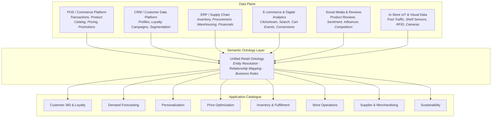
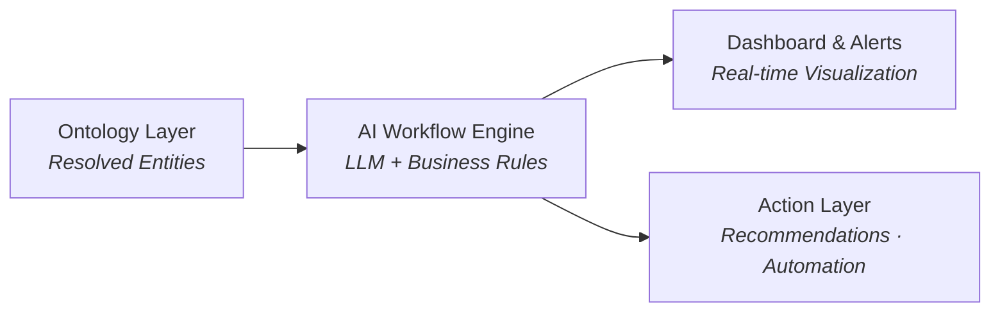

# Retail Application Catalogue

Enterprise AI applications for omnichannel retail operations, powered by the Semantic Ontology Layer.

---

## Data Plane Overview

The application catalogue draws from a unified data plane spanning commerce platforms, CRM, ERP, and digital/physical store data sources:

---

## Data Plane Components

### Structured Enterprise Systems

| System | Market-Leading Products | Role |
|--------|------------------------|------|
| **POS / Commerce Platform** | **Shopify Plus**, **Oracle Retail Xstore**, **SAP Customer Activity Repository (CAR)**, NCR Voyix, Lightspeed, Square, **Salesforce Commerce Cloud** (B2C/B2B storefront) | Transaction capture, product catalog, pricing rules, promotions, store-level sales, e-commerce orders |
| **CRM / Customer Data Platform** | **Salesforce Marketing Cloud + Commerce Cloud**, **Adobe Real-Time CDP**, Segment (Twilio), mParticle, **Klaviyo**, Braze, **Emarsys (SAP)** | Customer profiles, loyalty programs, campaign management, email/SMS, identity resolution, segmentation |
| **ERP / Supply Chain** | **SAP S/4HANA Retail**, **Oracle Retail Merchandising System**, Microsoft Dynamics 365 Supply Chain, **Blue Yonder** (demand planning + WMS), Manhattan Associates (WMS/OMS), NetSuite | Inventory management, procurement, warehouse operations, financials, vendor master, replenishment |

### Semi-Structured & Unstructured Sources

| Source | Market-Leading Products | Role |
|--------|------------------------|------|
| **E-commerce & Digital Analytics** | **Google Analytics 4**, **Adobe Analytics**, Amplitude, Mixpanel, Snowplow (event streaming), **Contentsquare** (experience analytics) | Web/app browsing behavior, search queries, cart events, conversion funnels, heatmaps, session replay |
| **Social Media & Reviews** | **Sprinklr**, **Bazaarvoice**, Yotpo, PowerReviews, Trustpilot, **Brandwatch**, Talkwalker | Product reviews, ratings, brand sentiment, influencer mentions, competitor monitoring, UGC |
| **In-Store IoT & Visual Data** | **RetailNext** (traffic analytics), **Sensormatic / JCI** (loss prevention + traffic), Pricer (electronic shelf labels), **Zebra Technologies** (RFID), Impinj (RAIN RFID), **Cognex** (computer vision) | Foot traffic counters, dwell-time heatmaps, shelf-level inventory, planogram compliance, self-checkout monitoring |

---

## Application Catalogue

### P0 — Immediate ROI

| Application | Primary Data Sources | ROI Signal | Time to Value |
|-------------|---------------------|------------|---------------|
| [Customer 360 & Loyalty Intelligence](customer-360.md) | CRM/CDP, POS, Digital, Social | Increase repeat purchase 15-25%, improve loyalty ROI 20-30% | 4-6 weeks |
| [Demand Forecasting & Replenishment](demand-forecasting.md) | POS, ERP, Digital, Social | Reduce stockouts 25-35%, cut overstock 15-25% | 4-6 weeks |

### P1 — High Value

| Application | Primary Data Sources | ROI Signal | Time to Value |
|-------------|---------------------|------------|---------------|
| [Personalization & Recommendation Engine](personalization.md) | CRM/CDP, POS, Digital | Increase conversion 15-30%, lift AOV 8-15% | 6-8 weeks |
| [Price & Promotion Optimization](price-optimization.md) | POS, ERP, Digital, Social | Improve gross margin 2-4 pts, increase promo ROI 25-40% | 6-8 weeks |

### P2 — Strategic Value

| Application | Primary Data Sources | ROI Signal | Time to Value |
|-------------|---------------------|------------|---------------|
| [Inventory & Fulfillment Intelligence](inventory-fulfillment.md) | ERP, POS, Digital | Reduce fulfillment cost 10-20%, improve availability 5-8% | 8-10 weeks |
| [Store Operations & Workforce](store-operations.md) | IoT, POS, ERP | Reduce labor cost 8-12%, cut shrinkage 15-25% | 8-10 weeks |

### P3 — Operational Excellence

| Application | Primary Data Sources | ROI Signal | Time to Value |
|-------------|---------------------|------------|---------------|
| [Supplier & Merchandising Analytics](supplier-merchandising.md) | ERP, POS, Social | Improve vendor terms 3-5%, optimize assortment lift 10-15% | 10-12 weeks |
| [Sustainability & Compliance](sustainability-compliance.md) | ERP, Social, IoT | Reduce waste 20-30%, ensure food safety compliance 100% | 10-12 weeks |

---

## Ontology Entity Map

Key business entities resolved across systems by the Semantic Ontology Layer:

| Business Entity | POS / Commerce | CRM / CDP | ERP / Supply Chain |
|----------------|---------------|-----------|-------------------|
| **Customer / Shopper** | Transaction Customer ID | Profile / Loyalty ID | — |
| **Product / SKU** | Item / Barcode | — | Material / Item Master |
| **Transaction** | Sale / Return / Exchange | — | Inventory Movement |
| **Store / Location** | Store / Register | — | Warehouse / DC |
| **Promotion** | Discount / Coupon | Campaign / Offer | — |
| **Supplier** | — | — | Vendor Master / PO |

---

## Architecture Pattern

Every application in this catalogue follows a consistent execution pattern:

1. **Data Ingestion** — Ontology layer resolves entities across POS, CRM/CDP, ERP, and unstructured sources (customer identity stitching, product matching, channel unification)
2. **AI Workflow Execution** — LLM-powered pipelines apply business logic, demand prediction, personalization models, and optimization algorithms
3. **Presentation** — Dashboards surface KPIs; alerts trigger on stockouts, margin erosion, and customer behavior shifts
4. **Action** — Recommendations feed back into commerce platforms (personalized offers, dynamic pricing, replenishment orders, workforce schedules)

---

[← Back to Home](../../index.md)
