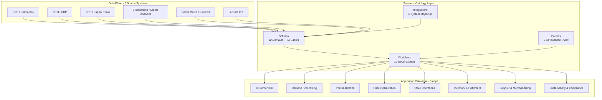

# Retail Semantic Ontology Layer

The Semantic Ontology Layer sits between the Data Plane and the Application Catalogue, providing a unified, standards-aligned knowledge graph that resolves entities across POS/Commerce, CRM/CDP, ERP/Supply Chain, E-commerce/Digital Analytics, Social Media/Reviews, and In-Store IoT systems.

---

## Industry Standards Alignment

The retail ontology is aligned to global product identification and retail industry standards.

### GS1 Standards

The GS1 system provides globally unique identifiers for products, locations, and shipments. Every product, store, and logistics entity in this ontology carries GS1-aligned identifiers:

| GS1 Standard | Purpose | Ontology Entity |
|--------------|---------|-----------------|
| **GTIN** | Product/SKU identification | `Product_Master.GTIN` |
| **GLN** | Store/warehouse location | `Store_Master.GLN`, `Warehouse.GLN` |
| **SSCC** | Shipment tracking | `Shipment.SSCC` |
| **GPC** | Product classification | `Product_Master.GPC_Code` |

### NRF / Retail Taxonomy

The National Retail Federation (NRF) retail taxonomy and Global Product Classification (GPC) govern process areas and product hierarchies:

| Process Area | Scope | Ontology Coverage |
|-------------|-------|-------------------|
| **Merchandising** | Assortment, pricing, promotions | Demand Forecasting, Price Optimization, Supplier & Merchandising |
| **Store Operations** | Labor, planogram, shrinkage, energy | Store Operations |
| **Supply Chain** | Inventory, fulfillment, procurement | Inventory & Fulfillment, Demand Forecasting |
| **Customer** | Loyalty, personalization, engagement | Customer 360, Personalization |
| **Digital Commerce** | E-commerce, mobile, marketplace | Personalization, Inventory & Fulfillment |
| **Sustainability** | Waste, carbon, traceability, compliance | Sustainability & Compliance |

---

## Architecture

---

## Ontology Components

The ontology consists of four interconnected layers, all stored in `enterprise-knowledge/`:

| Layer | Files | Format | Purpose |
|-------|-------|--------|---------|
| [Schema](schema-reference.md) | `retail-schema.yaml` | YAML | 12 domains, ~50 tables with fields, types, risk levels, constraints, and relationships |
| [Workflows](workflows.md) | `workflows/*.yaml` (10 files) | YAML | Triggered process flows with steps, rules, SLAs, and dependencies |
| [Policies](policies.md) | `policies/*.md` (8 files) | Markdown | Business rules, thresholds, approval chains, and compliance constraints |
| [Integrations](integrations.md) | `integrations/*.yaml` (6 files) | YAML | Field-level sync mappings between source systems with conflict resolution |

### Relationship Types

Entities in the schema are connected via typed relationships that form a knowledge graph:

| Relationship | Meaning | Example |
|-------------|---------|---------|
| `triggers` | Entity event initiates a workflow | `Transaction` quantity spike triggers `Demand Reforecast` workflow |
| `syncs_to` | Entity data flows to another system | `Product_Master` syncs_to `E-commerce_Catalog` via integration |
| `constrained_by` | Entity operations governed by a policy | `Promotion` constrained_by `pricing-policy` |
| `depends_on` | Entity requires a parent/related entity | `Inventory_Position` depends_on `Store_Master` |
| `validates` | Entity validates another in a business process | `Vendor_Master` validates `Product_Master` for sourcing |

---

## Cross-Application Entity Heatmap

Shows how many of the 8 retail apps require each entity. Higher usage = more foundational.

| Entity | Count | Applications |
|--------|-------|-------------|
| `Product_Master` | **8** | All apps |
| `Transaction` | **6** | Customer 360, Demand Forecasting, Personalization, Price Optimization, Store Operations, Revenue |
| `Store_Master` | **5** | Demand Forecasting, Store Operations, Inventory & Fulfillment, Price Optimization, Sustainability & Compliance |
| `Customer_Profile` | **4** | Customer 360, Personalization, Price Optimization, Revenue |
| `Inventory_Position` | **4** | Demand Forecasting, Inventory & Fulfillment, Store Operations, Sustainability & Compliance |
| `Promotion` | **3** | Demand Forecasting, Price Optimization, Personalization |
| `Vendor_Master` | **2** | Supplier & Merchandising, Sustainability & Compliance |
| `Shelf_Condition` | **1** | Store Operations |

`Product_Master` is the most connected entity in the retail ontology — equivalent to `Material_Master` in Supply Chain, `Customer_Master` in Banking, `Patient_Master` in Healthcare.

---

## Schema Statistics

| Metric | Count |
|--------|-------|
| **Domains** | 12 |
| **Tables** | ~50 |
| **Source Systems** | 6 (POS/Commerce, CRM/CDP, ERP/Supply Chain, E-commerce/Digital Analytics, Social Media/Reviews, In-Store IoT) |
| **Workflows** | 10 |
| **Policies** | 8 |
| **Integrations** | 6 |
| **Relationship Types** | 5 (triggers, syncs_to, constrained_by, depends_on, validates) |
| **GS1 Standards Covered** | 4 (GTIN, GLN, SSCC, GPC) |

---

## Documentation

| Document | Description |
|----------|-------------|
| [Schema Reference](schema-reference.md) | Complete domain and table reference with fields, types, and relationships |
| [Workflows](workflows.md) | All 10 AI workflow definitions with triggers, steps, and dependencies |
| [Policies](policies.md) | All 8 governance policies with rules, thresholds, and approval chains |
| [Integrations](integrations.md) | All 6 system integration mappings with field-level detail |
| [App-Object Mapping](app-object-mapping.md) | Minimum required objects per application with relationship matrix |
| [Mapping Architecture](mapping-architecture.md) | Schema-first architecture, Semantic RAG pipeline, and ReAct tools |

---

[← Back to Retail Catalogue](../index.md)
