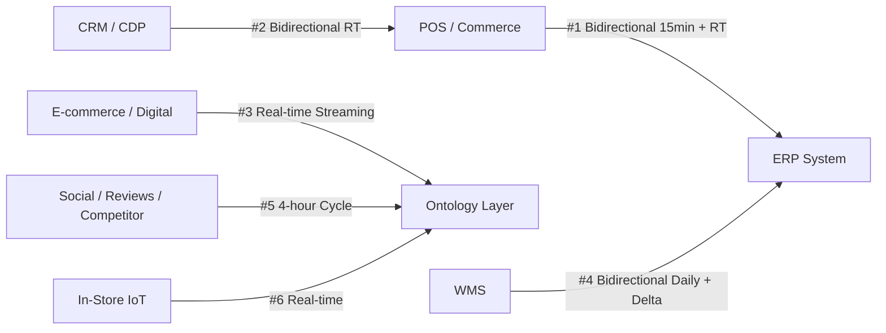
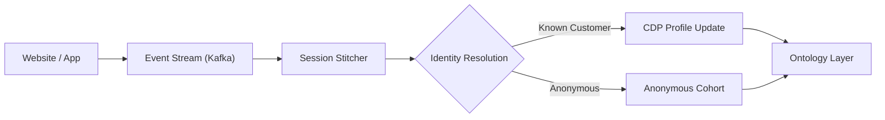
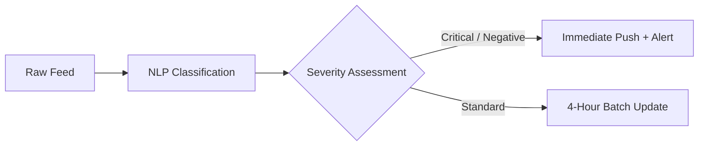
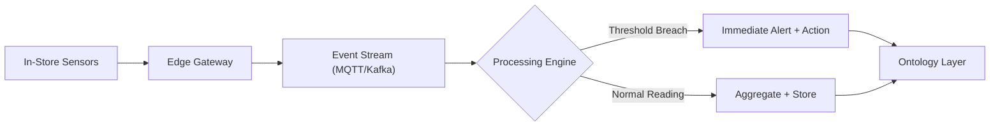

# Integrations

6 system integration mappings that connect the Data Plane source systems to the Semantic Ontology Layer. Each integration is defined in `enterprise-knowledge/integrations/` as a YAML file with field-level mappings, conflict resolution, and failure handling.

---

## Integration Summary

| # | Integration | Source | Target | Type | Frequency |
|---|------------|--------|--------|------|-----------|
| 1 | [POS-ERP Sync](#1-pos-erp-sync) | POS | ERP | Bidirectional | 15-min + real-time transactions |
| 2 | [CRM/CDP-POS Sync](#2-crmcdp-pos-sync) | CRM/CDP | POS | Bidirectional | Real-time |
| 3 | [E-commerce & Digital Feed](#3-e-commerce--digital-feed) | E-commerce / Digital Analytics | Ontology Layer | Unidirectional | Real-time streaming |
| 4 | [ERP-WMS Inventory Feed](#4-erp-wms-inventory-feed) | WMS | ERP | Bidirectional | Daily + real-time delta |
| 5 | [Social & Market Intelligence Feed](#5-social--market-intelligence-feed) | Social / Review / Competitor APIs | Ontology Layer | Unidirectional | 4-hour cycle |
| 6 | [IoT & Sensor Feed](#6-iot--sensor-feed) | In-Store IoT | Ontology Layer | Unidirectional | Real-time |

---

## Integration Architecture

---

## 1. POS-ERP Sync

**ID:** `INTEGRATION_POS_ERP_V1_0` | **File:** `pos-erp-sync.yaml`

POS is source of truth for transaction data. ERP is source of truth for product master, pricing, and promotions.

### Transaction Sync (POS -> ERP)

| POS Field | ERP Field | Direction | Transformation / Constraint |
|----------|----------|-----------|---------------------------|
| Transaction.Transaction_ID | ERP_Sales_Document.External_ID | POS -> ERP | — |
| Transaction.Store_ID | ERP_Sales_Document.Plant_ID | POS -> ERP | Via store-plant mapping table |
| Transaction.Total_Amount | ERP_Sales_Document.Revenue | POS -> ERP | Net of discounts and returns |
| Transaction_Line_Item.SKU | ERP_Sales_Document_Line.Material_ID | POS -> ERP | Via GTIN-to-Material mapping |
| Transaction_Line_Item.Quantity | ERP_Sales_Document_Line.Quantity | POS -> ERP | — |
| Return_Transaction.* | ERP_Return_Document.* | POS -> ERP | Full return record for inventory credit |

### Master Data Sync (ERP -> POS)

| ERP Field | POS Field | Direction | Notes |
|----------|----------|-----------|-------|
| Product_Master.GTIN | POS_Product.Barcode | ERP -> POS | GS1-compliant identifier |
| Product_Master.Description | POS_Product.Display_Name | ERP -> POS | — |
| Price_Record.Active_Price | POS_Product.Price | ERP -> POS | Effective date/time enforced |
| Promotion.Discount_Rules | POS_Promotion.Rules | ERP -> POS | Applied at checkout |
| Product_Attribute.Age_Restricted | POS_Product.Requires_Age_Check | ERP -> POS | Triggers age verification at register |

**Conflict Resolution:** POS wins for transaction data; ERP wins for master data (product, pricing, promotions)

**Failure Handling:** 3 retries at 5-min intervals; dead letter queue; alert retail-integration-alerts@company.com

---

## 2. CRM/CDP-POS Sync

**ID:** `INTEGRATION_CDP_POS_V1_0` | **File:** `cdp-pos-sync.yaml`

CDP is source of truth for customer profile and loyalty. POS is source of truth for in-store transactions.

### Transaction Event Sync (POS -> CRM/CDP)

| POS Field | CDP Field | Direction | Transformation / Constraint |
|----------|----------|-----------|---------------------------|
| Transaction.Transaction_ID | CDP_Event.Event_ID | POS -> CDP | — |
| Transaction.Customer_ID (loyalty swipe) | CDP_Event.Customer_ID | POS -> CDP | Identity stitched via loyalty card or app |
| Transaction_Line_Item.SKU | CDP_Event.Product_ID | POS -> CDP | — |
| Transaction_Line_Item.Quantity | CDP_Event.Quantity | POS -> CDP | — |
| Transaction.Total_Amount | CDP_Event.Basket_Value | POS -> CDP | — |
| Loyalty_Account.Points_Earned | CDP_Loyalty.Points_Balance | POS -> CDP | Delta update on each transaction |

### Profile & Offer Sync (CRM/CDP -> POS)

| CDP Field | POS Field | Direction | Notes |
|----------|----------|-----------|-------|
| Customer_Profile.Customer_ID | POS_Customer.Loyalty_ID | CDP -> POS | For loyalty lookup at checkout |
| Loyalty_Account.Tier | POS_Customer.Tier | CDP -> POS | Tier-based pricing and offers |
| Promotion.Personalized_Offers | POS_Offer.Active_Offers | CDP -> POS | Displayed at checkout or app |
| Customer_Segment.Segment_ID | POS_Customer.Segment | CDP -> POS | For real-time offer targeting |

**Conflict Resolution:** CDP wins for customer profile and loyalty data; POS wins for transaction data

**Frequency:** POS→CDP: real-time (every transaction with loyalty identifier); CDP→POS: on profile/offer change + daily full sync

---

## 3. E-commerce & Digital Feed

**ID:** `INTEGRATION_ECOM_DIGITAL_V1_0` | **File:** `ecom-digital-feed.yaml`

Real-time streaming of digital interaction data into the Ontology Layer for personalization and demand forecasting.

| Feed | Target Entity | Frequency | Special Rules |
|------|--------------|-----------|---------------|
| Clickstream events (page views, product views, add-to-cart) | Clickstream_Event | Real-time streaming | Session stitching via cookie/device ID |
| Search queries | Browsing_Session | Real-time streaming | Zero-result searches flagged for merchandising review |
| Cart events (add, remove, abandon) | Browsing_Session | Real-time streaming | Cart abandonment at 30 min inactivity triggers retargeting |
| Conversion data (checkout, payment) | Online_Order | Real-time streaming | — |
| Online orders (line items, delivery address, fulfillment method) | Online_Order | Real-time | Fulfillment routing based on ATP and proximity |

**Digital Event Pipeline:**

---

## 4. ERP-WMS Inventory Feed

**ID:** `INTEGRATION_ERP_WMS_V1_0` | **File:** `erp-wms-inventory-feed.yaml`

WMS is source of truth for warehouse stock positions. ERP is source of truth for store stock and product master.

### WMS -> ERP

| WMS Field | ERP Field | Direction | Notes |
|----------|----------|-----------|-------|
| WMS_Stock.SKU x Location | Inventory_Position.Unrestricted_Qty | WMS -> ERP | Warehouse positions updated daily + real-time delta |
| WMS_Receipt.GRN_ID | Goods_Receipt.GRN_ID | WMS -> ERP | Triggers three-way match (PO-GRN-Invoice) |
| WMS_Shipment.Shipment_ID | Shipment.Shipment_ID | WMS -> ERP | Carrier, tracking, estimated delivery |
| WMS_Stock_Movement.Type | Stock_Movement.Movement_Type | WMS -> ERP | Receipts, issues, transfers, adjustments |

### ERP -> WMS

| ERP Field | WMS Field | Direction | Notes |
|----------|----------|-----------|-------|
| Purchase_Order.PO_ID | WMS_Inbound.PO_Reference | ERP -> WMS | Expected receipts for dock scheduling |
| Transfer_Order.Transfer_ID | WMS_Transfer.Transfer_Reference | ERP -> WMS | Inter-location stock movements |
| Online_Order.Fulfillment_Node | WMS_Outbound.Order_Reference | ERP -> WMS | Ship-from-store or ship-from-DC routing |

**Conflict Resolution:** WMS wins for warehouse stock positions; ERP wins for store stock and product master

**Frequency:** WMS→ERP: daily full (06:00 UTC) + real-time delta on receipts/shipments; ERP→WMS: on-event (PO creation, transfer order, online order)

---

## 5. Social & Market Intelligence Feed

**ID:** `INTEGRATION_SOCIAL_MARKET_V1_0` | **File:** `social-market-intelligence-feed.yaml`

4-hour refresh cycle for standard data; critical/negative signals pushed immediately.

| Feed | Target Entity | Frequency | Special Rules |
|------|--------------|-----------|---------------|
| Product reviews (marketplace, own site) | Product_Review | 4-hour cycle | Negative reviews (rating ≤2): immediate push for response |
| Brand/product sentiment (social media) | Brand_Sentiment | 4-hour cycle | Sentiment score <30 for 7+ days: escalation to Marketing VP |
| Competitor pricing (web scraping, APIs) | Competitor_Price | 4-hour cycle | KVI price changes: immediate push for price matching review |
| Market trends (search trends, category data) | Market_Trend | 4-hour cycle | Trending products flagged for demand planning |

**Signal Classification Pipeline:**

---

## 6. IoT & Sensor Feed

**ID:** `INTEGRATION_IOT_SENSOR_V1_0` | **File:** `iot-sensor-feed.yaml`

Real-time streaming of in-store sensor data into the Ontology Layer for store operations and sustainability monitoring.

| Feed | Target Entity | Frequency | Special Rules |
|------|--------------|-----------|---------------|
| Foot traffic counters (entrance/zone) | Store_Traffic | Real-time | Aggregated to 15-min intervals for reporting; raw for real-time staffing |
| Shelf condition (computer vision) | Shelf_Condition | Real-time | Out-of-stock or planogram deviation: immediate alert to floor staff |
| Temperature sensors (cold chain) | Temperature_Sensor | Real-time | Excursion outside spec: immediate quarantine alert per POL-SUST-001 |
| RFID (high-value items, apparel) | Inventory_Position (delta) | Real-time | Reconciled against ERP inventory daily; discrepancy >2%: investigation |

**IoT Sensor Pipeline:**

---

## Failure Handling (All Integrations)

All integrations share a common failure handling pattern:

| Setting | Value |
|---------|-------|
| Retry count | 3 |
| Retry interval | 5 minutes |
| Dead letter queue | Enabled |
| Alert on failure | Integration-specific alert email |
| Fallback | Source system value is authoritative; manual update required in target |

---

[← Back to Ontology Overview](index.md)
