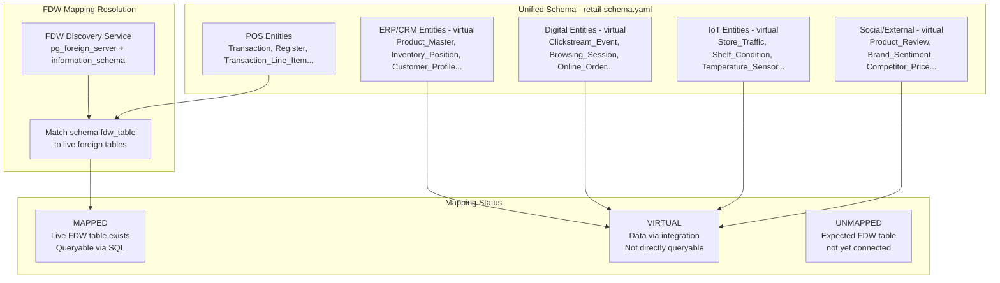
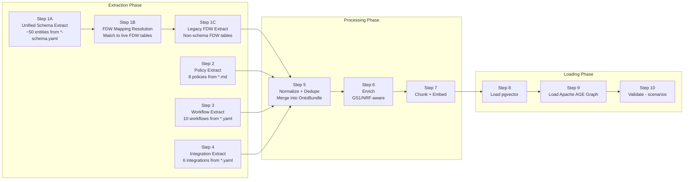

# Mapping Architecture & Semantic Indexing

How the unified retail schema maps to the existing systems of record, how the semantic indexing pipeline processes it, and how the ReAct agent uses the indexed ontology to serve queries and take actions.

---

## Schema-First Architecture

The retail ontology uses a **schema-first** approach — the unified schema is the primary knowledge source, not the FDW foreign tables. FDW becomes a mapping resolution layer that annotates which schema entities have live database connections.



### Entity Mapping Status

| Status | Meaning | Count | Example |
|--------|---------|-------|---------|
| **Mapped** | Live FDW foreign table exists; entity is queryable via `query_table` tool | ~8 | Transaction, Product_Master, Customer_Profile, Store_Master, Inventory_Position, Loyalty_Account, Register, Price_Record |
| **Virtual** | Entity data flows via integration sync; not directly queryable via FDW | ~35 | Online_Order, Clickstream_Event, Shipment, Vendor_Master, Brand_Sentiment, Competitor_Price |
| **Unmapped** | Schema defines the entity but no FDW table or integration connected yet | ~5 | Carbon_Footprint, Product_Origin (derived/calculated entities) |

---

## Semantic RAG Pipeline (12 Steps)

The pipeline follows the same 12-step process as other vertical ontologies, extended with Steps 1A (Unified Schema Extraction) and 1B (FDW Mapping Resolution):



### Step Details

| Step | File | What It Does |
|------|------|-------------|
| **1A** | `unified_schema_extractor.py` | Reads `retail-schema.yaml`; creates OntoDocuments for every entity with GS1 standard, NRF process area, and FDW mapping status annotations |
| **1B** | `fdw_mapping_resolver.py` | Queries `FDWDiscoveryService` to match schema entities to live FDW foreign tables; annotates as mapped/virtual/unmapped; enriches mapped entities with live column metadata |
| **1C** | `fdw_extractor.py` | Original FDW extractor for non-schema tables (backward compatibility) |
| **2** | `policy_extractor.py` | Auto-discovers all `*.md` from `enterprise-knowledge/policies/` — includes 8 retail policies |
| **3** | `workflow_extractor.py` | Auto-discovers all `*.yaml` from `enterprise-knowledge/workflows/` — includes 10 retail workflows |
| **4** | `integration_extractor.py` | Auto-discovers all `*.yaml` from `enterprise-knowledge/integrations/` — includes 6 retail integrations |
| **5** | `normalizer.py` | Merges all extracted documents; deduplicates by ID; merges relationships and `structured_metadata` on collision |
| **6** | `enricher.py` | Schema entities: auto-enriched with GS1 standard, NRF process area, and FDW status. Policies/workflows/integrations: LLM-enriched via gpt-4o-mini |
| **7** | `chunker.py` | 1 document = 1 chunk; batch embedded (20/batch) via OpenAI text-embedding-3-small |
| **8** | `vector_loader.py` | Upserted to pgvector `control_plane_embeddings` with content_type: `onto_schema`, `onto_policy`, `onto_workflow`, `onto_integration` |
| **9** | `graph_loader.py` | Nodes (Entity) and edges (triggers/syncs_to/constrained_by/depends_on/validates) merged into Apache AGE `enterprise_onto` graph |
| **10** | `validator.py` | Black-box test scenarios validating retrieval quality across 6 dimensions |

### What Gets Indexed

| Source | Content Type | Approx Count |
|--------|-------------|-------------|
| Unified schema (POS + ERP + CRM/CDP + E-commerce + IoT + Social) | `onto_schema` | ~50 |
| Policies (8 retail) | `onto_policy` | ~55+ (split by section) |
| Workflows (10 retail) | `onto_workflow` | ~10 |
| Integrations (6 retail) | `onto_integration` | ~6 |
| **Total** | — | **~120+** |

---

## ReAct Agent and Tools

The ReAct agent uses the indexed ontology to answer questions and take actions. The flow is: **Search ontology -> Reason with policies -> Execute actions -> Validate compliance.**

### Tool Inventory

#### Read Tools

| Tool | Domain | What It Does |
|------|--------|-------------|
| `search_enterprise_knowledge` | Core | Hybrid vector + graph search across all ontology types |
| `search_schema_knowledge` | Core | Vector search over FDW table definitions |
| `discover_tables` / `discover_columns` / `query_table` | Core | FDW table discovery and parameterized SQL queries |
| `check_policy_compliance` | Governance | Validates proposed actions against indexed policies |
| `get_product_360` | Retail | Assemble unified product profile across POS, ERP, E-commerce, Reviews |
| `get_customer_360` | Retail | Assemble unified customer profile across CRM/CDP, POS, E-commerce, Loyalty |
| `get_inventory_position` | Retail | Query inventory for a SKU across stores, warehouses, and channels |
| `get_store_performance` | Retail | Retrieve store KPIs: sales, traffic, conversion, shrinkage, labor efficiency |
| `get_promotion_effectiveness` | Retail | Analyze promotion ROI, uplift, cannibalization, and margin impact |

#### Write Tools

| Tool | Risk Level | What It Does |
|------|-----------|-------------|
| `create_replenishment_order` | LOW_RISK_WRITE | Create stock replenishment order for a store or DC |
| `update_price` | HIGH_RISK_WRITE | Update product price (triggers margin floor check per POL-PRICE-001) |
| `create_markdown` | LOW_RISK_WRITE | Create markdown schedule for seasonal clearance |
| `create_promotion` | LOW_RISK_WRITE | Create promotion with discount rules and eligibility |
| `update_planogram` | LOW_RISK_WRITE | Update planogram assignment for a category/store |

### End-to-End ReAct Flow

```mermaid
sequenceDiagram
    participant User
    participant Agent as ReAct Agent
    participant RAG as Ontology Search
    participant Policy as Policy Check
    participant SoR as System of Record

    User->>Agent: "Which stores have excess inventory of SKU X that could fulfill online orders?"
    Agent->>RAG: search_enterprise_knowledge("inventory SKU X excess stores fulfillment")
    RAG-->>Agent: Inventory_Position schema + inventory-policy + ship-from-store rules
    Agent->>Agent: REASON: Policy says ship-from-store requires >10 units excess above safety stock
    Agent->>SoR: get_inventory_position(sku="SKU-X", include_stores=true)
    SoR-->>Agent: 12 stores with stock; 5 stores have >10 units excess above safety stock
    Agent->>Policy: check_policy_compliance("ship_from_store", "Inventory_Position", "5 stores eligible")
    Policy-->>Agent: COMPLIANT — meets >10 unit excess threshold per POL-INV-001 Section 4
    Agent->>User: 5 stores have excess inventory of SKU X eligible for online fulfillment. Store A (42 excess), Store B (31 excess), Store C (28 excess), Store D (19 excess), Store E (14 excess). Recommend routing online orders to Store A and B (highest excess, lowest shipping cost).
```

---

## UI Integration

### Data Plane Page

- **Vertical selector** filters data sources by domain (All / Retail / Supply Chain / CRM)
- Each source node shows **ontology entity count** and **NRF process area coverage**
- Source cards display **FDW mapping status** (mapped / virtual) and **entity count badges**

### Control Plane Page

- **Semantic Layer tab** shows vertical-level stats (Retail: 50 entities, 10 workflows, 8 policies, 6 integrations)
- **NRF process area distribution** badges (Merchandising, Store Operations, Supply Chain, Customer, Digital Commerce, Sustainability)
- **Knowledge Formation** and **Semantic Explorer** tabs support system and NRF filtering

### Reasoning Page

- **ReAct Tools tab** organizes tools into **Read Tools** and **Write Tools** with domain badges (Core / Retail / Governance)
- **AI Copilot** system prompt includes retail context and tool selection strategy

---

## Configuration

The pipeline is configured via `SemanticRagConfig`:

| Parameter | Default | Purpose |
|-----------|---------|---------|
| `schema_dir` | `enterprise-knowledge/` | Directory containing `*-schema.yaml` files |
| `policy_path` | `enterprise-knowledge/policies/` | Directory with policy Markdown files |
| `workflow_path` | `enterprise-knowledge/workflows/` | Directory with workflow YAML files |
| `integration_path` | `enterprise-knowledge/integrations/` | Directory with integration YAML files |
| `skip_unified_schema` | `false` | Skip Step 1A (unified schema extraction) |
| `skip_fdw_mapping` | `false` | Skip Step 1B (FDW mapping resolution) |
| `enrich_with_llm` | `true` | Enable LLM enrichment for non-schema docs |
| `skip_graph` | `false` | Skip Apache AGE graph loading |

Trigger reindex via: `POST /api/v1/control-plane/reindex`

---

[← Back to Ontology Overview](index.md)
