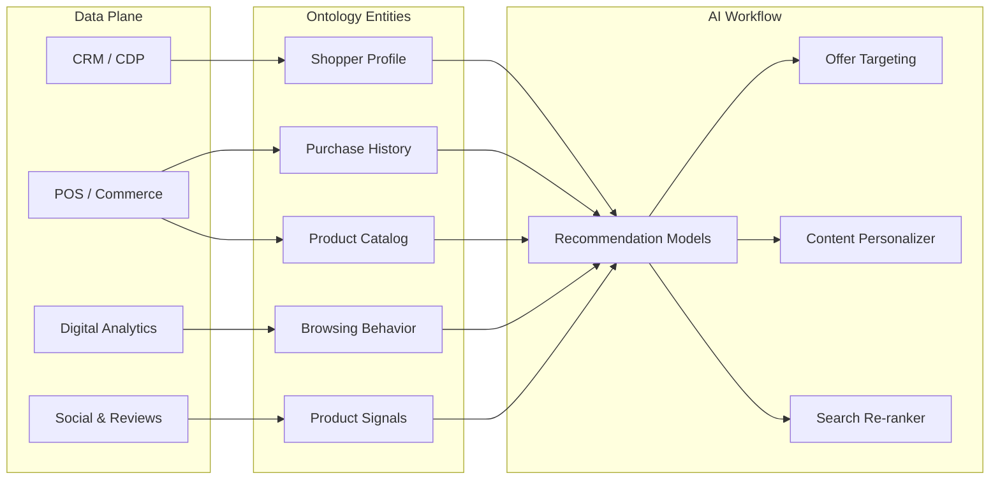

# Personalization & Recommendation Engine

Product recommendations, personalized offers, and dynamic content across all retail channels.

**Priority:** P1 — High Value  
**Time to Value:** 6-8 weeks  
**Category:** Marketing & Digital

---

## Business Problem

Retailers serve thousands of SKUs across multiple channels but present the same experience to every shopper. Without personalization:

- **Low conversion** — generic product listings and email campaigns yield 2-3% conversion; personalized experiences can reach 8-15%
- **Missed cross-sell** — a customer buying a running shoe is never prompted for performance socks, insoles, or a fitness tracker
- **Email fatigue** — batch-and-blast campaigns with identical content drive unsubscribes rather than engagement
- **Search irrelevance** — on-site search returns results by popularity rather than individual relevance, missing long-tail opportunities
- **Cold-start challenge** — new or anonymous visitors receive no personalization, despite behavioral signals from the current session

---

## Capabilities

### Product Recommendations
AI-powered recommendations across touchpoints: "You may also like" (PDP), "Complete the look" (cart), "Based on your browsing" (homepage), "Customers also bought" (post-purchase email).

### Personalized Offer Targeting
Match promotional offers to individual shoppers based on purchase history, price sensitivity, category affinity, and predicted CLV — maximizing incremental lift per promotion dollar.

### Dynamic Content Personalization
Personalize website/app content blocks (hero banners, category order, featured products, messaging) per visitor segment or individual behavioral profile.

### Personalized Search & Merchandising
Re-rank on-site search results and category pages per visitor based on their affinity signals (brand preference, price range, size, style, past purchases).

### Real-Time Session Personalization
For anonymous visitors, build an intra-session behavioral profile from browsing patterns, search queries, and cart activity to serve relevant recommendations within the current visit.

---

## Data Sources & Ontology Mapping

| Ontology Entity | Source System | Key Fields |
|----------------|--------------|------------|
| Shopper Profile | CRM/CDP | Customer ID, Segment, CLV, Affinity Categories, Preferred Channel, Loyalty Tier |
| Product Catalog | POS + ERP | SKU, Name, Category, Brand, Price, Attributes (size, color, style), Availability |
| Browsing Behavior | Digital Analytics | Session ID, Pages Viewed, Products Viewed, Search Queries, Time on Page, Cart Events |
| Purchase History | POS + E-commerce | Transaction ID, Items, Basket Value, Channel, Date, Promo Used, Return Flag |
| Product Signals | Social + Reviews | Product, Rating, Review Count, Sentiment, Trending Score, UGC Content |

---

## AI Workflow

1. **Profile Enrichment** — Merge CRM/CDP profile with POS purchase history, digital browsing behavior, and review/social engagement into a unified feature set per shopper
2. **Collaborative Filtering** — Matrix factorization on the customer × product interaction matrix to identify latent preference patterns; "shoppers like you also bought..."
3. **Content-Based Filtering** — Product attribute matching based on individual affinity vectors (brand preference, price range, category interest, style profile)
4. **Hybrid Ensemble** — Combine collaborative, content-based, and popularity signals with a learned weighting model optimized for conversion
5. **Context Layer** — Apply real-time context: current page (PDP → cross-sell, cart → complementary, homepage → discovery), device, time of day, inventory availability, and active promotions
6. **Offer Targeting** — For customers eligible for a promotion, select the highest-propensity offer using uplift modeling (who will respond incrementally vs. who would buy anyway)
7. **A/B Testing** — Continuously test recommendation strategies, content variants, and offer types; automatically route traffic to winning variants
8. **Output** — Recommendation API for website/app; personalized email content blocks for CRM; offer targeting lists for campaign manager; search re-ranking for e-commerce platform

---

## Dashboard & Alerts

### Key Metrics

| KPI | Description | Target |
|-----|-------------|--------|
| **Recommendation Click-Through Rate** | % of recommendation impressions that are clicked | > 12% |
| **Recommendation Conversion Rate** | % of recommendation clicks that result in purchase | > 8% |
| **Revenue from Recommendations** | % of total revenue attributed to recommendation clicks | > 15% |
| **Average Order Value (AOV) Lift** | AOV increase for sessions with recommendation engagement | > 12% |
| **Email Personalization CTR** | Click-through rate for personalized vs. generic emails | 2.5x improvement |
| **Search Relevance Score** | Mean Reciprocal Rank of clicked results | > 0.65 |

### Alert Rules

| Alert | Trigger | Severity | Action |
|-------|---------|----------|--------|
| Recommendation CTR drop | Category-level reco CTR drops >30% week-over-week | High | Investigate model freshness; check catalog data quality |
| Cold-start gap | >40% of sessions receive no personalization (new/anonymous) | Medium | Review session-based model coverage; enhance cold-start strategy |
| A/B test significance | Test variant reaches statistical significance (p < 0.05) | Medium | Auto-promote winning variant; notify merchandising team |
| Offer fatigue | Personalized offer acceptance rate drops below 3% for a segment | Medium | Refresh offer creative; adjust targeting criteria |
| Catalog coverage gap | >20% of catalog SKUs never appear in recommendations | Info | Review model diversity settings; investigate long-tail suppression |

---

## ROI Model

| Metric | Before | After | Impact |
|--------|--------|-------|--------|
| E-commerce conversion rate | 2.8% | 4.2% | **50% lift → $5.6M incremental online revenue** |
| Average order value | $68 | $78 | **15% AOV lift → $3.8M incremental revenue** |
| Email campaign revenue | $1.2M / year | $2.4M / year | **2x from personalized content** |
| Recommendation-attributed revenue | 5% of online sales | 18% of online sales | **3.6x increase** |
| Return rate (personalized purchases) | 12% | 9% | **25% reduction → better fit recommendations** |

!!! success "Estimated Annual ROI"
    **$8M - $14M** annually from conversion lift, AOV increase, email personalization, and reduced returns — across a mid-size retailer with $80M in e-commerce revenue.

---

## Implementation Notes

- Recommendation models require minimum 6 months of browsing + purchase interaction data with product-level granularity
- Real-time session personalization requires sub-100ms model inference; consider pre-computed candidate sets with real-time re-ranking
- Product catalog must include rich attributes (category hierarchy, brand, attributes) for content-based filtering to work well
- A/B testing infrastructure is essential for continuous improvement; ensure proper holdout groups and statistical rigor
- GDPR/CCPA consent is required for cross-session personalization using cookies/identifiers; anonymous session-based personalization avoids this constraint

---

[← Back to Catalogue](index.md) | [Previous: Demand Forecasting](demand-forecasting.md) | [Next: Price Optimization →](price-optimization.md)
