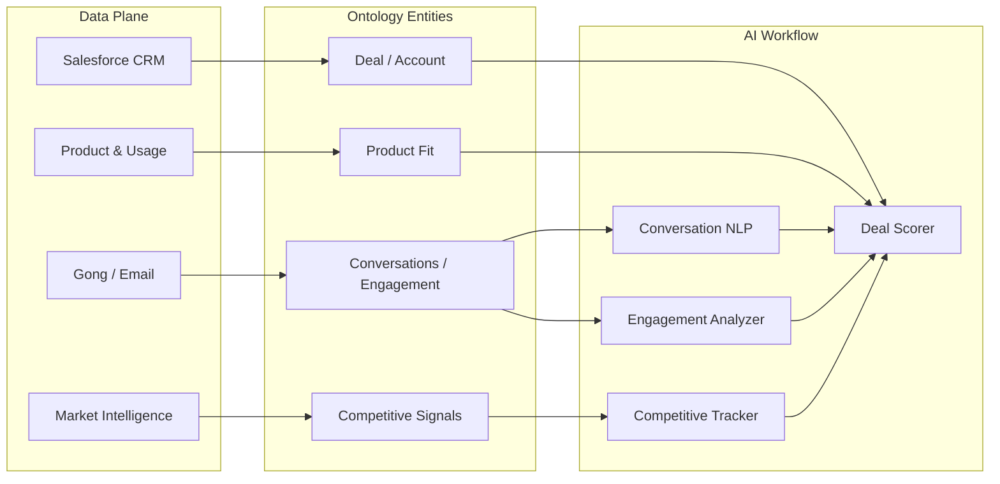

# Deal Intelligence & Contextual Analytics

AI-powered deal analysis combining CRM pipeline data, conversation intelligence, email engagement, product fit, and competitive signals for contextual deal scoring.

**Priority:** P0 — Immediate ROI  
**Time to Value:** 4-6 weeks  
**Category:** Sales Intelligence

---

## Business Problem

B2B sales organizations generate massive volumes of deal activity across CRM, calls, emails, and product usage — but lack the ability to synthesize these signals into actionable deal intelligence:

- **Opaque deal health** — reps update CRM subjectively; managers lack objective signals of deal progression or stall
- **Conversation blindness** — thousands of sales calls happen weekly; insights (objections, competitor mentions, champion engagement) are lost
- **Email black hole** — critical buyer engagement signals in email threads (multi-threading, executive involvement, response latency) are invisible to leadership
- **Product-fit mismatch** — deals sold without understanding product fit result in churn; usage data never reaches sales
- **Competitive ambush** — competitor involvement is discovered late; no systematic tracking of competitive mentions across conversations and emails

---

## Capabilities

### AI Deal Health Scoring
Composite score combining CRM stage progression, conversation sentiment/momentum, email engagement velocity, stakeholder mapping completeness, and product-fit signals — updated continuously per deal.

### Conversation Intelligence
NLP on call recordings: extract competitor mentions, objections raised, decision criteria (MEDDPICC), champion identification, next steps commitment, and deal risk signals.

### Email Engagement Analytics
Analyze email threads per deal: multi-threading depth (# unique buyer contacts), executive engagement, response time trends, attachment opens, and ghost-risk detection.

### Product-Fit & Expansion Signals
Correlate product usage data with deal context: prospect already using free tier → expansion signal; usage declining at renewal customer → churn risk.

### Competitive Intelligence Overlay
Aggregate competitor mentions from calls, emails, and intent data; surface competitive battle cards and win/loss patterns per competitor.

---

## Data Sources & Ontology Mapping

| Ontology Entity | Source System | Key Fields |
|----------------|--------------|------------|
| Deal / Opportunity | Salesforce CRM | Opportunity_ID, Account_ID, Amount, Stage, Close_Date, Owner, MEDDPICC_Score |
| Conversation Record | Gong / Call Platform | Call_ID, Opportunity_ID, Participants, Duration, Transcript, Sentiment_Score, Topics, Competitor_Mentions |
| Email Thread | Email Platform | Thread_ID, Opportunity_ID, Participants, Message_Count, Response_Time_Avg, Executive_Flag, Last_Activity |
| Product Usage | Product Platform | Account_ID, Product, Feature_Adoption_Pct, MAU, Usage_Trend, License_Utilization |
| Competitive Signal | Market Intelligence | Signal_ID, Competitor, Source (Call/Email/Intent), Opportunity_ID, Detection_Date |

---

## AI Workflow

1. **Deal Context Assembly** — Pull Salesforce opportunity + all related calls from Gong + email threads + product usage + intent signals into unified deal context
2. **Conversation NLP** — Process call transcripts: extract MEDDPICC elements (Metrics, Economic Buyer, Decision Criteria, Decision Process, Identify Pain, Champion), competitor mentions, objections, next-step commitments
3. **Email Engagement Scoring** — Calculate per-deal: multi-thread depth, executive involvement ratio, response velocity trend, attachment engagement, and ghost risk (no response >7 days from key contact)
4. **Product-Fit Analysis** — For existing customer upsells: map current usage against proposed expansion; for new logos: match prospect firmographics + intent signals against ideal customer profile
5. **Competitive Intelligence** — Aggregate all competitor signals (call mentions, email references, intent data); surface relevant battle card; calculate competitive threat score per deal
6. **Composite Deal Scoring** — Weighted ensemble: CRM progression (25%) + conversation momentum (25%) + email engagement (20%) + product fit (15%) + competitive position (15%) → single deal health score 0-100
7. **Output** — Deal intelligence dashboard for sales leadership; deal-level risk cards for reps; conversation insights pushed to Salesforce activity; competitive alerts to enablement

---

## Dashboard & Alerts

### Key Metrics

| KPI | Description | Target |
|-----|-------------|--------|
| **Deal Health Score Distribution** | % of pipeline with deal health score above threshold | > 70% of pipeline scoring > 60 |
| **Win Rate** | Closed-won / total qualified opportunities | Increase 15-25% |
| **Average Sales Cycle** | Days from opportunity creation to close | Reduce 20-30% |
| **MEDDPICC Completion** | % of qualified opps with complete MEDDPICC scoring | > 80% of qualified opps |
| **Conversation Coverage** | % of sales meetings with recorded and analyzed calls | > 90% of meetings recorded |
| **Multi-Threading Depth** | Average unique buyer contacts engaged per deal | > 3 unique contacts per deal |

### Alert Rules

| Alert | Trigger | Severity | Action |
|-------|---------|----------|--------|
| Deal stall detected | Opportunity stage unchanged >14 days with declining engagement | Critical | Surface to manager; recommend re-engagement strategy |
| Champion gone silent | Primary champion no response >10 days on active deal | High | Alert rep; suggest executive sponsor outreach |
| Competitor detected | Competitor mention in call or email on deal >$100K | High | Push competitive battle card; notify sales enablement |
| Ghost deal | No meetings, calls, or emails on opportunity >21 days | Medium | Flag for pipeline hygiene; recommend close or re-engage |
| Product-fit warning | Prospect use case does not match top 3 ICP segments | Medium | Alert solutions engineer; assess custom requirements |

---

## ROI Model

| Metric | Before | After | Impact |
|--------|--------|-------|--------|
| Win rate | 22% | 29% | **32% improvement → $8.4M incremental revenue** (on $120M pipeline) |
| Average sales cycle | 68 days | 52 days | **24% reduction → faster cash conversion** |
| Deal inspection time | 45 min/deal/week (manual) | 8 min/deal/week (AI-assisted) | **82% time savings for managers** |
| Competitive win rate | 35% (when competitor present) | 48% | **37% improvement** |
| Forecast accuracy (deal level) | 55% | 72% | **31% improvement** |

!!! success "Estimated Annual ROI"
    **$6M - $12M** annually from improved win rates, shorter sales cycles, better competitive positioning, and manager productivity — across a B2B SaaS company with $120M annual pipeline and 50+ AEs.

---

## Implementation Notes

- Gong API integration required for call transcript and metadata ingestion; ensure recording consent and compliance with regional regulations
- Email integration via Exchange/Gmail API requires OAuth scoping limited to sales team mailboxes; PII filtering applied before ontology ingestion
- MEDDPICC field mapping is customizable per sales methodology; initial configuration requires sales ops input on stage definitions and scoring weights
- Product telemetry pipeline must expose account-level usage metrics; coordinate with product engineering on data availability and refresh cadence
- CRM data hygiene is a prerequisite — deduplicate contacts, standardize opportunity stages, and enforce required fields before AI scoring is reliable

---

[← Back to Catalogue](index.md) | [Next: Pipeline Risk & Forecasting →](pipeline-risk-forecasting.md)
