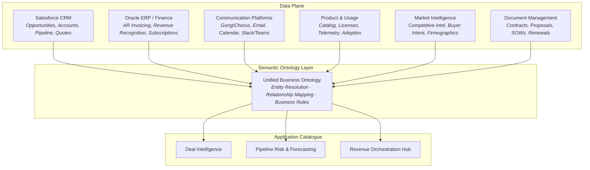
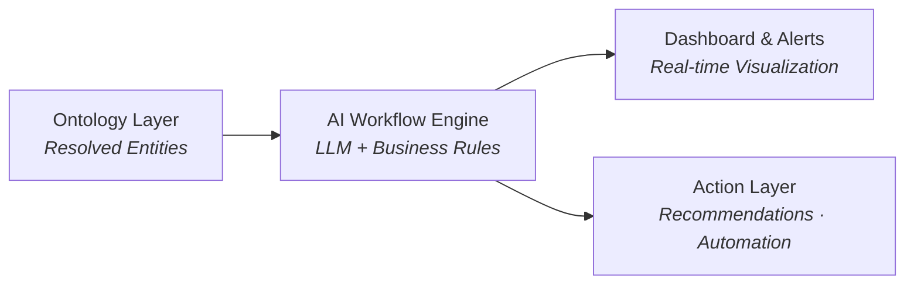

# Revenue Operations Application Catalogue

Enterprise AI applications for B2B revenue operations, powered by the Semantic Ontology Layer.

---

## Data Plane Overview

The application catalogue draws from a unified data plane spanning structured enterprise systems and unstructured data sources:

---

## Application Catalogue

### P0 — Immediate ROI

| Application | Primary Data Sources | ROI Signal | Time to Value |
|-------------|---------------------|------------|---------------|
| [Deal Intelligence & Contextual Analytics](deal-intelligence.md) | Salesforce CRM, Gong/Email, Product & Usage, Market Intel | Increase win rate 15-25%, reduce sales cycle 20-30% | 4-6 weeks |

### P1 — High Value

| Application | Primary Data Sources | ROI Signal | Time to Value |
|-------------|---------------------|------------|---------------|
| [Pipeline Risk & Revenue Forecasting](pipeline-risk-forecasting.md) | Salesforce CRM, Oracle Finance, Gong/Email, Market Intel | Improve forecast accuracy 30-40%, reduce pipeline surprise loss 40-50% | 6-8 weeks |

### P2 — Strategic Value

| Application | Primary Data Sources | ROI Signal | Time to Value |
|-------------|---------------------|------------|---------------|
| [Revenue Operations Orchestration Hub](revenue-orchestration.md) | Salesforce CRM, Oracle Finance, Product & Usage, Documents | Reduce revenue leakage 3-5%, accelerate quote-to-cash 40-60% | 8-10 weeks |

---

## Ontology Entity Map

Key business entities resolved across systems by the Semantic Ontology Layer:

| Business Entity | Salesforce CRM | Oracle ERP / Finance | Communication Platforms |
|----------------|---------------|---------------------|------------------------|
| **Deal / Opportunity** | Opportunity / Opp Line Item | — | Call Recording / Email Thread |
| **Account / Buyer** | Account / Contact | Customer Master | Meeting Attendees |
| **Product / SKU** | Product / Price Book | Revenue Line / Subscription | Usage Telemetry |
| **Quote / Proposal** | Quote / CPQ | — | Attached Docs |
| **Invoice / Payment** | — | AR Invoice / Payment | — |
| **Contract** | — | Contract / Renewal | Signed Agreement |

---

## Architecture Pattern

Every application in this catalogue follows a consistent execution pattern:

1. **Data Ingestion** — Ontology layer resolves entities across Salesforce CRM, Oracle ERP/Finance, Communication Platforms, and unstructured sources
2. **AI Workflow Execution** — LLM-powered pipelines apply business logic, anomaly detection, and predictive models
3. **Presentation** — Dashboards surface KPIs; alerts trigger on threshold breaches
4. **Action** — Recommendations feed back into source systems or trigger automated workflows

---

[← Back to Home](../../index.md)
