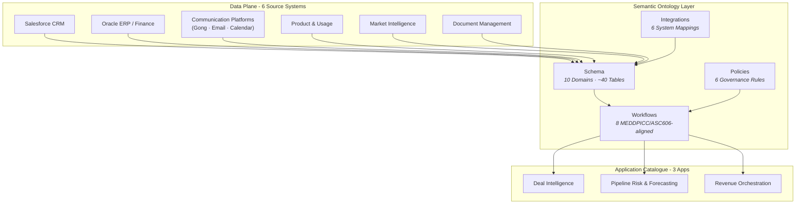

# Rev-Ops Semantic Ontology Layer

The Semantic Ontology Layer sits between the Data Plane and the Application Catalogue, providing a unified, standards-aligned knowledge graph that resolves entities across Salesforce CRM, Oracle ERP/Finance, Communication Platforms (Gong, Email, Calendar), Product & Usage, Market Intelligence, and Document Management sources.

---

## Industry Standards Alignment

The Rev-Ops ontology is aligned to three frameworks — MEDDPICC for sales methodology, ASC 606 / IFRS 15 for revenue recognition, and B2B SaaS Metrics for operational benchmarking.

### MEDDPICC (Sales Methodology Framework)

MEDDPICC is the industry-standard qualification framework for complex B2B sales. Every deal-facing entity and workflow in this ontology maps to a MEDDPICC element:

| MEDDPICC Element | Scope | Ontology Coverage |
|-----------------|-------|-------------------|
| **Metrics** | Quantified business impact | `Deal_Opportunity.Metrics_Identified` |
| **Economic Buyer** | Decision authority mapping | `Stakeholder_Map.Economic_Buyer_ID` |
| **Decision Criteria** | Technical/business requirements | `Conversation_Record.Decision_Criteria_Extracted` |
| **Decision Process** | Buying process and timeline | `Deal_Velocity.Stage_Progression` |
| **Identify Pain** | Business pain articulation | `Conversation_Record.Pain_Points_Extracted` |
| **Champion** | Internal advocate identification | `Stakeholder_Map.Champion_ID` |
| **Competition** | Competitive landscape per deal | `Competitive_Signal.Competitor`, `Competitive_Signal.Threat_Score` |

### ASC 606 / IFRS 15 (Revenue Recognition)

Revenue recognition entities follow the five-step model prescribed by ASC 606 and IFRS 15:

| ASC 606 Step | Purpose | Ontology Entity |
|-------------|---------|-----------------|
| **Step 1: Identify Contract** | Contract existence validation | `Contract_Record.Status` |
| **Step 2: Identify Performance Obligations** | Deliverables per contract | `Contract_Record.Performance_Obligations` |
| **Step 3: Determine Transaction Price** | Total consideration | `Deal_Opportunity.Amount`, `Contract_Record.Total_Value` |
| **Step 4: Allocate Price** | Price per obligation | `Revenue_Schedule.Allocation` |
| **Step 5: Recognize Revenue** | Revenue timing | `Revenue_Schedule.Recognition_Date`, `Revenue_Schedule.Method` |

### B2B SaaS Metrics

Operational and financial metrics embedded as first-class entities in the ontology:

| Metric | Purpose | Ontology Entity |
|--------|---------|-----------------|
| **ARR** (Annual Recurring Revenue) | Subscription revenue run-rate | `Subscription.ARR` |
| **NDR** (Net Dollar Retention) | Expansion minus churn | `Renewal_Record.NDR_Pct` |
| **CAC** (Customer Acquisition Cost) | Sales + marketing cost per win | `Deal_Opportunity.Total_Cost_to_Acquire` |
| **LTV** (Lifetime Value) | Predicted total customer revenue | `Account_Profile.LTV` |
| **Magic Number** | Sales efficiency metric | Derived from ARR growth / S&M spend |

---

## Architecture

---

## Ontology Components

The ontology consists of four interconnected layers, all stored in `enterprise-knowledge/`:

| Layer | Files | Format | Purpose |
|-------|-------|--------|---------|
| [Schema](schema-reference.md) | `rev-ops-schema.yaml` | YAML | 10 domains, ~40 tables with fields, types, risk levels, constraints, and relationships |
| [Workflows](workflows.md) | `workflows/*.yaml` (8 files) | YAML | Triggered process flows with steps, rules, SLAs, and dependencies |
| [Policies](policies.md) | `policies/*.md` (6 files) | Markdown | Business rules, thresholds, approval chains, and compliance constraints |
| [Integrations](integrations.md) | `integrations/*.yaml` (6 files) | YAML | Field-level sync mappings between source systems with conflict resolution |

### Relationship Types

Entities in the schema are connected via typed relationships that form a knowledge graph:

| Relationship | Meaning | Example |
|-------------|---------|---------|
| `triggers` | Entity event initiates a workflow | `Deal_Opportunity` triggers `Deal Scoring` workflow |
| `syncs_to` | Entity data flows to another system | `Account_Profile` syncs_to `Oracle_AR_Customer` via integration |
| `constrained_by` | Entity operations governed by a policy | `Revenue_Schedule` constrained_by `revenue-recognition-policy` |
| `depends_on` | Entity requires a parent/related entity | `Conversation_Record` depends_on `Deal_Opportunity` |
| `validates` | Entity validates another in a business process | `Contract_Record` validates `Deal_Opportunity` in deal-to-revenue handoff |

---

## Cross-Application Entity Heatmap

Shows how many of the 3 Rev-Ops apps require each entity. Higher usage = more foundational.

| Entity | Count | Applications |
|--------|-------|-------------|
| `Deal_Opportunity` | **3** | All apps |
| `Account_Profile` | **3** | All apps |
| `Conversation_Record` | **2** | Deal Intelligence, Pipeline Risk |
| `Email_Thread` | **2** | Deal Intelligence, Pipeline Risk |
| `Contract_Record` | **2** | Pipeline Risk, Revenue Orchestration |
| `Revenue_Schedule` | **2** | Pipeline Risk, Revenue Orchestration |
| `Subscription` | **2** | Pipeline Risk, Revenue Orchestration |
| `AR_Invoice` | **1** | Revenue Orchestration |

`Deal_Opportunity` and `Account_Profile` are the most connected entities in the Rev-Ops ontology — equivalent to `Material_Master` in Supply Chain or `Subscriber` in Telco.

---

## Schema Statistics

| Metric | Count |
|--------|-------|
| **Domains** | 10 |
| **Tables** | ~40 |
| **Source Systems** | 6 (Salesforce CRM, Oracle ERP/Finance, Communication Platforms, Product & Usage, Market Intelligence, Document Management) |
| **Workflows** | 8 |
| **Policies** | 6 |
| **Integrations** | 6 |
| **Relationship Types** | 5 (triggers, syncs_to, constrained_by, depends_on, validates) |

---

## Documentation

| Document | Description |
|----------|-------------|
| [Schema Reference](schema-reference.md) | Complete domain and table reference with fields, types, and relationships |
| [Workflows](workflows.md) | All 8 AI workflow definitions with triggers, steps, and dependencies |
| [Policies](policies.md) | All 6 governance policies with rules, thresholds, and approval chains |
| [Integrations](integrations.md) | All 6 system integration mappings with field-level detail |
| [App-Object Mapping](app-object-mapping.md) | Minimum required objects per application with relationship matrix |

---

[← Back to Rev-Ops Catalogue](../index.md)
