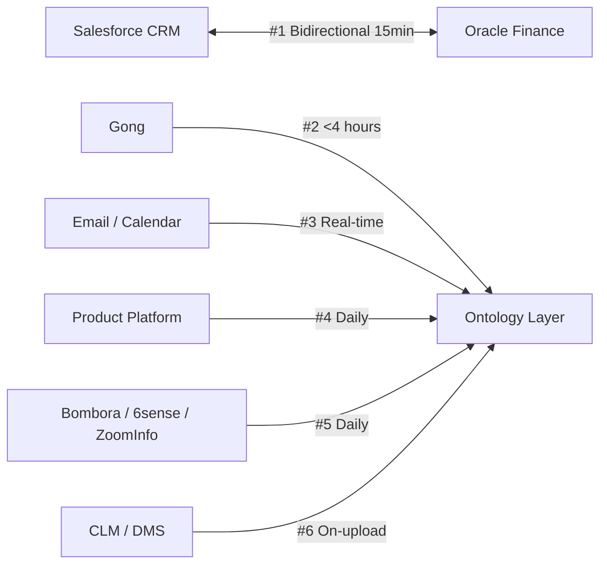
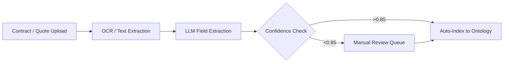

# Integrations

6 system integration mappings that connect the Data Plane source systems to the Semantic Ontology Layer. Each integration is defined in `enterprise-knowledge/integrations/` as a YAML file with field-level mappings, conflict resolution, and failure handling.

---

## Integration Summary

| # | Integration | Source | Target | Type | Frequency |
|---|------------|--------|--------|------|-----------|
| 1 | [Salesforce CRM - Oracle Finance Sync](#1-salesforce-crm---oracle-finance-sync) | Salesforce CRM / Oracle Finance | Bidirectional | Bidirectional | 15-min + real-time on close |
| 2 | [Gong / Conversation Intelligence Feed](#2-gong--conversation-intelligence-feed) | Gong | Ontology Layer | Unidirectional | <4 hours from call |
| 3 | [Email & Calendar Sync](#3-email--calendar-sync) | Email / Calendar | Ontology Layer | Unidirectional | Real-time |
| 4 | [Product & Usage Feed](#4-product--usage-feed) | Product Platform | Ontology Layer | Unidirectional | Daily aggregation |
| 5 | [Market Intelligence Feed](#5-market-intelligence-feed) | Bombora / 6sense / ZoomInfo | Ontology Layer | Unidirectional | Daily |
| 6 | [Document Management / CLM Feed](#6-document-management--clm-feed) | CLM / DMS | Ontology Layer | Unidirectional | On-upload + NLP |

---

## Integration Architecture

---

## 1. Salesforce CRM - Oracle Finance Sync

**ID:** `INTEGRATION_CRM_FINANCE_V1_0` | **File:** `crm-finance-sync.yaml`

Salesforce CRM is source of truth for deal/pipeline data. Oracle Finance is source of truth for billing, revenue recognition, and AR.

### CRM → Finance (Deal Close & Customer Master)

| CRM Field | Finance Field | Direction | Transformation / Constraint |
|----------|--------------|-----------|---------------------------|
| Deal_Opportunity.ID | Oracle_Booking.SF_Opportunity_ID | CRM → Finance | — |
| Deal_Opportunity.Amount | Oracle_Booking.Booking_Amount | CRM → Finance | Currency conversion if non-USD |
| Deal_Opportunity.Close_Date | Oracle_Booking.Booking_Date | CRM → Finance | — |
| Account_Profile.Account_ID | Oracle_AR_Customer.SF_Account_ID | CRM → Finance | Create or update customer record |
| Contract_Record.Terms | Oracle_Billing.Payment_Terms | CRM → Finance | Map to Oracle payment term codes |
| Opportunity_Line_Item.* | Oracle_Revenue_Line.* | CRM → Finance | Per-line revenue schedule creation |

### Finance → CRM (Billing & Revenue Status)

| Finance Field | CRM Field | Direction | Notes |
|--------------|----------|-----------|-------|
| Oracle_AR_Invoice.Status | Deal_Opportunity.Invoice_Status__c | Finance → CRM | Read-only in Salesforce |
| Oracle_AR_Invoice.Payment_Status | Account_Profile.Payment_Status__c | Finance → CRM | — |
| Oracle_Revenue.Recognition_Status | Deal_Opportunity.Rev_Rec_Status__c | Finance → CRM | ASC 606 compliance status |
| Oracle_AR_Aging.Aging_Bucket | Account_Profile.AR_Aging__c | Finance → CRM | For account health scoring |

**Conflict Resolution:** CRM wins for deal/pipeline data; Finance wins for billing/revenue recognition data

**Failure Handling:** 3 retries at 5-min intervals; dead letter queue; alert revops-integration-alerts@company.com

---

## 2. Gong / Conversation Intelligence Feed

**ID:** `INTEGRATION_GONG_FEED_V1_0` | **File:** `gong-feed.yaml`

Unidirectional feed from Gong into the ontology for conversation analytics and deal intelligence.

### Field Mapping (Gong → Ontology)

| Gong Field | Target Entity | Target Field | Notes |
|-----------|--------------|-------------|-------|
| Call.recording_url | Conversation_Record | Recording_URL | Encrypted link with TTL |
| Call.transcript | Conversation_Record | Transcript | Full text; chunked for embedding |
| Call.topics[] | Conversation_Record | Topics_Extracted | AI-extracted topic tags |
| Call.sentiment_score | Conversation_Record | Sentiment_Score | -1.0 to 1.0 scale |
| Call.action_items[] | Meeting_Action_Item | Description | One record per action item |
| Call.participants[] | Meeting_Action_Item | Assigned_To | Matched to Contact by email |
| Call.deal_id | Conversation_Record | Opportunity_ID | Linked to Deal_Opportunity |
| Call.duration_seconds | Conversation_Record | Duration_Seconds | — |

**Frequency:** <4 hours from call end; batch processing every 2 hours with incremental catch-up

**Conflict Resolution:** Gong is authoritative for all conversation data; CRM enrichment (opportunity link) applied post-ingestion

---

## 3. Email & Calendar Sync

**ID:** `INTEGRATION_EMAIL_CALENDAR_V1_0` | **File:** `email-calendar-sync.yaml`

Real-time sync of email and calendar activity linked to opportunities for engagement analytics.

### Email Mapping

| Source Field | Target Entity | Target Field | Notes |
|-------------|--------------|-------------|-------|
| Email.thread_id | Email_Thread | Thread_ID | Unique thread identifier |
| Email.subject | Email_Thread | Subject | — |
| Email.participants[] | Email_Thread | Participants | Matched to Contact by email domain |
| Email.timestamp | Email_Thread | Last_Activity | — |
| Email.opportunity_id | Email_Thread | Opportunity_ID | Auto-linked via account/contact matching |
| Email.response_time_seconds | Email_Thread | Response_Time_Seconds | Time to first reply |

### Calendar Mapping

| Source Field | Target Entity | Target Field | Notes |
|-------------|--------------|-------------|-------|
| Event.event_id | Calendar_Event | Event_ID | — |
| Event.title | Calendar_Event | Title | — |
| Event.attendees[] | Calendar_Event | Attendees | Matched to Contact + internal user records |
| Event.start_time | Calendar_Event | Start_Time | — |
| Event.opportunity_id | Calendar_Event | Opportunity_ID | Auto-linked via attendee matching |
| Event.meeting_type | Calendar_Event | Meeting_Type | Classified: Discovery / Demo / Negotiation / Exec |

**Frequency:** Real-time event-driven sync

**Conflict Resolution:** Email/Calendar platform is authoritative; CRM opportunity linkage applied as enrichment layer

---

## 4. Product & Usage Feed

**ID:** `INTEGRATION_PRODUCT_USAGE_V1_0` | **File:** `product-usage-feed.yaml`

Daily aggregated product usage data for health scoring, expansion signals, and churn prediction.

### Field Mapping

| Source Field | Target Entity | Target Field | Notes |
|-------------|--------------|-------------|-------|
| Subscription.subscription_id | Subscription | Subscription_ID | — |
| Subscription.plan | Subscription | Plan_Name | — |
| Subscription.status | Subscription | Status | Active / Trial / Churned / Paused |
| Subscription.arr | Subscription | ARR | Current ARR for subscription |
| Usage.mau | Product_Usage | MAU | Monthly Active Users |
| Usage.dau | Product_Usage | DAU | Daily Active Users |
| Usage.api_calls | Product_Usage | API_Usage | Monthly API call count |
| Usage.storage_gb | Product_Usage | Storage_Used_GB | — |
| Usage.login_frequency | Product_Usage | Login_Frequency | Logins per user per week |
| Usage.feature_adoption[] | Product_Usage | Feature_Adoption_Pct | Percentage of licensed features used |

**Frequency:** Daily aggregation at 02:00 UTC; incremental updates for subscription status changes (real-time)

**Conflict Resolution:** Product platform is authoritative for all usage and subscription data

---

## 5. Market Intelligence Feed

**ID:** `INTEGRATION_MARKET_INTEL_V1_0` | **File:** `market-intelligence-feed.yaml`

Daily external intelligence feeds for buyer intent, firmographics, competitive signals, and review data.

### Field Mapping

| Source | Target Entity | Target Field | Notes |
|--------|--------------|-------------|-------|
| Bombora / 6sense intent topics | Intent_Data | Topic | Buyer intent topic cluster |
| Bombora / 6sense intent score | Intent_Data | Intent_Score | 0-100 composite score |
| Bombora / 6sense surge flag | Intent_Data | Surge_Flag | Boolean: score above baseline |
| ZoomInfo firmographic update | Account_Profile | Firmographic_* | Employee count, revenue, industry |
| ZoomInfo contact enrichment | Contact | Title, Phone, LinkedIn | Contact data refresh |
| Competitive intel (Klue/Crayon) | Competitive_Signal | Competitor | Competitor name |
| Competitive intel | Competitive_Signal | Signal_Type | Pricing change / Product launch / Leadership change |
| Competitive intel | Competitive_Signal | Threat_Score | 1-10 threat level |
| G2 review data | Competitive_Signal | Review_Sentiment | Aggregate review sentiment and category scores |

**Frequency:** Daily batch at 06:00 UTC; intent surges pushed near-real-time when available

**Conflict Resolution:** External sources are authoritative for their respective data; CRM account matching uses domain + name fuzzy match (>0.90 confidence required)

---

## 6. Document Management / CLM Feed

**ID:** `INTEGRATION_CLM_EXTRACT_V1_0` | **File:** `document-clm-feed.yaml`

NLP pipeline for extracting structured data from contracts, quotes, and legal documents.

### Extraction Mapping

| Pipeline | Source | Target Entity | Confidence Threshold |
|----------|--------|--------------|---------------------|
| Contract NLP | CLM (Ironclad/DocuSign CLM) | Contract_Record | >0.85: auto-index; <0.85: manual review |
| Quote PDF Extraction | DMS / Email attachments | Quote | >0.85: auto-populate; <0.85: flag for review |
| Terms Extraction | Contract PDFs | Contract_Record.Terms | >0.85: auto-index; <0.85: legal review |
| Ramp Schedule Extraction | Contract PDFs | Revenue_Schedule.Ramp_Schedule | >0.85: auto-create schedule; <0.85: manual entry |

### Extracted Fields

| Extracted Field | Target | Notes |
|----------------|--------|-------|
| Contract value | Contract_Record.Total_Value | — |
| Payment terms | Contract_Record.Payment_Terms | Mapped to standard term codes |
| Auto-renewal clause | Contract_Record.Auto_Renewal | Boolean |
| Termination for convenience | Contract_Record.Termination_Clause | Days notice required |
| Performance obligations | Contract_Record.Performance_Obligations | Array of obligation descriptions |
| Pricing ramp | Revenue_Schedule.Ramp_Schedule | Year-over-year pricing ramp |

### Extraction Pipeline

---

## Failure Handling (All Integrations)

All integrations share a common failure handling pattern:

| Setting | Value |
|---------|-------|
| Retry count | 3 |
| Retry interval | 5 minutes |
| Dead letter queue | Enabled |
| Alert on failure | Integration-specific alert email |
| Fallback | Source system value is authoritative; manual update required in target |

---

[← Back to Ontology Overview](index.md)
