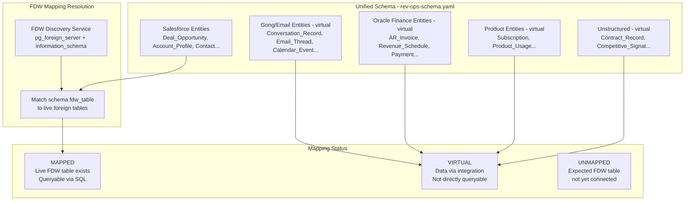
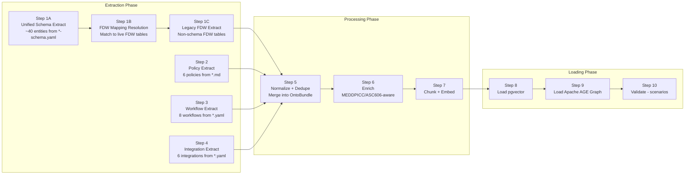
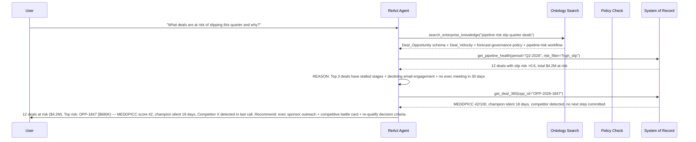

# Mapping Architecture & Semantic Indexing

How the unified revenue operations schema maps to the existing systems of record, how the semantic indexing pipeline processes it, and how the ReAct agent uses the indexed ontology to serve queries and take actions.

---

## Schema-First Architecture

The revenue operations ontology uses a **schema-first** approach — the unified schema is the primary knowledge source, not the FDW foreign tables. FDW becomes a mapping resolution layer that annotates which schema entities have live database connections.

### Entity Mapping Status

| Status | Meaning | Count | Example |
|--------|---------|-------|---------|
| **Mapped** | Live FDW foreign table exists; entity is queryable via `query_table` tool | ~6 | Deal_Opportunity, Account_Profile, Contact, Opportunity_Line_Item |
| **Virtual** | Entity data flows via integration sync; not directly queryable via FDW | ~28 | Conversation_Record, AR_Invoice, Revenue_Schedule, Subscription |
| **Unmapped** | Schema defines the entity but no FDW table or integration connected yet | ~4 | Deal_Velocity, Pipeline_Snapshot (derived entities) |

---

## Semantic RAG Pipeline (12 Steps)

The pipeline follows the same 12-step process as other vertical ontologies:

### Step Details

| Step | File | What It Does |
|------|------|-------------|
| **1A** | `unified_schema_extractor.py` | Reads `rev-ops-schema.yaml`; creates OntoDocuments for every entity with MEDDPICC element, ASC 606 step, SaaS metric, and FDW mapping status annotations |
| **1B** | `fdw_mapping_resolver.py` | Queries `FDWDiscoveryService` to match schema entities to live FDW foreign tables; annotates as mapped/virtual/unmapped |
| **1C** | `fdw_extractor.py` | Original FDW extractor for non-schema tables (backward compatibility) |
| **2** | `policy_extractor.py` | Auto-discovers all `*.md` from `enterprise-knowledge/policies/` — includes 6 rev-ops policies |
| **3** | `workflow_extractor.py` | Auto-discovers all `*.yaml` from `enterprise-knowledge/workflows/` — includes 8 rev-ops workflows |
| **4** | `integration_extractor.py` | Auto-discovers all `*.yaml` from `enterprise-knowledge/integrations/` — includes 6 rev-ops integrations |
| **5** | `normalizer.py` | Merges all extracted documents; deduplicates by ID; merges relationships and `structured_metadata` on collision |
| **6** | `enricher.py` | Schema entities: auto-enriched with MEDDPICC element, ASC 606 step, SaaS metric, and FDW status. Policies/workflows/integrations: LLM-enriched via gpt-4o-mini |
| **7** | `chunker.py` | 1 document = 1 chunk; batch embedded (20/batch) via OpenAI text-embedding-3-small |
| **8** | `vector_loader.py` | Upserted to pgvector `control_plane_embeddings` with content_type: `onto_schema`, `onto_policy`, `onto_workflow`, `onto_integration` |
| **9** | `graph_loader.py` | Nodes (Entity) and edges (triggers/syncs_to/constrained_by/depends_on/validates) merged into Apache AGE `enterprise_onto` graph |
| **10** | `validator.py` | Black-box test scenarios validating retrieval quality across 6 dimensions |

### What Gets Indexed

| Source | Content Type | Approx Count |
|--------|-------------|-------------|
| Unified schema (Salesforce + Gong + Oracle + Product + Documents + Market) | `onto_schema` | ~40 |
| Policies (6 rev-ops) | `onto_policy` | ~40+ (split by section) |
| Workflows (8 rev-ops) | `onto_workflow` | ~8 |
| Integrations (6 rev-ops) | `onto_integration` | ~6 |
| **Total** | — | **~95+** |

---

## ReAct Agent and Tools

The ReAct agent uses the indexed ontology to answer questions and take actions. The flow is: **Search ontology -> Reason with policies -> Execute actions -> Validate compliance.**

### Tool Inventory

#### Read Tools

| Tool | Domain | What It Does |
|------|--------|-------------|
| `search_enterprise_knowledge` | Core | Hybrid vector + graph search across all ontology types |
| `search_schema_knowledge` | Core | Vector search over FDW table definitions |
| `discover_tables` / `discover_columns` / `query_table` | Core | FDW table discovery and parameterized SQL queries |
| `check_policy_compliance` | Governance | Validates proposed actions against indexed policies |
| `get_deal_360` | RevOps | Assemble unified deal context: CRM + conversations + emails + product fit + competitive |
| `get_pipeline_health` | RevOps | Query pipeline coverage, velocity, concentration, and forecast accuracy |
| `get_account_health` | RevOps | Retrieve account health: usage, NPS, renewal status, expansion signals |
| `get_revenue_position` | RevOps | Query revenue recognition status, AR aging, and leakage metrics |
| `get_forecast_accuracy` | RevOps | Compare AI forecast vs. rep forecast vs. actuals over time |

#### Write Tools

| Tool | Risk Level | What It Does |
|------|-----------|-------------|
| `update_deal_score` | LOW_RISK_WRITE | Update deal health score and MEDDPICC assessment in Salesforce |
| `create_retention_task` | LOW_RISK_WRITE | Create retention/renewal task for CSM in Salesforce |
| `update_forecast_category` | LOW_RISK_WRITE | Update deal forecast category (Commit/Best Case/Pipeline) |
| `create_billing_schedule` | HIGH_RISK_WRITE | Create billing schedule in Oracle Finance (triggers invoicing) |
| `approve_discount` | HIGH_RISK_WRITE | Approve non-standard discount (triggers pricing policy check) |

### End-to-End ReAct Flow

---

## UI Integration

### Data Plane Page

- **Vertical selector** filters data sources by domain (All / Rev-Ops / Supply Chain / CRM)
- Each source node shows **ontology entity count** and **MEDDPICC element coverage**
- Source cards display **FDW mapping status** (mapped / virtual) and **entity count badges**

### Control Plane Page

- **Semantic Layer tab** shows vertical-level stats (Rev-Ops: 40 entities, 8 workflows, 6 policies, 6 integrations)
- **MEDDPICC element distribution** badges + **ASC 606 step coverage** badges
- **Knowledge Formation** and **Semantic Explorer** tabs support system and standard filtering

### Reasoning Page

- **ReAct Tools tab** organizes tools into **Read Tools** and **Write Tools** with domain badges (Core / RevOps / CRM / Governance)
- **AI Copilot** system prompt includes revenue operations context and tool selection strategy

---

## Configuration

The pipeline is configured via `SemanticRagConfig`:

| Parameter | Default | Purpose |
|-----------|---------|---------|
| `schema_dir` | `enterprise-knowledge/` | Directory containing `*-schema.yaml` files |
| `policy_path` | `enterprise-knowledge/policies/` | Directory with policy Markdown files |
| `workflow_path` | `enterprise-knowledge/workflows/` | Directory with workflow YAML files |
| `integration_path` | `enterprise-knowledge/integrations/` | Directory with integration YAML files |
| `skip_unified_schema` | `false` | Skip Step 1A (unified schema extraction) |
| `skip_fdw_mapping` | `false` | Skip Step 1B (FDW mapping resolution) |
| `enrich_with_llm` | `true` | Enable LLM enrichment for non-schema docs |
| `skip_graph` | `false` | Skip Apache AGE graph loading |

Trigger reindex via: `POST /api/v1/control-plane/reindex`

---

[← Back to Ontology Overview](index.md)
