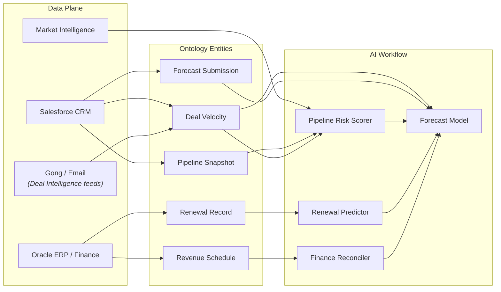

# Pipeline Risk & Revenue Forecasting

AI-driven pipeline risk identification, deal-level probability scoring, and bottoms-up revenue forecasting that surfaces revenue risks before they impact the quarter.

**Priority:** P1 — High Value  
**Time to Value:** 6-8 weeks  
**Category:** Revenue Forecasting & Risk

---

## Business Problem

Revenue forecasting remains one of the most consequential and least reliable processes in B2B organizations. CRM-based forecasting relies on rep judgment and stage-based probabilities that consistently miss:

- **Forecast miss culture** — 60%+ of B2B companies miss quarterly forecasts by >10%; CFOs and boards lose confidence
- **Pipeline coverage illusion** — 3x pipeline coverage looks healthy on paper but hides concentration risk, stage inflation, and dead deals
- **Late-quarter surprises** — deals slip in the final 2 weeks when it's too late to recover; no early warning system
- **Stage inflation** — reps advance deals to later stages without objective evidence of buyer progression
- **Renewal blindness** — upcoming renewals at risk of churn or downsell are not surfaced until 30 days before expiry
- **Disconnected finance** — CRM pipeline and ERP revenue recognition operate independently; no real-time revenue projection aligned to ASC 606

---

## Capabilities

### AI Pipeline Risk Scoring
Score every deal on slip/loss probability using deal velocity, engagement signals, historical patterns, and competitive intelligence — enabling managers to focus on at-risk deals with the highest recovery potential.

### Bottoms-Up Revenue Forecast
ML-driven forecast combining deal-level probabilities, historical conversion rates by stage/segment/rep, and seasonal patterns — producing a range-based forecast (best/likely/worst) that improves on CRM category roll-ups.

### Pipeline Health Analytics
Diagnose pipeline quality: coverage ratio by segment, stage distribution vs. healthy benchmarks, velocity by cohort, concentration risk (top 10 deals as % of target), and aging analysis — with trend comparison to prior quarters.

### Renewal & Expansion Risk
For existing customers: predict renewal probability, expansion likelihood, and downsell/churn risk using product usage, support tickets, NPS, and billing patterns — surfacing at-risk ARR 90+ days before renewal date.

### Finance-Aligned Revenue Projection
Project recognized revenue per ASC 606 rules: map pipeline to expected bookings → billing schedule → revenue recognition timing — giving CFOs real-time visibility into future-quarter revenue impact.

---

## Data Sources & Ontology Mapping

| Ontology Entity | Source System | Key Fields |
|----------------|--------------|------------|
| Pipeline Snapshot | Salesforce CRM | Snapshot_Date, Opportunity_ID, Stage, Amount, Close_Date, Forecast_Category, Owner |
| Deal Velocity | Salesforce CRM + Gong/Email | Opportunity_ID, Days_In_Stage, Stage_Progression_Rate, Engagement_Score, Last_Activity_Date |
| Renewal Record | Oracle ERP / Finance | Contract_ID, Account_ID, ARR, Renewal_Date, Term_Length, Usage_Score, NPS |
| Revenue Schedule | Oracle ERP / Finance | Booking_ID, Billing_Schedule, Recognition_Start, Recognition_End, ASC606_Category, Amount |
| Forecast Submission | Salesforce CRM | Rep_ID, Period, Category (Commit/Best Case/Pipeline), Amount, Submission_Date |

---

## AI Workflow

1. **Pipeline Snapshot Capture** — Daily snapshot of full Salesforce pipeline: stage, amount, close date, forecast category, and owner — building a longitudinal dataset for pattern detection
2. **Deal Velocity Analysis** — For each deal: calculate days-in-stage, stage progression velocity, engagement trend (from Deal Intelligence app), and compare against historical cohort benchmarks
3. **Risk Classification** — ML model classifies each deal as On Track / At Risk / Likely Slip / Likely Loss based on velocity, engagement, competitive signals, and historical win patterns for similar deals
4. **Renewal Risk Scoring** — For upcoming renewals (90-day window): combine product usage trends, support ticket volume, NPS, payment history, and executive engagement into renewal probability score
5. **Bottoms-Up Forecast** — Aggregate deal-level probabilities into segment/region/rep forecasts; apply historical conversion adjustment factors; generate best/likely/worst range with confidence intervals
6. **Finance Reconciliation** — Map forecasted bookings to billing schedules and ASC 606 recognition timing; surface gaps between CRM pipeline and finance revenue projections
7. **Output** — Forecast dashboard for CRO/CFO; weekly pipeline risk digest for managers; renewal risk alerts for customer success; finance-aligned revenue projection for FP&A

---

## Dashboard & Alerts

### Key Metrics

| KPI | Description | Target |
|-----|-------------|--------|
| **Forecast Accuracy** | Actual revenue vs. committed forecast at quarter end | Within ± 5% of commit |
| **Pipeline Coverage Health** | Weighted pipeline / quota (adjusted for stage probability) | 2.5-3.5x weighted coverage |
| **Deal Slip Rate** | % of deals that push close date past current quarter | < 15% of commit deals |
| **Renewal Retention Rate** | % of ARR retained at renewal (gross retention) | > 92% gross retention |
| **Revenue Recognition Accuracy** | Projected vs. actual recognized revenue per ASC 606 | Within ± 3% |

### Alert Rules

| Alert | Trigger | Severity | Action |
|-------|---------|----------|--------|
| Forecast gap detected | Weighted pipeline drops below 2x of remaining quota mid-quarter | Critical | Escalate to CRO; activate pipeline generation plays |
| Commit deal at risk | Deal in commit category scores >60% slip probability | Critical | Manager intervention; executive sponsor engagement |
| Stage inflation detected | Deal advanced to later stage without corresponding engagement increase | High | Flag for pipeline review; require manager validation |
| Renewal churn risk | Renewal within 90 days with renewal probability <60% | High | Alert customer success; trigger executive business review |
| Concentration risk | Top 5 deals represent >40% of quarterly target | Medium | Diversify pipeline focus; assess deal-level risk for top 5 |

---

## ROI Model

| Metric | Before | After | Impact |
|--------|--------|-------|--------|
| Quarterly forecast accuracy | ± 18% variance | ± 6% variance | **67% improvement → CFO/board confidence** |
| Pipeline surprise loss | 22% of commit deals lost/slipped in final 2 weeks | 9% of commit deals | **59% reduction in late-quarter surprises** |
| Gross revenue retention | 85% | 92% | **$2.1M ARR saved** (on $30M renewal base) |
| Pipeline inspection time | 6 hours/week per manager | 1.5 hours/week | **75% time savings → redirected to coaching** |
| Finance reconciliation | 5-day monthly close process | 2-day process | **60% faster close** |

!!! success "Estimated Annual ROI"
    **$8M - $15M** annually from improved forecast accuracy, reduced pipeline surprise losses, higher gross retention, and manager productivity — across a B2B SaaS company with $100M ARR and 200+ person sales organization.

---

## Implementation Notes

- Pipeline snapshot infrastructure requires daily Salesforce extract with full opportunity history; configure change data capture or scheduled SOQL exports
- Deal velocity scoring depends on Deal Intelligence app outputs (conversation and email engagement signals); deploy P0 app first for maximum accuracy
- Renewal risk model requires Oracle ERP subscription and billing data; coordinate with finance on ARR calculation methodology and contract term mapping
- ASC 606 revenue recognition rules must be codified with finance team; different booking types (new, expansion, renewal) follow distinct recognition schedules
- Historical forecast accuracy calibration requires 4-6 quarters of pipeline snapshot data; initial deployment uses industry benchmarks until sufficient data accumulates

---

[← Back to Catalogue](index.md) | [Previous: Deal Intelligence](deal-intelligence.md) | [Next: Revenue Orchestration →](revenue-orchestration.md)
