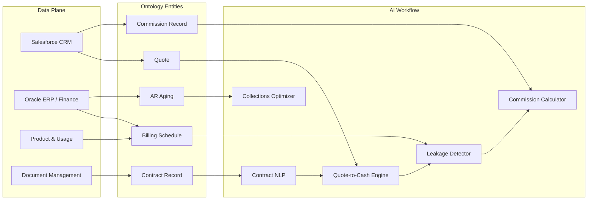

# Revenue Operations Orchestration Hub

Real-time coordination across CRM, finance, billing, and contract systems — eliminating handoff gaps in the quote-to-cash lifecycle.

**Priority:** P2 — Strategic Value  
**Time to Value:** 8-10 weeks  
**Category:** Operations Orchestration

---

## Business Problem

The quote-to-cash lifecycle spans multiple systems and teams — sales, deal desk, legal, finance, billing, and collections — with manual handoffs at every junction that create delays, errors, and revenue leakage:

- **Quote-to-cash friction** — deals close in Salesforce but contracts, billing, and provisioning happen in separate systems with manual handoffs taking 5-15 days
- **Revenue leakage** — pricing discrepancies between CRM quotes and ERP billing, unapplied payments, and missed renewal billing erode 2-5% of revenue
- **Contract-billing disconnect** — contract terms (ramp schedules, usage tiers, multi-year commits) are in PDFs that never sync to billing system
- **Commission disputes** — sales compensation relies on manual CRM-to-finance matching; disputes consume 15-20% of finance team time each quarter
- **Dunning inefficiency** — collections follow static aging rules rather than customer-context-aware strategies (high-value customer with temporary AP issue vs. chronic late payer)

---

## Capabilities

### Automated Quote-to-Cash Pipeline
End-to-end orchestration from CPQ quote approval → contract generation → billing schedule creation → revenue recognition → commission calculation — reducing manual handoff from days to hours.

### Revenue Leakage Detection
AI reconciliation across CRM (bookings), billing (invoiced), collections (payments), and recognition (ASC 606) to detect and quantify leakage at each junction — with root cause classification and automated remediation.

### Contract Intelligence
NLP extraction of contract terms (ramp schedules, usage tiers, SLAs, renewal terms, termination clauses) into structured billing and recognition rules — ensuring billing system reflects actual contracted obligations.

### Commission Automation
Rules-driven commission calculation from closed-won CRM data + ERP payment data; automated plan modeling, quota attainment tracking, and payout scheduling — eliminating manual spreadsheet reconciliation.

### Intelligent Collections
AI-scored A/R prioritization combining payment probability, customer value, relationship context, and optimal outreach timing and channel — moving from static aging buckets to dynamic collection strategies.

---

## Data Sources & Ontology Mapping

| Ontology Entity | Source System | Key Fields |
|----------------|--------------|------------|
| Quote | Salesforce CRM (CPQ) | Quote_ID, Opportunity_ID, Product_Lines, Total_Amount, Discount_Pct, Approval_Status, Ramp_Schedule |
| Contract Record | Document Management | Contract_ID, Account_ID, Effective_Date, Term_Months, Renewal_Type, Usage_Tiers, SLA_Terms, Termination_Clause |
| Billing Schedule | Oracle ERP / Finance | Billing_ID, Contract_ID, Billing_Frequency, Amount, Start_Date, End_Date, Usage_Component, Ramp_Adjustments |
| Commission Record | Salesforce CRM + Oracle ERP | Rep_ID, Opportunity_ID, Booking_Amount, Payment_Status, Plan_Type, Rate, Attainment_Pct, Payout_Date |
| AR Aging | Oracle ERP / Finance | Invoice_ID, Account_ID, Amount, Due_Date, Days_Outstanding, Payment_History, Dunning_Stage, Customer_Value_Score |

---

## AI Workflow

1. **Quote Validation** — On CPQ quote approval: validate pricing against contract terms, discount authority matrix, and product configuration rules; flag discrepancies before booking
2. **Contract Term Extraction** — NLP processing of signed contracts: extract ramp schedules, usage tiers, payment terms, renewal clauses, and SLA commitments into structured data
3. **Billing Schedule Generation** — Map extracted contract terms to Oracle ERP billing schedules: create invoice cadence, apply ramp adjustments, configure usage-based billing thresholds
4. **Revenue Recognition Mapping** — Apply ASC 606 rules to each booking: determine performance obligations, allocate transaction price, set recognition schedule (point-in-time vs. over-time)
5. **Leakage Reconciliation** — Continuous reconciliation: CRM booking amount vs. billing schedule total vs. collected revenue vs. recognized revenue — surface and classify gaps at each junction
6. **Commission Calculation** — On payment confirmation: calculate commission per plan rules, apply accelerators/decelerators based on quota attainment, generate payout schedule for finance
7. **Output** — Quote-to-cash status dashboard for revenue ops; leakage alerts for finance; commission statements for reps; intelligent collection queue for AR team

---

## Dashboard & Alerts

### Key Metrics

| KPI | Description | Target |
|-----|-------------|--------|
| **Quote-to-Cash Cycle Time** | Days from quote approval to first invoice sent | < 3 days |
| **Revenue Leakage Rate** | % variance between CRM bookings and billed revenue | < 0.5% |
| **DSO (Days Sales Outstanding)** | Average days to collect on invoices | Reduce by 10-15 days |
| **Commission Dispute Rate** | % of commission payments disputed by reps | < 2% |
| **Collections Effectiveness** | % of overdue AR collected within 30 days of due date | > 85% |

### Alert Rules

| Alert | Trigger | Severity | Action |
|-------|---------|----------|--------|
| Quote-billing mismatch | CRM booking amount differs from billing schedule by >1% | Critical | Hold invoice; route to deal desk for reconciliation |
| Revenue leakage detected | Monthly reconciliation surfaces >$50K unexplained variance | Critical | Finance investigation; root cause classification |
| Commission dispute filed | Rep disputes payout; CRM and ERP data disagree | High | Auto-generate reconciliation report; route to comp admin |
| Payment overdue (high value) | Invoice >$100K past due >30 days on strategic account | High | Escalate to account executive; adjust collection strategy |
| Contract term drift | Billing schedule does not match extracted contract terms | Medium | Flag for contract ops review; hold billing adjustment |

---

## ROI Model

| Metric | Before | After | Impact |
|--------|--------|-------|--------|
| Quote-to-cash cycle | 8-15 days | 2-4 days | **70% reduction → faster revenue recognition** |
| Revenue leakage | 3.2% of bookings | 0.4% of bookings | **$2.8M recovered** (on $100M bookings) |
| DSO | 52 days | 38 days | **27% improvement → $3.8M working capital freed** |
| Commission processing | 120 hours/quarter (manual) | 8 hours/quarter (automated) | **93% time savings for finance team** |
| Collection effectiveness | 68% within 30 days | 87% within 30 days | **28% improvement** |

!!! success "Estimated Annual ROI"
    **$5M - $10M** annually from eliminated revenue leakage, faster cash collection, commission automation, and quote-to-cash acceleration — across a B2B SaaS company with $100M ARR and complex multi-product billing.

---

## Implementation Notes

- CPQ integration requires Salesforce CPQ or equivalent quote system with API access for real-time quote validation and booking triggers
- Contract NLP accuracy depends on document standardization; prioritize standard templates first (>90% extraction accuracy), then address bespoke agreements
- Oracle ERP billing configuration requires finance team involvement for ramp schedule logic, usage-based billing rules, and ASC 606 recognition categories
- Commission plan modeling must accommodate multiple plan types (AE, SDR, overlay, management); initial deployment should cover top-of-house plans first
- AR aging integration requires real-time payment feeds from Oracle ERP; customer value scoring uses firmographic data + lifetime revenue for intelligent prioritization

---

[← Back to Catalogue](index.md) | [Previous: Pipeline Risk](pipeline-risk-forecasting.md)
