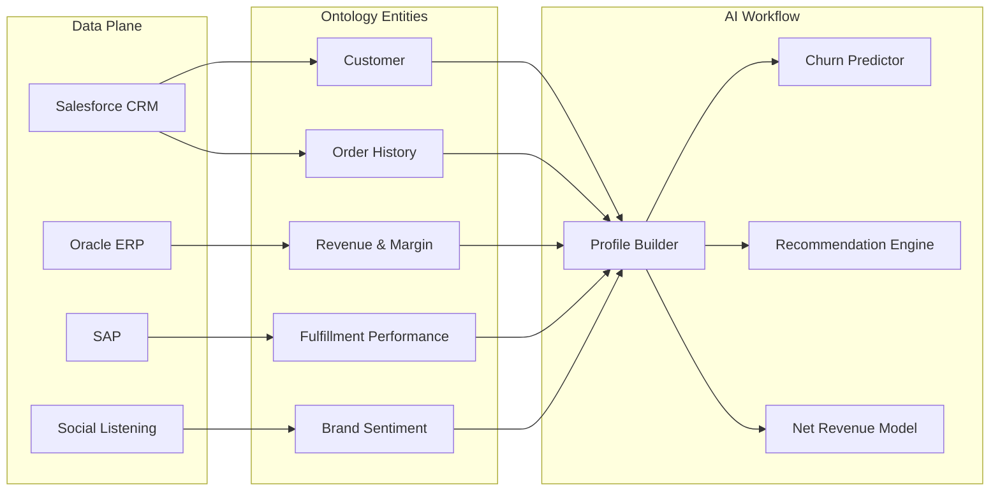

# Customer 360 & Revenue Growth Intelligence

Unified customer profiles with churn prediction, cross-sell recommendations, and revenue optimization.

**Priority:** P2 — Strategic Value  
**Time to Value:** 8-10 weeks  
**Category:** Sales & Revenue

---

## Business Problem

In beverage distribution, customer relationships span distributors, retailers, and institutional buyers — each tracked differently across Salesforce (sales interactions), Oracle ERP (financials), and SAP (fulfillment). Without a unified view:

- **Fragmented profiles** — sales reps see opportunities, finance sees invoices, logistics sees shipments — nobody sees the full picture
- **Silent churn** — distributors reduce order volumes gradually before leaving; decline is invisible until revenue drops
- **Missed cross-sell** — a retailer buying Pepsi but not Tropicana is never flagged despite high propensity
- **Unprofitable accounts** — high-volume customers with excessive returns, deductions, and service costs appear profitable until fully costed
- **Blind pricing** — no data-driven view of price elasticity by channel, region, or customer tier

---

## Capabilities

### Unified Customer Profile
Single view of every customer combining Salesforce interactions, Oracle financial transactions, SAP fulfillment performance, and social sentiment — resolved through the ontology layer.

### Churn Prediction
ML model predicting distributor/retailer churn risk based on declining order patterns, increasing complaints, payment behavior changes, and sentiment shifts.

### Cross-Sell & Upsell Recommendations
AI-powered product recommendations per account: _"Retailer Y buys Pepsi and Lay's but not Tropicana — high propensity based on similar account profiles."_

### Customer Profitability Scoring
True profitability per account factoring in gross revenue, discounts, returns, deductions, logistics cost-to-serve, and payment terms.

### Net Revenue Management
Price elasticity modeling by channel, region, and customer segment to optimize pricing, pack architecture, and promotional investment allocation.

---

## Data Sources & Ontology Mapping

| Ontology Entity | Source System | Key Fields |
|----------------|--------------|------------|
| Customer | Salesforce Account/Contact | Account ID, Name, Channel, Region, Tier, Owner |
| Revenue & Margin | Oracle ERP AR + GL | Revenue, Discounts, Returns, Deductions, COGS, Net Margin |
| Order History | Salesforce Opportunities | Products, Quantities, Frequency, Win Rate, Average Deal Size |
| Fulfillment Performance | SAP Delivery | Fill Rate, On-Time Delivery, Order Accuracy, Returns |
| Brand Sentiment | Social Listening | Mentions, Sentiment Score, Topics, Engagement |

---

## AI Workflow

1. **Entity Resolution** — Resolve customer identity across Salesforce Account, Oracle Customer Master, and SAP Business Partner into a single golden record
2. **Profile Enrichment** — Assemble purchase history, financial metrics, fulfillment KPIs, and sentiment data into a 360-degree customer profile
3. **Churn Scoring** — Train gradient-boosted model on historical churn events; score active accounts monthly on probability of volume decline >30% in next quarter
4. **Recommendation Generation** — Collaborative filtering + market basket analysis across the account portfolio to identify cross-sell opportunities
5. **Profitability Calculation** — Fully loaded P&L per account: gross revenue → net revenue → gross margin → contribution margin (after cost-to-serve)
6. **Elasticity Modeling** — Regression analysis on historical price/volume data by segment to identify optimal pricing corridors
7. **Output** — Customer scorecards on dashboard; churn alerts to sales; recommendations pushed to Salesforce

---

## Dashboard & Alerts

### Key Metrics

| KPI | Description | Target |
|-----|-------------|--------|
| **Customer Lifetime Value (CLV)** | Predicted revenue over next 3 years per account | Monitor; grow top 20% |
| **Churn Risk Score** | Probability of >30% volume decline in next quarter | Act on > 0.6 |
| **Wallet Share** | Our share of customer's total beverage spend | > 35% for key accounts |
| **Cross-Sell Conversion** | % of recommendations accepted and ordered | > 15% |
| **Customer Profitability** | Net contribution margin per account | All accounts > 8% |
| **NPS / Sentiment Score** | Net Promoter Score + social sentiment composite | > 45 NPS |

### Alert Rules

| Alert | Trigger | Severity | Action |
|-------|---------|----------|--------|
| Churn risk high | Account churn probability > 0.7 with revenue > $500K | Critical | Assign retention campaign; escalate to regional sales head |
| Volume decline | Account order volume drops >20% vs. prior quarter | High | Sales rep outreach within 48 hours |
| Profitability negative | Account contribution margin turns negative for 2 consecutive months | High | Review pricing, deductions, and cost-to-serve; flag for renegotiation |
| Cross-sell opportunity | High-propensity recommendation for key account with upcoming sales call | Medium | Push recommendation to Salesforce activity |
| Sentiment drop | Customer social sentiment drops >25 points in 30 days | Medium | Notify brand team; assess root cause |

---

## ROI Model

| Metric | Before | After | Impact |
|--------|--------|-------|--------|
| Key account churn rate | 12% / year | 8% / year | **33% reduction → $2.4M retained revenue** |
| Wallet share (key accounts) | 28% | 34% | **$1.8M incremental revenue** |
| Cross-sell attach rate | 6% | 14% | **$900K new product revenue** |
| Unprofitable account count | 18% of portfolio | 8% of portfolio | **Pricing corrected or accounts exited** |
| Sales planning time | 6 hours/week per rep | 2 hours/week per rep | **67% time savings for field team** |

!!! success "Estimated Annual ROI"
    **$2.0M - $4.0M** annually from retained revenue, incremental cross-sell, pricing optimization, and sales productivity — across a mid-size beverage distributor with $150M revenue.

---

## Implementation Notes

- Customer entity resolution is the foundation; ontology layer must resolve Salesforce Account ↔ Oracle Customer ↔ SAP Business Partner with high confidence
- Churn model requires minimum 24 months of order history plus labeled churn events (accounts that left or declined >30%)
- Profitability calculation depends on accurate cost-to-serve allocation from Oracle ERP; may require finance team collaboration
- Cross-sell recommendations should be validated by category management before deploying to sales force

---

[← Back to Catalogue](index.md) | [Previous: Supply Chain Risk](supply-chain-risk.md) | [Next: Procurement Analytics →](procurement-analytics.md)
