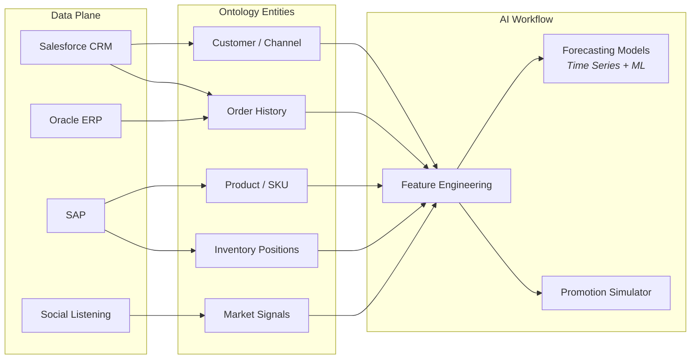

# Demand Forecasting & Planning Engine

AI-driven demand prediction across SKUs, regions, and channels for beverage supply chain operations.

**Priority:** P0 — Immediate ROI  
**Time to Value:** 4-6 weeks  
**Category:** Planning & Forecasting

---

## Business Problem

Beverage supply chains face volatile demand influenced by seasonality, promotions, events, and market trends. Manual forecasting leads to:

- **Overstock** — excess inventory tying up working capital and increasing spoilage risk
- **Stockouts** — lost sales and damaged retailer relationships
- **Bullwhip effect** — demand signal distortion amplified across the supply chain
- **Reactive planning** — inability to anticipate market shifts until they hit the P&L

---

## Capabilities

### SKU-Level Demand Forecasting
Predict demand at the granular SKU × Region × Channel level (e.g., Pepsi 500ml demand in South region through modern trade channel for the next 4 weeks).

### Seasonal & Event-Based Modeling
Automatically detect and model seasonal patterns (summer peaks, festive demand) and overlay event calendars (sports tournaments, holidays, promotional windows).

### Promotion Impact Simulation
Model "what-if" scenarios: _"If we run a 10% discount on Mountain Dew across the West region, what is the expected volume lift and cannibalization impact on Pepsi?"_

### Cannibalization Analysis
Quantify cross-product demand transfer when promotions or new launches shift volume between SKUs within the portfolio.

### Consensus Forecast Workflow
Combine statistical AI forecasts with sales team inputs and trade intelligence to produce a unified consensus forecast.

---

## Data Sources & Ontology Mapping

| Ontology Entity | Source System | Key Fields |
|----------------|--------------|------------|
| Product / SKU | SAP Material Master | Material ID, Category, Pack Size, Shelf Life |
| Customer / Channel | Salesforce Account | Account ID, Channel Type, Region, Tier |
| Order History | Salesforce Opportunities + Oracle Sales Orders | Order Date, Quantity, Revenue, Fulfillment Rate |
| Inventory Positions | SAP Inventory | Stock on Hand, Reorder Point, Safety Stock |
| Market Signals | Social Listening | Sentiment Score, Trend Keywords, Volume |

---

## AI Workflow

1. **Feature Engineering** — Combine historical sales, inventory movement, weather data, event calendars, and social sentiment into a unified feature set
2. **Model Ensemble** — Run time-series (Prophet/ARIMA) and ML (XGBoost/LightGBM) models in parallel; ensemble for best accuracy
3. **Promotion Overlay** — Layer planned promotions with learned elasticity curves to adjust base forecast
4. **Cannibalization Adjustment** — Apply cross-product substitution factors from historical promotion data
5. **Consensus Integration** — Merge AI forecast with manual overrides from sales and trade teams
6. **Output** — Publish SKU × Region × Week demand plan to SAP MRP and dashboard

---

## Dashboard & Alerts

### Key Metrics

| KPI | Description | Target |
|-----|-------------|--------|
| **Forecast Accuracy (MAPE)** | Mean Absolute Percentage Error vs. actuals | < 15% |
| **Bias** | Systematic over/under-forecasting tendency | ± 3% |
| **Stockout Rate** | % of SKU-locations with zero available inventory | < 2% |
| **Overstock Days** | Days of excess inventory above safety stock | < 10 days |
| **Promotion Lift Accuracy** | Predicted vs. actual promotional volume uplift | ± 10% |

### Alert Rules

| Alert | Trigger | Severity | Action |
|-------|---------|----------|--------|
| Demand spike detected | Forecast exceeds 2σ above baseline for any SKU-region | High | Notify supply planning; trigger expedited production review |
| Forecast degradation | MAPE exceeds 20% for 2 consecutive weeks | Medium | Retrain model; flag for manual review |
| Promotion conflict | Overlapping promotions on substitutable SKUs | Medium | Notify trade marketing team |
| Seasonal ramp alert | 30-day lookahead shows >25% volume increase | Info | Pre-position inventory; alert warehouse operations |

---

## ROI Model

| Metric | Before | After | Impact |
|--------|--------|-------|--------|
| Forecast accuracy (MAPE) | 30-40% | 12-18% | 50-60% improvement |
| Overstock inventory value | $2.4M tied up | $1.8M tied up | **$600K working capital freed** |
| Stockout incidents / month | 120 SKU-locations | 85 SKU-locations | **30% reduction → recovered sales** |
| Expired / wasted product | 4.2% of volume | 2.8% of volume | **33% waste reduction** |
| Planning cycle time | 5 days / week | 1 day / week | **80% time savings** |

!!! success "Estimated Annual ROI"
    **$1.2M - $2.5M** annually from reduced waste, freed working capital, and recovered sales — across a mid-size beverage distributor with $150M revenue.

---

## Implementation Notes

- Requires minimum 18-24 months of order history from Salesforce + Oracle ERP for baseline model training
- SAP inventory snapshots should be available at daily granularity
- Social listening data enhances accuracy by 3-5% but is optional for initial deployment
- Promotion calendar integration with trade marketing team is critical for lift modeling

---

[← Back to Catalogue](index.md) | [Next: Inventory Optimization →](inventory-optimization.md)
