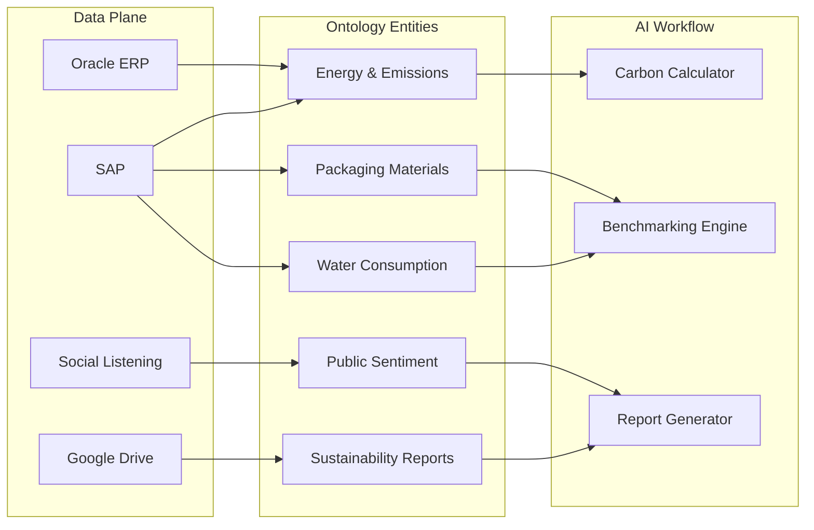

# ESG & Sustainability Tracker

Carbon footprint tracking, water usage monitoring, and ESG compliance reporting for beverage operations.

**Priority:** P3 — Operational Excellence  
**Time to Value:** 10-12 weeks  
**Category:** Sustainability & Compliance

---

## Business Problem

Beverage companies face increasing pressure from regulators, investors, and consumers to demonstrate measurable sustainability commitments. The data needed spans multiple systems:

- **No unified carbon view** — emissions data scattered across production (SAP), logistics (Oracle ERP), and energy systems
- **Water usage opacity** — beverage manufacturing is water-intensive, but usage per SKU or per plant is not tracked against targets
- **Packaging sustainability gap** — recycled content percentages and circular economy metrics not measured systematically
- **Manual ESG reporting** — sustainability teams spend weeks assembling annual reports from spreadsheets and disconnected sources
- **Brand risk** — consumers increasingly link purchase decisions to sustainability performance; negative social sentiment on ESG issues can erode market share

---

## Capabilities

### Carbon Footprint per SKU / Route
Calculate Scope 1, 2, and 3 carbon emissions at the SKU level (production) and per distribution route (logistics), enabling targeted reduction initiatives.

### Water Usage Tracking
Monitor water consumption per plant, per production line, and per unit of output. Track against industry benchmarks and internal reduction targets.

### Packaging Sustainability Metrics
Track recycled content percentage, packaging weight per unit, and circular economy metrics (collection rate, recyclability score) across the product portfolio.

### ESG Compliance Dashboard
Consolidated view of all ESG KPIs mapped to reporting frameworks (GRI, SASB, CDP, TCFD) for investor and regulatory reporting.

### Sustainability Sentiment Monitoring
Track public and social media sentiment on the company's sustainability initiatives, competitor benchmarking, and emerging consumer expectations.

---

## Data Sources & Ontology Mapping

| Ontology Entity | Source System | Key Fields |
|----------------|--------------|------------|
| Energy & Emissions | SAP Plant Maintenance + Oracle ERP | Energy Type, Consumption (kWh), Emission Factor, Plant, Period |
| Water Consumption | SAP Utilities | Water Source, Volume (m³), Plant, Production Line, Period |
| Packaging Materials | SAP Material Master | Pack Type, Weight, Recycled Content %, Recyclability Score |
| Sustainability Reports | Google Drive (PDF/DOCX) | Report Type, Period, KPIs, Targets, Actuals |
| Public Sentiment | Social Listening | Brand Mentions, ESG Topics, Sentiment Score, Platform |

---

## AI Workflow

1. **Data Collection** — Aggregate energy consumption from SAP plant data and Oracle ERP utility cost centers; water usage from SAP metering records
2. **Emission Calculation** — Apply emission factors (Scope 1: direct combustion, Scope 2: purchased electricity, Scope 3: upstream supply chain and downstream distribution) to activity data
3. **Per-SKU Allocation** — Allocate plant-level emissions and water to individual SKUs using BOM-based activity allocation
4. **Per-Route Calculation** — Calculate logistics emissions per distribution route using distance, vehicle type, and load factor
5. **Benchmarking** — Compare plant/SKU performance against industry benchmarks, prior periods, and internal targets
6. **Report Generation** — AI-assisted compilation of ESG metrics into framework-aligned reports (GRI, SASB, CDP)
7. **Sentiment Analysis** — Monitor and trend public perception of sustainability initiatives; flag negative sentiment spikes

---

## Dashboard & Alerts

### Key Metrics

| KPI | Description | Target |
|-----|-------------|--------|
| **Carbon Intensity** | kg CO₂e per liter of beverage produced | Year-over-year reduction of 5% |
| **Water Ratio** | Liters of water per liter of beverage produced | < 2.0 L/L (industry best practice) |
| **Recycled Content %** | Average recycled material percentage across packaging portfolio | > 50% by 2027 |
| **Energy Efficiency** | kWh per 1,000 liters produced | Year-over-year reduction of 3% |
| **ESG Reporting Completeness** | % of required ESG metrics available for reporting | 100% |
| **Sustainability Sentiment Score** | Social media composite sentiment on ESG topics | > 60 (positive) |

### Alert Rules

| Alert | Trigger | Severity | Action |
|-------|---------|----------|--------|
| Emission spike | Plant carbon intensity exceeds target by >15% for any month | High | Investigate energy source; review production efficiency |
| Water usage anomaly | Plant water ratio exceeds 2.5 L/L for any week | High | Check for leaks; review production process |
| Recycled content below target | Portfolio average drops below 40% recycled content | Medium | Escalate to packaging procurement; review supplier mix |
| Negative ESG sentiment | Social sentiment on sustainability drops below 30 for 7 days | Medium | Notify communications team; assess root cause |
| Reporting deadline | ESG report submission due in 30 days with incomplete data | Medium | Notify sustainability team; flag missing data sources |

---

## ESG Framework Mapping

| Framework | Relevant Metrics | Application Coverage |
|-----------|-----------------|---------------------|
| **GRI 303** (Water) | Water withdrawal, consumption, discharge by source | Water Usage Tracking |
| **GRI 305** (Emissions) | Scope 1, 2, 3 emissions; emission intensity | Carbon Footprint Calculator |
| **GRI 301** (Materials) | Recycled input materials; reclaimed products | Packaging Sustainability |
| **SASB FB-NB** (Non-Alcoholic Beverages) | Water management, packaging lifecycle, energy management | All capabilities |
| **CDP Climate** | Scope 1-3 emissions, reduction targets, climate risks | Carbon + Benchmarking |
| **TCFD** | Climate-related risks and opportunities | Scenario analysis |

---

## ROI Model

| Metric | Before | After | Impact |
|--------|--------|-------|--------|
| Energy cost | $1.8M / year | $1.6M / year | **$200K savings from efficiency identification** |
| Water cost | $420K / year | $360K / year | **$60K savings from usage optimization** |
| ESG reporting effort | 6 weeks / year (2 FTEs) | 1 week / year (0.5 FTE) | **83% effort reduction** |
| Packaging waste penalty risk | $150K / year exposure | $40K / year exposure | **$110K risk reduction** |
| Brand equity (sustainability) | Neutral perception | Positive perception | **Market share protection** |

!!! success "Estimated Annual ROI"
    **$400K - $800K** annually from energy/water savings, reporting efficiency, and regulatory risk reduction — plus significant brand equity protection (hard to quantify but strategically important).

---

## Implementation Notes

- Scope 1 and 2 emission calculations require plant-level energy consumption data from SAP utilities or metering systems
- Scope 3 (upstream/downstream) is estimated and requires supplier emission factors — accuracy improves as suppliers report their own emissions
- Water metering granularity determines per-line vs. per-plant tracking capability
- ESG framework compliance mapping should be reviewed annually as reporting standards evolve
- Social sentiment monitoring requires configuration of relevant sustainability keywords and competitor tracking

---

[← Back to Catalogue](index.md) | [Previous: Production & Quality](production-quality.md)
