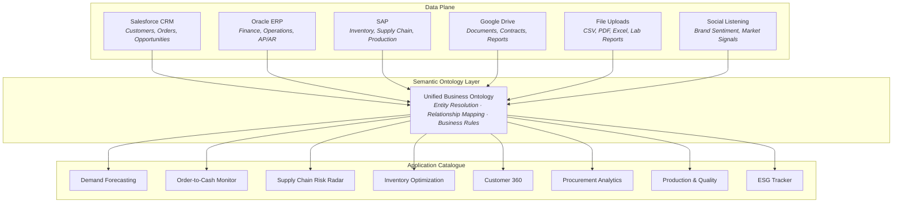
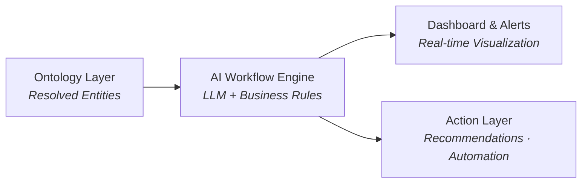

# Supply Chain Application Catalogue

Enterprise AI applications for beverage supply chain operations, powered by the Semantic Ontology Layer.

---

## Data Plane Overview

The application catalogue draws from a unified data plane spanning structured enterprise systems and unstructured data sources:

---

## Application Catalogue

### P0 — Immediate ROI

| Application | Primary Data Sources | ROI Signal | Time to Value |
|-------------|---------------------|------------|---------------|
| [Demand Forecasting & Planning Engine](demand-forecasting.md) | Salesforce, SAP, Social Listening, Oracle ERP | Reduce overstock 15-25%, cut stockouts 20-30% | 4-6 weeks |
| [Inventory Optimization & Distribution Intelligence](inventory-optimization.md) | SAP, Oracle ERP, Salesforce | Reduce carrying costs 15-20%, cut waste 25-40% | 4-6 weeks |

### P1 — High Value

| Application | Primary Data Sources | ROI Signal | Time to Value |
|-------------|---------------------|------------|---------------|
| [Intelligent Order-to-Cash Monitor](order-to-cash.md) | Salesforce, Oracle ERP, SAP | Reduce DSO by 10-15 days, cut revenue leakage 5-8% | 6-8 weeks |
| [Supply Chain Risk & Disruption Radar](supply-chain-risk.md) | SAP, Oracle ERP, Social Listening, Google Drive | Reduce disruption impact 30-40% | 6-8 weeks |

### P2 — Strategic Value

| Application | Primary Data Sources | ROI Signal | Time to Value |
|-------------|---------------------|------------|---------------|
| [Customer 360 & Revenue Growth Intelligence](customer-360.md) | Salesforce, Oracle ERP, Social Listening, SAP | Increase wallet share 8-12%, reduce churn 15-20% | 8-10 weeks |
| [Procurement & Spend Analytics](procurement-analytics.md) | Oracle ERP, SAP, Google Drive, File Uploads | 3-7% procurement cost savings | 8-10 weeks |

### P3 — Operational Excellence

| Application | Primary Data Sources | ROI Signal | Time to Value |
|-------------|---------------------|------------|---------------|
| [Production & Quality Control Copilot](production-quality.md) | SAP, Oracle ERP, File Uploads | Improve OEE 5-10%, reduce quality waste 20% | 10-12 weeks |
| [ESG & Sustainability Tracker](esg-sustainability.md) | SAP, Oracle ERP, Social Listening, Google Drive | 5-10% energy/water cost reduction | 10-12 weeks |

---

## Ontology Entity Map

Key business entities resolved across systems by the Semantic Ontology Layer:

| Business Entity | Salesforce CRM | Oracle ERP | SAP |
|----------------|---------------|------------|-----|
| **Product / SKU** | Opportunity Line Item | Item Master | Material Master |
| **Customer** | Account / Contact | Customer Master | Business Partner |
| **Order** | Opportunity | Sales Order / Invoice | Sales Document |
| **Supplier** | — | Vendor Master | Vendor / Source List |
| **Warehouse** | — | Inventory Org | Plant / Storage Location |
| **Financial** | — | GL / Cost Center | Cost Center / Profit Center |

---

## Architecture Pattern

Every application in this catalogue follows a consistent execution pattern:

1. **Data Ingestion** — Ontology layer resolves entities across Salesforce, Oracle ERP, SAP, and unstructured sources
2. **AI Workflow Execution** — LLM-powered pipelines apply business logic, anomaly detection, and predictive models
3. **Presentation** — Dashboards surface KPIs; alerts trigger on threshold breaches
4. **Action** — Recommendations feed back into source systems or trigger automated workflows

---

[← Back to Home](../../index.md)
