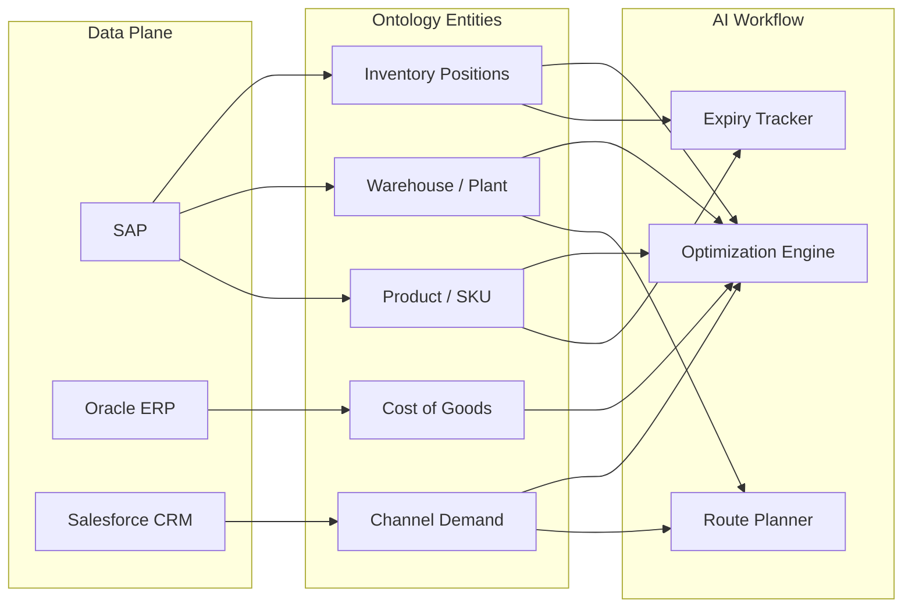

# Inventory Optimization & Distribution Intelligence

Multi-echelon inventory optimization and distribution route intelligence for beverage operations.

**Priority:** P0 — Immediate ROI  
**Time to Value:** 4-6 weeks  
**Category:** Inventory & Logistics

---

## Business Problem

Beverage supply chains operate across multiple distribution tiers (factory → regional DC → last-mile depot) with perishable products that have limited shelf life. Key challenges:

- **Imbalanced stock** — surplus at one warehouse while another faces stockouts
- **High carrying costs** — excess safety stock buffers driven by uncertainty
- **Expiry / waste** — beverages past shelf life written off as dead inventory
- **Static reorder points** — fixed parameters that don't adapt to demand variability
- **Blind last-mile** — no visibility into distributor/retailer stock levels

---

## Capabilities

### Multi-Echelon Inventory Optimization
Optimize stock levels simultaneously across factory finished goods, regional distribution centers, and last-mile depots — balancing service levels against holding costs.

### Dynamic Safety Stock Calculation
Replace static reorder points with AI-driven safety stock that adapts to demand variability, lead time fluctuations, and supplier reliability per SKU per location.

### Shelf-Life & Expiry Management
Track batch-level expiry dates across the distribution network. Flag near-expiry stock for markdown, redistribution, or promotional clearance before write-off.

### Stock Rebalancing Recommendations
Detect imbalances across the network and recommend inter-warehouse transfers to prevent simultaneous overstock and stockout conditions.

### Distribution Route Optimization
Optimize delivery routes and schedules for the distribution fleet, minimizing transit time and cost while meeting service level windows.

---

## Data Sources & Ontology Mapping

| Ontology Entity | Source System | Key Fields |
|----------------|--------------|------------|
| Inventory Positions | SAP Inventory | Material, Plant, Storage Location, Batch, Qty, Expiry Date |
| Warehouse / Plant | SAP Plant Master | Plant ID, Location, Capacity, Operating Hours |
| Product / SKU | SAP Material Master | Material ID, Shelf Life, Pack Config, Weight/Volume |
| Cost of Goods | Oracle ERP | Item Cost, Freight Cost, Handling Cost, Write-off Cost |
| Channel Demand | Salesforce Opportunities | Account, Region, Ordered Qty, Delivery Date |

---

## AI Workflow

1. **Demand Signal Ingestion** — Pull forecast output from the Demand Forecasting app + real-time order signals from Salesforce
2. **Inventory Snapshot** — Daily stock positions by SKU × Location × Batch from SAP
3. **Optimization Model** — Mixed-integer programming to minimize total cost (holding + stockout penalty + transportation) subject to service level constraints
4. **Expiry Scan** — Flag batches within 30/60/90-day expiry windows; rank by redistribution feasibility
5. **Rebalancing Plan** — Generate inter-warehouse transfer orders where surplus/deficit exceeds threshold
6. **Route Optimization** — Vehicle routing problem (VRP) solver for delivery fleet scheduling
7. **Output** — Push replenishment orders to SAP MRP; surface rebalancing and expiry actions on dashboard

---

## Dashboard & Alerts

### Key Metrics

| KPI | Description | Target |
|-----|-------------|--------|
| **Inventory Turns** | Annual COGS / Average Inventory Value | > 12x |
| **Days of Supply** | Current stock / Daily demand rate | 7-14 days (varies by SKU) |
| **Fill Rate** | % of orders fulfilled completely from available stock | > 98% |
| **Expired Write-off %** | Value of expired product / Total inventory value | < 1% |
| **Carrying Cost %** | Annual holding cost / Average inventory value | < 18% |
| **Rebalancing Efficiency** | % of transfer recommendations executed within SLA | > 85% |

### Alert Rules

| Alert | Trigger | Severity | Action |
|-------|---------|----------|--------|
| Stock imbalance | Warehouse A > 45 days supply while Warehouse B < 5 days for same SKU | Critical | Generate transfer order; notify logistics |
| Near-expiry batch | Batch within 30 days of expiry with qty > 500 cases | High | Flag for markdown / redistribution |
| Stockout imminent | Projected days of supply < 3 days at current demand rate | High | Trigger emergency replenishment; notify sales |
| Safety stock breach | Actual stock below dynamic safety stock level | Medium | Expedite pending PO; adjust production schedule |
| Carrying cost spike | Monthly carrying cost exceeds budget by > 10% | Medium | Review slow-moving SKUs; recommend clearance |

---

## ROI Model

| Metric | Before | After | Impact |
|--------|--------|-------|--------|
| Inventory carrying cost | $3.6M / year | $2.9M / year | **$700K annual savings** |
| Expired product write-off | 3.8% of inventory | 1.5% of inventory | **60% waste reduction** |
| Stockout-driven lost sales | $1.8M / year | $1.1M / year | **$700K recovered revenue** |
| Inter-warehouse transfers | Ad-hoc, 5-day cycle | Automated, 2-day cycle | **60% faster rebalancing** |
| Distribution fleet cost | $2.1M / year | $1.8M / year | **14% logistics cost reduction** |

!!! success "Estimated Annual ROI"
    **$1.5M - $3.0M** annually from reduced carrying costs, waste elimination, recovered sales, and logistics savings — across a mid-size beverage distributor with $150M revenue.

---

## Implementation Notes

- Requires real-time (or daily) inventory feeds from SAP — batch-level data is critical for expiry management
- Demand Forecasting app output feeds directly into the optimization engine; deploy together for best results
- Route optimization requires geocoded warehouse and delivery point master data
- Initial optimization model calibration needs 2-3 weeks of parameter tuning with operations team

---

[← Back to Catalogue](index.md) | [Previous: Demand Forecasting](demand-forecasting.md) | [Next: Order-to-Cash →](order-to-cash.md)
