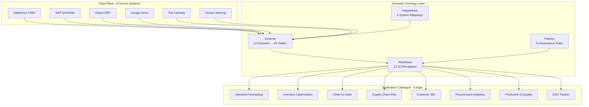

# Supply Chain Semantic Ontology Layer

The Semantic Ontology Layer sits between the Data Plane and the Application Catalogue, providing a unified, standards-aligned knowledge graph that resolves entities across Salesforce CRM, SAP S/4HANA, Oracle ERP (Finance & Operations), and unstructured data sources.

---

## Industry Standards Alignment

The supply chain ontology is aligned to two global standards — the equivalent of TMF Open APIs used in the Telco vertical.

### SCOR (Supply Chain Operations Reference)

The ASCM/APICS SCOR model is the global standard for supply chain management. Every domain, workflow, and policy in this ontology is tagged with its SCOR process:

| SCOR Process | Scope | Ontology Coverage |
|-------------|-------|-------------------|
| **Plan** | Demand forecasting, S&OP, inventory planning | Demand Forecasting app, Inventory Optimization app |
| **Source** | Procurement, vendor management, receiving | Procurement Analytics app, Supply Chain Risk app |
| **Make** | Production scheduling, manufacturing, quality | Production & Quality app |
| **Deliver** | Order fulfillment, warehousing, transportation | Order-to-Cash app, Customer 360 app |
| **Return** | Reverse logistics, defective/excess handling | Return_Order entity, Expiry Management workflow |
| **Enable** | Governance, master data, compliance, sustainability | ESG app, all policies, master data domains |

### GS1 Standards

Product identification and traceability entities carry GS1-aligned identifiers:

| GS1 Standard | Purpose | Ontology Entity |
|-------------|---------|-----------------|
| **GTIN** (Global Trade Item Number) | SKU identification | `Material_Master.GTIN` |
| **GLN** (Global Location Number) | Warehouse/plant location | `Plant_Master.GLN` |
| **SSCC** (Serial Shipping Container Code) | Shipment tracking | `Delivery_Document.SSCC` |
| **Batch/Lot** | Traceability and recall | `Batch_Master.Batch_ID` |

---

## Architecture

---

## Ontology Components

The ontology consists of four interconnected layers, all stored in `enterprise-knowledge/`:

| Layer | Files | Format | Purpose |
|-------|-------|--------|---------|
| [Schema](schema-reference.md) | `supply-chain-schema.yaml` | YAML | 12 domains, ~45 tables with fields, types, risk levels, constraints, and relationships |
| [Workflows](workflows.md) | `workflows/*.yaml` (12 files) | YAML | Triggered process flows with steps, rules, SLAs, and dependencies |
| [Policies](policies.md) | `policies/*.md` (8 files) | Markdown | Business rules, thresholds, approval chains, and compliance constraints |
| [Integrations](integrations.md) | `integrations/*.yaml` (6 files) | YAML | Field-level sync mappings between source systems with conflict resolution |

### Relationship Types

Entities in the schema are connected via typed relationships that form a knowledge graph:

| Relationship | Meaning | Example |
|-------------|---------|---------|
| `triggers` | Entity event initiates a workflow | `Inventory_Position` triggers `Inventory Rebalancing` workflow |
| `syncs_to` | Entity data flows to another system | `Account` syncs_to `AR_Customer` via integration |
| `constrained_by` | Entity operations governed by a policy | `Batch_Master` constrained_by `quality-policy` |
| `depends_on` | Entity requires a parent/related entity | `Opportunity_Line_Item` depends_on `Material_Master` |
| `validates` | Entity validates another in a business process | `Goods_Receipt` validates `AP_Invoice` in three-way match |

---

## Cross-Application Entity Heatmap

Shows how many of the 8 supply chain apps require each entity. Higher usage = more foundational.

| Entity | Count | Applications |
|--------|-------|-------------|
| `Material_Master` | **8** | All apps |
| `Cost_Accounting` | **4** | Inventory, Customer 360, Production, ESG |
| `Delivery_Document` | **4** | Inventory, O2C, Customer 360, ESG |
| `Account` | **4** | Demand, O2C, Customer 360, Inventory |
| `Opportunity` | **4** | Demand, O2C, Customer 360, Inventory |
| `Plant_Master` | **3** | Inventory, Production, ESG |
| `Inventory_Position` | **3** | Demand, Inventory, Production |
| `Batch_Master` | **2** | Inventory, Production |
| `Vendor_Master` | **2** | Risk, Procurement |
| `Purchase_Order` | **2** | Risk, Procurement |
| `Contract_Document` | **2** | Risk, Procurement |
| `Market_Signal` | **2** | Demand, Risk |
| `Brand_Sentiment` | **2** | Customer 360, ESG |

`Material_Master` is the most connected entity in the supply chain ontology — equivalent to `Account` in CRM or `Subscriber` in Telco.

---

## Schema Statistics

| Metric | Count |
|--------|-------|
| **Domains** | 12 |
| **Tables** | ~45 |
| **Source Systems** | 6 (Salesforce, SAP, Oracle, Google Drive, File Uploads, Social Listening) |
| **Workflows** | 12 |
| **Policies** | 8 |
| **Integrations** | 6 |
| **Relationship Types** | 5 (triggers, syncs_to, constrained_by, depends_on, validates) |
| **SCOR Processes Covered** | 6/6 (Plan, Source, Make, Deliver, Return, Enable) |

---

## Documentation

| Document | Description |
|----------|-------------|
| [Schema Reference](schema-reference.md) | Complete domain and table reference with fields, types, and relationships |
| [Workflows](workflows.md) | All 12 AI workflow definitions with triggers, steps, and dependencies |
| [Policies](policies.md) | All 8 governance policies with rules, thresholds, and approval chains |
| [Integrations](integrations.md) | All 6 system integration mappings with field-level detail |
| [App-Object Mapping](app-object-mapping.md) | Minimum required objects per application with relationship matrix |

---

[← Back to Supply Chain Catalogue](../index.md)
