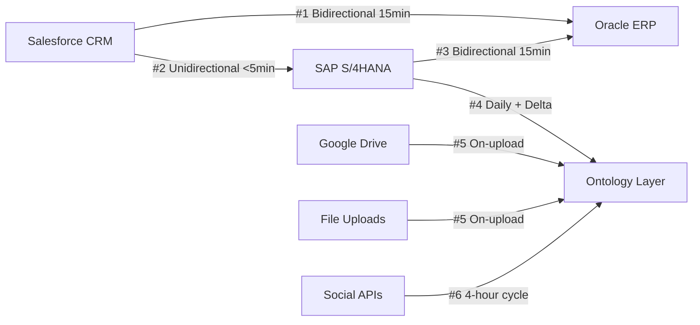
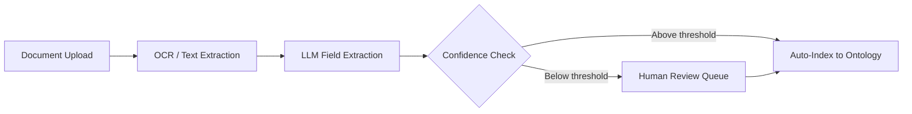
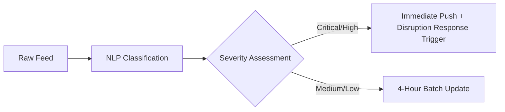

# Integrations

6 system integration mappings that connect the Data Plane source systems to the Semantic Ontology Layer. Each integration is defined in `enterprise-knowledge/integrations/` as a YAML file with field-level mappings, conflict resolution, and failure handling.

---

## Integration Summary

| # | Integration | Source | Target | Type | Frequency |
|---|------------|--------|--------|------|-----------|
| 1 | [SF-Oracle Supply Chain Sync](#1-salesforce-to-oracle-supply-chain-sync) | Salesforce | Oracle ERP | Bidirectional | 15-min interval |
| 2 | [SF-SAP Demand Sync](#2-salesforce-to-sap-demand-sync) | Salesforce | SAP | Unidirectional | Near real-time (<5 min) |
| 3 | [SAP-Oracle Finance Sync](#3-sap-to-oracle-finance-sync) | SAP | Oracle ERP | Bidirectional | 15-min interval |
| 4 | [SAP Inventory Feed](#4-sap-inventory-feed) | SAP | Ontology Layer | Unidirectional | Daily full + real-time delta |
| 5 | [Unstructured Extraction](#5-unstructured-data-extraction) | Google Drive / File Uploads | Ontology Layer | Unidirectional | On-upload + daily scan |
| 6 | [Social Listening Feed](#6-social-listening--market-data-feed) | Social Listening APIs | Ontology Layer | Unidirectional | 4-hour cycle (critical immediate) |

---

## Integration Architecture

---

## 1. Salesforce to Oracle Supply Chain Sync

**ID:** `INTEGRATION_SF_ORACLE_SC_V1_0` | **File:** `sf-oracle-supply-chain-sync.yaml`

Salesforce is source of truth for customer and order data. Oracle is source of truth for financial transactions.

### Customer Sync (Account -> Oracle_AR_Customer)

| Salesforce Field | Oracle Field | Direction | Transformation / Constraint |
|-----------------|-------------|-----------|---------------------------|
| Account.Name | AR_Customer.customer_name | SF -> Oracle | — |
| Account.Channel_Type | — | SF -> Oracle | Metadata only |
| Account.Tier | AR_Customer.collection_priority | SF -> Oracle | Platinum->Priority, Gold->Standard, Silver->Monitored, Bronze->Basic |
| Account.Credit_Limit | AR_Customer.credit_limit | SF -> Oracle | Requires approval workflow completion |
| Account.Payment_Terms | AR_Customer.payment_terms | SF -> Oracle | — |
| Account.Status | AR_Customer.customer_status | SF -> Oracle | Deactivation blocked if AR_Balance > 0 |
| AR_Customer.AR_Balance | Account.AR_Balance__c | Oracle -> SF | Read-only visibility in Salesforce |
| AR_Customer.Collection_Priority | Account.Collection_Priority__c | Oracle -> SF | Read-only |

### Order Sync (Opportunity -> Oracle reference)

| Salesforce Field | Oracle Field | Direction | Notes |
|-----------------|-------------|-----------|-------|
| Opportunity.Opportunity_ID | Internal reference | SF -> Oracle | For billing trigger |
| Opportunity.Account_ID | Customer_ID mapping | SF -> Oracle | — |
| Opportunity.Total_Value | Invoice reference | SF -> Oracle | — |

**Conflict Resolution:** Salesforce wins for customer/order data; Oracle wins for financial data (AR_Balance, payments)

**Failure Handling:** 3 retries at 5-min intervals; dead letter queue; alert finance-integration-alerts@company.com

---

## 2. Salesforce to SAP Demand Sync

**ID:** `INTEGRATION_SF_SAP_DEMAND_V1_0` | **File:** `sf-sap-demand-sync.yaml`

Pushes order line items, customer data, and forecast overrides to SAP for demand planning.

### Order to Demand (Opportunity_Line_Item -> SAP Sales Document)

| Salesforce Field | SAP Field | Transformation |
|-----------------|----------|----------------|
| Opportunity_Line_Item.Product_ID | SAP_Sales_Document.material_id | Via product mapping table |
| Opportunity_Line_Item.Quantity | SAP_Sales_Document.quantity | — |
| Opportunity_Line_Item.Delivery_Date | SAP_Sales_Document.delivery_date | — |
| Opportunity_Line_Item.Delivery_Priority | SAP_Sales_Document.delivery_priority | — |
| Opportunity_Line_Item.Account_ID | SAP_Sales_Document.business_partner_id | Via customer mapping table |

### Customer Sync (Account -> SAP Business Partner)

| Salesforce Field | SAP Field |
|-----------------|----------|
| Account.Account_ID | SAP_Business_Partner.partner_id |
| Account.Name | SAP_Business_Partner.partner_name |
| Account.Channel_Type | SAP_Business_Partner.channel_type |
| Account.Region | SAP_Business_Partner.region |
| Account.Tier | SAP_Business_Partner.tier |

### Forecast Override (Forecast_Override -> SAP MRP Forecast)

| Salesforce Field | SAP Field |
|-----------------|----------|
| Forecast_Override.Product_ID | SAP_MRP_Forecast.material_id (via mapping) |
| Forecast_Override.Region | SAP_MRP_Forecast.region |
| Forecast_Override.Period | SAP_MRP_Forecast.period |
| Forecast_Override.Override_Qty | SAP_MRP_Forecast.forecast_quantity |

**Conflict Resolution:** Salesforce wins | **Frequency:** Near real-time (<5 min)

---

## 3. SAP to Oracle Finance Sync

**ID:** `INTEGRATION_SAP_ORACLE_FINANCE_V1_0` | **File:** `sap-oracle-finance-sync.yaml`

SAP is source of truth for operational data; Oracle for financial posting.

### Mappings

| Flow | Source | Target | Purpose |
|------|--------|--------|---------|
| Goods Receipt -> AP Match | SAP Goods_Receipt | Oracle_AP_Invoice | GRN_ID, PO_ID, Qty_Received -> triggers three-way match |
| Production Costs | SAP Production_Order | Oracle_Cost_Accounting | Order_ID, Qty_Produced, Qty_Scrapped -> Material/Labor/Overhead costs |
| Inventory Valuation | SAP Inventory_Position | Oracle_GL_Journal | Material x Qty x Valuation_Price -> GL inventory accounts |
| Delivery -> AR Invoice | SAP Delivery_Document | Oracle_AR_Invoice | Delivery triggers invoice creation |

**Conflict Resolution:** SAP wins for quantities/operations; Oracle wins for financial postings

**Constraint:** GL postings blocked during close-window-policy active period

---

## 4. SAP Inventory Feed

**ID:** `INTEGRATION_SAP_INVENTORY_FEED_V1_0` | **File:** `sap-inventory-feed.yaml`

Daily full extract + near real-time delta from SAP into the Ontology Layer.

| Data | Frequency | Details |
|------|-----------|---------|
| Inventory_Position | Daily full (06:00 UTC) + 15-min delta | All SKU x Plant x Batch positions |
| Batch_Master | Daily + immediate on status change | Batch_ID, Expiry_Date, Status |
| Production_Order | Near real-time on confirmation | Qty_Produced, Yield_Pct, Status |
| Material_Master | On-change + daily full sync | All product master data |
| Material_Plant | On-change + daily full sync | MRP parameters |
| Plant_Master | On-change + daily full sync | Plant locations, capacity |
| Vendor_Master | On-change + daily full sync | Vendor ratings, status |
| Source_List | On-change + daily full sync | Approved vendor-material mappings |

---

## 5. Unstructured Data Extraction

**ID:** `INTEGRATION_UNSTRUCTURED_EXTRACT_V1_0` | **File:** `unstructured-extraction.yaml`

NLP and OCR+LLM pipeline for extracting structured data from unstructured documents.

| Pipeline | Source | Target Entity | Confidence Threshold |
|----------|--------|--------------|---------------------|
| Contract NLP | Google Drive PDFs | Contract_Document | >0.85: auto-index; <0.85: human review |
| Sustainability Report NLP | Google Drive PDFs | Sustainability_Report | >0.85: auto-index; <0.85: human review |
| Invoice OCR + LLM | File Upload PDFs/scans | Invoice_Upload | >0.7: auto-process; <0.7: manual review |
| Lab Report NLP | File Upload PDFs/Excel | Lab_Report_Upload | >0.85: auto-populate QC; <0.85: manual |

**Extraction Pipeline:**

---

## 6. Social Listening & Market Data Feed

**ID:** `INTEGRATION_SOCIAL_LISTENING_V1_0` | **File:** `social-listening-feed.yaml`

4-hour refresh cycle for standard data; Critical/High severity signals pushed immediately.

| Feed | Target Entity | Frequency | Special Rules |
|------|--------------|-----------|---------------|
| News / Social / Weather APIs | Market_Signal | 4-hour cycle | Critical/High severity: immediate push (bypasses cycle) |
| Social media monitoring | Brand_Sentiment | 4-hour cycle | Aggregate by brand, category, platform |
| Market data APIs | Commodity_Price | Daily close | Sugar, PET_Resin, Aluminum, Glass, Concentrate, CO2, HFCS |

**Signal Classification Pipeline:**

---

## Failure Handling (All Integrations)

All integrations share a common failure handling pattern:

| Setting | Value |
|---------|-------|
| Retry count | 3 |
| Retry interval | 5 minutes |
| Dead letter queue | Enabled |
| Alert on failure | Integration-specific alert email |
| Fallback | Source system value is authoritative; manual update required in target |

---

[← Back to Ontology Overview](index.md)
