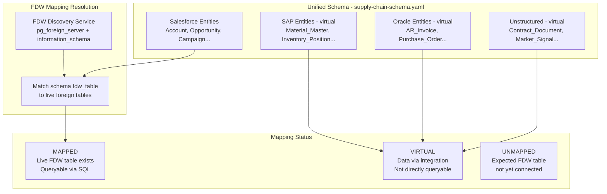
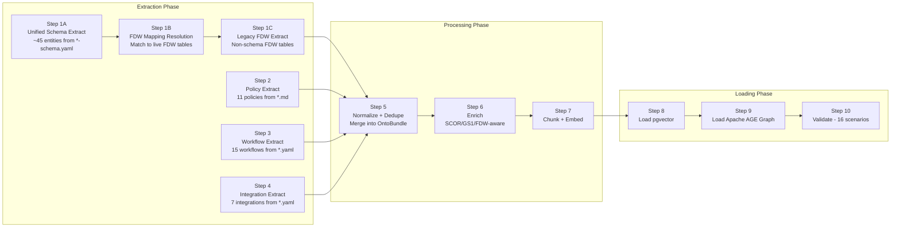
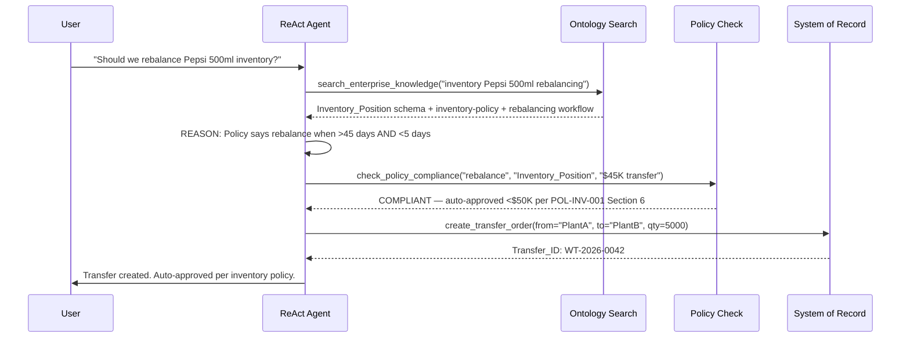

# Mapping Architecture & Semantic Indexing

How the unified supply chain schema maps to the existing systems of record, how the semantic indexing pipeline processes it, and how the ReAct agent uses the indexed ontology to serve queries and take actions.

---

## Schema-First Architecture

The supply chain ontology uses a **schema-first** approach — the unified schema is the primary knowledge source, not the FDW foreign tables. FDW becomes a mapping resolution layer that annotates which schema entities have live database connections.

### Entity Mapping Status

| Status | Meaning | Count | Example |
|--------|---------|-------|---------|
| **Mapped** | Live FDW foreign table exists; entity is queryable via `query_table` tool | ~6 | Account, Opportunity, Contact |
| **Virtual** | Entity data flows via integration sync; not directly queryable via FDW | ~37 | Material_Master, Oracle_AR_Invoice, Market_Signal |
| **Unmapped** | Schema defines the entity but no FDW table or integration connected yet | ~2 | Forecast_Override, Campaign (pending FDW config) |

---

## Semantic RAG Pipeline (12 Steps)

The pipeline has been extended from the original 10 steps to 12 steps with the addition of Steps 1A (Unified Schema Extraction) and 1B (FDW Mapping Resolution):

### Step Details

| Step | File | What It Does |
|------|------|-------------|
| **1A** | `unified_schema_extractor.py` | Reads all `*-schema.yaml` files; creates OntoDocuments for every entity with SCOR process, GS1 standard, and FDW mapping status annotations |
| **1B** | `fdw_mapping_resolver.py` | Queries `FDWDiscoveryService` to match schema entities to live FDW foreign tables; annotates as mapped/virtual/unmapped; enriches mapped entities with live column metadata |
| **1C** | `fdw_extractor.py` | Original FDW extractor for non-schema tables (backward compatibility for CRM-only FDW tables) |
| **2** | `policy_extractor.py` | Auto-discovers all `*.md` from `enterprise-knowledge/policies/` — includes 8 supply chain + 3 CRM policies |
| **3** | `workflow_extractor.py` | Auto-discovers all `*.yaml` from `enterprise-knowledge/workflows/` — includes 12 supply chain + 3 CRM workflows |
| **4** | `integration_extractor.py` | Auto-discovers all `*.yaml` from `enterprise-knowledge/integrations/` — includes 6 supply chain + 1 CRM integration |
| **5** | `normalizer.py` | Merges all extracted documents; deduplicates by ID; merges relationships and `structured_metadata` on collision |
| **6** | `enricher.py` | Schema entities: auto-enriched with SCOR process, GS1 standard, and FDW status. Policies/workflows/integrations: LLM-enriched via gpt-4o-mini |
| **7** | `chunker.py` | 1 document = 1 chunk; batch embedded (20/batch) via OpenAI text-embedding-3-small |
| **8** | `vector_loader.py` | Upserted to pgvector `control_plane_embeddings` with content_type: `onto_schema`, `onto_policy`, `onto_workflow`, `onto_integration` |
| **9** | `graph_loader.py` | Nodes (Entity) and edges (triggers/syncs_to/constrained_by/depends_on/validates) merged into Apache AGE `enterprise_onto` graph |
| **10** | `validator.py` | 16 black-box test scenarios (10 CRM + 6 supply chain) validating retrieval quality across 6 dimensions |

### What Gets Indexed

| Source | Content Type | Approx Count |
|--------|-------------|-------------|
| Unified schema (Salesforce + SAP + Oracle + unstructured) | `onto_schema` | ~45 |
| Policies (8 SC + 3 CRM) | `onto_policy` | ~60+ (split by section) |
| Workflows (12 SC + 3 CRM) | `onto_workflow` | ~15 |
| Integrations (6 SC + 1 CRM) | `onto_integration` | ~7 |
| **Total** | — | **~125+** |

---

## ReAct Agent and Tools

The ReAct agent uses the indexed ontology to answer questions and take actions. The flow is: **Search ontology -> Reason with policies -> Execute actions -> Validate compliance.**

### Tool Inventory

#### Read Tools

| Tool | Domain | What It Does |
|------|--------|-------------|
| `search_enterprise_knowledge` | Core | Hybrid vector + graph search across all ontology types |
| `search_schema_knowledge` | Core | Vector search over FDW table definitions |
| `discover_tables` / `discover_columns` / `query_table` | Core | FDW table discovery and parameterized SQL queries |
| `check_policy_compliance` | Governance | Validates proposed actions against indexed policies |
| `get_inventory_position` | Supply Chain | Query inventory for a material across plants |
| `get_order_lifecycle` | Supply Chain | Trace order from Salesforce -> SAP -> Oracle |
| `score_supplier_risk` | Supply Chain | Retrieve supplier risk scoring framework |

#### Write Tools

| Tool | Risk Level | What It Does |
|------|-----------|-------------|
| `create_forecast_override` | LOW_RISK_WRITE | Create demand forecast override in Salesforce |
| `create_transfer_order` | LOW_RISK_WRITE | Create stock rebalancing transfer in SAP |
| `hold_batch` | HIGH_RISK_WRITE | Quality hold on a batch in SAP |
| `update_customer_credit` | HIGH_RISK_WRITE | Update credit limit in Salesforce (triggers approval) |

### End-to-End ReAct Flow

---

## UI Integration

### Data Plane Page

- **Vertical selector** filters data sources by domain (All / Supply Chain / CRM)
- Each source node shows **ontology entity count** and **SCOR process coverage**
- Source cards display **FDW mapping status** (mapped / virtual) and **entity count badges**

### Control Plane Page

- **Semantic Layer tab** shows vertical-level stats (Supply Chain: 45 entities, 12 workflows, 8 policies, 6 integrations)
- **SCOR process distribution** badges (Plan, Source, Make, Deliver, Return, Enable)
- **Knowledge Formation** and **Semantic Explorer** tabs support system and SCOR filtering

### Reasoning Page

- **ReAct Tools tab** organizes tools into **Read Tools** and **Write Tools** with domain badges (Core / Supply Chain / CRM / Governance)
- **AI Copilot** system prompt includes supply chain context and tool selection strategy

---

## Configuration

The pipeline is configured via `SemanticRagConfig`:

| Parameter | Default | Purpose |
|-----------|---------|---------|
| `schema_dir` | `enterprise-knowledge/` | Directory containing `*-schema.yaml` files |
| `policy_path` | `enterprise-knowledge/policies/` | Directory with policy Markdown files |
| `workflow_path` | `enterprise-knowledge/workflows/` | Directory with workflow YAML files |
| `integration_path` | `enterprise-knowledge/integrations/` | Directory with integration YAML files |
| `skip_unified_schema` | `false` | Skip Step 1A (unified schema extraction) |
| `skip_fdw_mapping` | `false` | Skip Step 1B (FDW mapping resolution) |
| `enrich_with_llm` | `true` | Enable LLM enrichment for non-schema docs |
| `skip_graph` | `false` | Skip Apache AGE graph loading |

Trigger reindex via: `POST /api/v1/control-plane/reindex`

---

[← Back to Ontology Overview](index.md)
