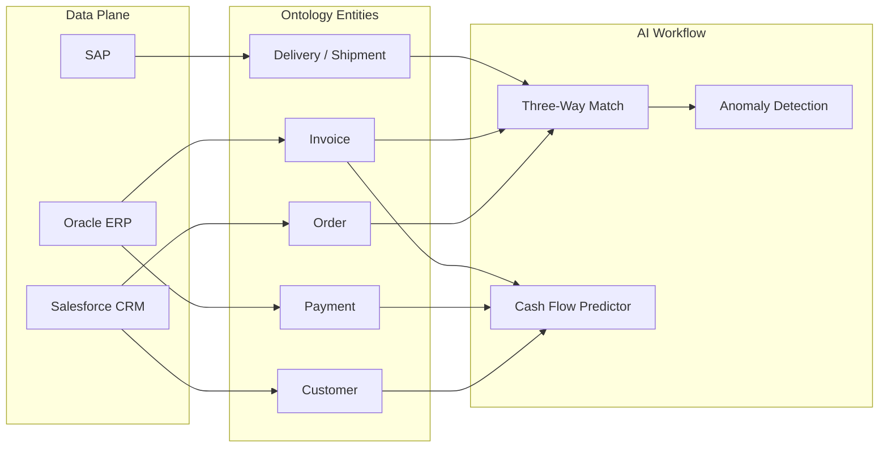

# Intelligent Order-to-Cash Monitor

End-to-end visibility and anomaly detection across the order-to-cash lifecycle.

**Priority:** P1 — High Value  
**Time to Value:** 6-8 weeks  
**Category:** Finance & Operations

---

## Business Problem

The order-to-cash (O2C) cycle in beverage distribution spans multiple systems — orders captured in Salesforce, invoiced in Oracle ERP, fulfilled from SAP. This fragmentation creates:

- **Blind spots** — no single view of an order from placement to payment
- **Revenue leakage** — invoice mismatches, unapplied credits, and pricing errors go undetected
- **High DSO** — slow collections due to lack of proactive dunning on at-risk accounts
- **Manual reconciliation** — finance teams spend days matching orders, shipments, and invoices across systems
- **Late escalation** — SLA breaches and payment defaults surface only in monthly reviews

---

## Capabilities

### End-to-End Order Lifecycle Tracking
Unified timeline for every order: Salesforce opportunity → SAP delivery → Oracle invoice → payment receipt — with status, timestamps, and responsible parties at each stage.

### Anomaly Detection
AI-powered detection of deviations from expected patterns: delayed shipments, invoice-order quantity mismatches, duplicate invoices, unusual credit notes, and pricing discrepancies.

### At-Risk Order Prioritization
Score open orders by risk factors (large value, key account SLA, payment history, fulfillment delays) and surface a prioritized action queue for operations and finance.

### Cash Flow Prediction
Forecast expected cash inflows based on open invoices, historical payment patterns per customer, and current aging distribution.

### Automated Escalation Workflows
Trigger alerts and escalation chains when orders breach configured thresholds — aging invoices, unfulfilled orders, payment defaults.

---

## Data Sources & Ontology Mapping

| Ontology Entity | Source System | Key Fields |
|----------------|--------------|------------|
| Order | Salesforce Opportunity | Opportunity ID, Account, Products, Value, Stage, Close Date |
| Customer | Salesforce Account | Account ID, Payment Terms, Credit Limit, Region, Tier |
| Invoice | Oracle ERP AR | Invoice Number, Amount, Due Date, Status, Line Items |
| Payment | Oracle ERP AR | Payment ID, Amount, Date, Method, Applied Invoice |
| Delivery / Shipment | SAP Shipping | Delivery Number, Ship Date, Qty, Carrier, POD Status |

---

## AI Workflow

1. **Entity Resolution** — Match Salesforce orders to SAP deliveries to Oracle invoices using the ontology layer's unified order entity
2. **Three-Way Match** — Validate PO quantity = Delivered quantity = Invoiced quantity; flag discrepancies
3. **Anomaly Scoring** — Score each order touchpoint against learned baselines (typical cycle times, expected values, payment patterns)
4. **Risk Prioritization** — Rank open items by composite risk score (value × days overdue × account risk × SLA proximity)
5. **Cash Flow Projection** — Apply customer-specific payment probability curves to open invoices; generate weekly/monthly cash forecast
6. **Alert & Action** — Trigger escalation workflows for threshold breaches; push recommended actions to dashboard

---

## Dashboard & Alerts

### Key Metrics

| KPI | Description | Target |
|-----|-------------|--------|
| **DSO (Days Sales Outstanding)** | Average days from invoice to payment | < 35 days |
| **Order-to-Cash Cycle Time** | Average days from order to payment receipt | < 21 days |
| **Invoice Match Rate** | % of invoices matching PO and delivery without manual intervention | > 95% |
| **Revenue Leakage Rate** | Value of pricing/quantity discrepancies as % of revenue | < 0.5% |
| **On-Time Payment Rate** | % of invoices paid within terms | > 88% |
| **Cash Forecast Accuracy** | Predicted vs. actual weekly cash inflows | ± 8% |

### Alert Rules

| Alert | Trigger | Severity | Action |
|-------|---------|----------|--------|
| Invoice mismatch | Invoice amount deviates >5% from PO value | High | Hold payment; route to AR team for review |
| Payment default risk | Account has 3+ overdue invoices totaling >$100K | Critical | Escalate to finance director; consider credit hold |
| SLA breach imminent | Order unfulfilled within 80% of committed lead time | High | Notify fulfillment team; flag for expedited processing |
| Unusual credit note | Credit note >$50K issued without linked return/complaint | Medium | Flag for audit review |
| Cash flow shortfall | Projected weekly inflows <80% of forecast | Medium | Notify treasury; review collection priorities |

---

## ROI Model

| Metric | Before | After | Impact |
|--------|--------|-------|--------|
| DSO | 48 days | 35 days | **13 days improvement → working capital freed** |
| Revenue leakage | 1.2% of revenue | 0.4% of revenue | **$1.2M recovered on $150M revenue** |
| Manual reconciliation effort | 4 FTEs, 80 hours/week | 1.5 FTEs, 30 hours/week | **62% effort reduction** |
| Late payment penalties | $180K / year | $65K / year | **$115K savings** |
| Bad debt write-off | 0.8% of AR | 0.3% of AR | **$375K reduction** |

!!! success "Estimated Annual ROI"
    **$1.8M - $2.8M** annually from reduced DSO, recovered revenue leakage, lower reconciliation costs, and reduced bad debt — across a mid-size beverage distributor with $150M revenue.

---

## Implementation Notes

- Requires Salesforce-to-Oracle order mapping; ontology layer must resolve the order entity across both systems
- SAP delivery/shipment data needed for three-way match; proof-of-delivery status is critical
- Customer payment history from Oracle AR (minimum 12 months) required for cash flow prediction model training
- Credit hold automation requires integration with Oracle AR credit management module

---

[← Back to Catalogue](index.md) | [Previous: Inventory Optimization](inventory-optimization.md) | [Next: Supply Chain Risk →](supply-chain-risk.md)
